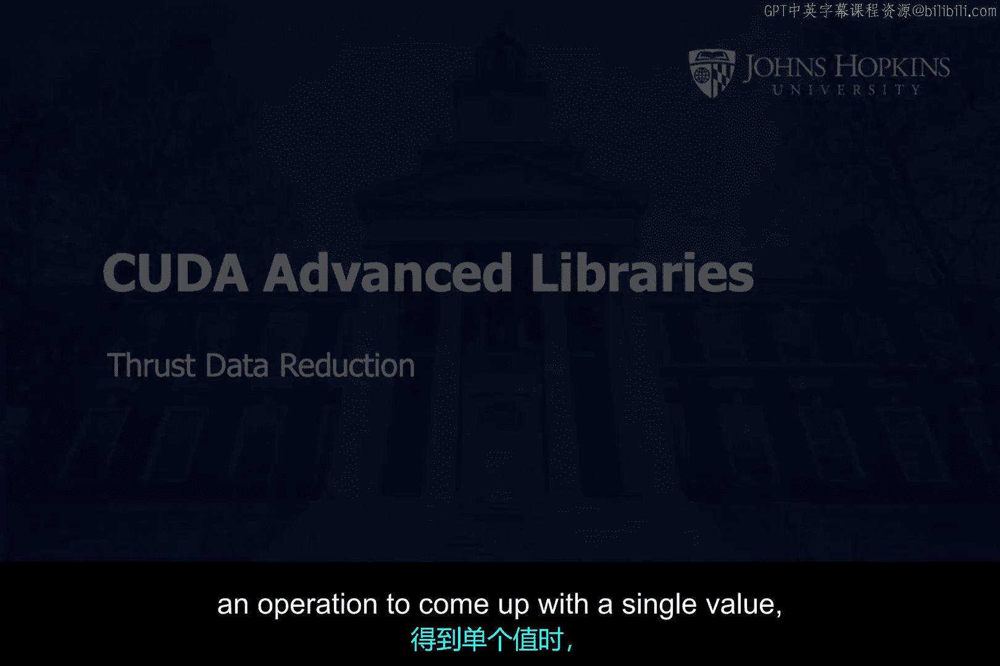
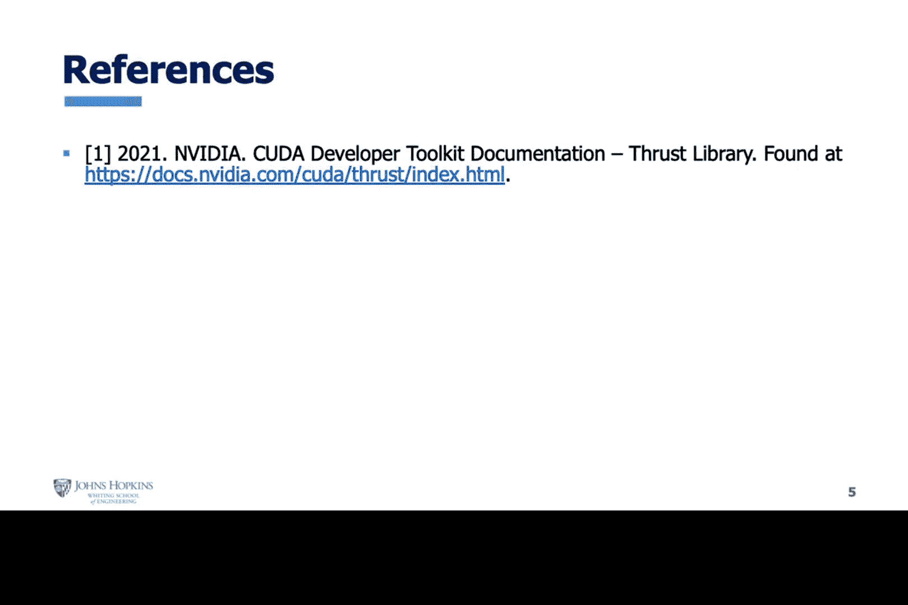

# 约翰霍普金斯大学《GPU编程（并发编程、并行编程、面向企业、CUDA高级库）｜GPU Programming》 p114 20_Thrust数据归约操作视频.zh_en -BV1a1421r7vw_p114-

We're going to now talk about the thrust Lib's ability to do reductions on data。

 and remember that is when you take an input factor and perform an operation to come up with a single value。

😔。

Note that。😔，Data reductions occur on device vectors。 There's no reason to have it on a host vector。

 And what it does is it performs the past operation between the values。 So if you say。😔。

I want to do a reduction with input。 or in this case， the function is called。V。

And the opera and or operation is plus， it's like。Vor value at0 plus vector at v1 or V2 between them so you go say the vector is1 and 2。

 the result would be 3。The syntax for reduction。In terms of arguments past。

Is0 and1 are the beginning and end index。 Remember。

 often you pass the begin and and the output of them， those iterators， such as gets the full index。

 but you can do a subset second argument。Is the initial value to start from that then gets added on or multiplied by however it works for the values in the input。

The third argument is the operation， I note that with doing summation。😔，You can do the top option。

 which is fully specified， but you can go all the way down to just giving the beginning an end and by default。

 that is always a sum。With value stirring at zero。 so that's some shorthand specific to doing summation。

 So there are some specific special reductions。 those count min Max element is sorted in our product and so forth and those you don't have to pass the operator you just passed。

The beginning and and start and index or iterator， and then the initial value。 and then it will do。

The actual operation for you。

