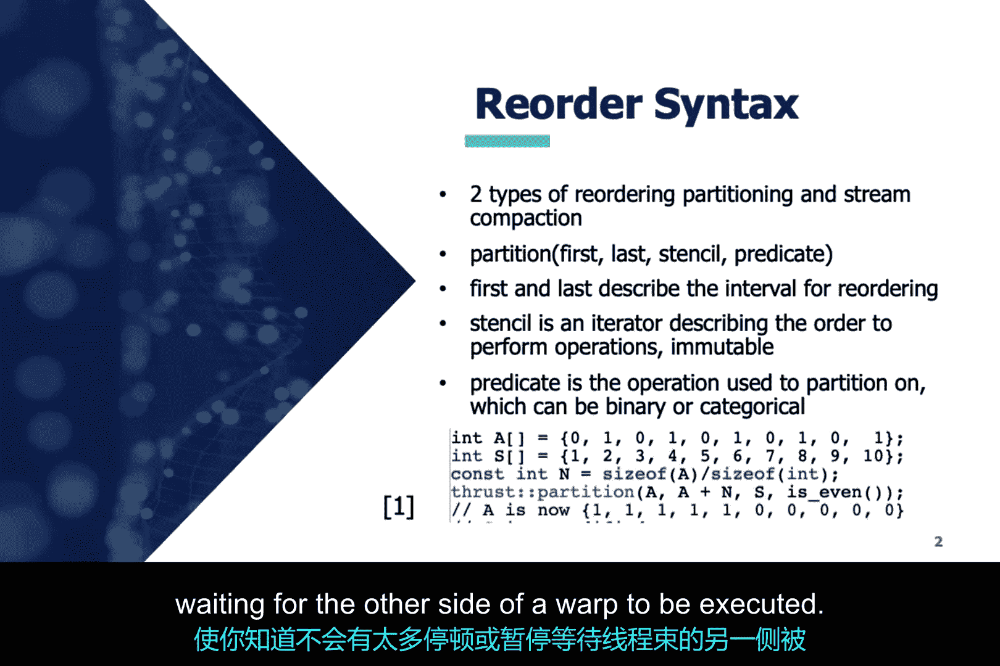
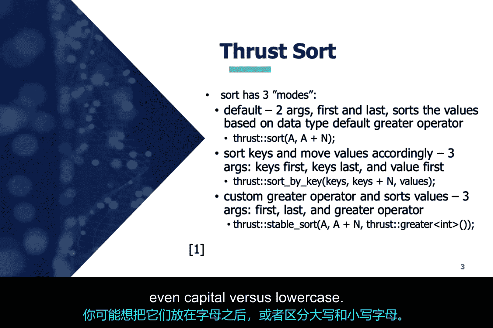

# 约翰霍普金斯大学《GPU编程（并发编程、并行编程、面向企业、CUDA高级库）｜GPU Programming》 p115 21_Thrust数据重构与排序视频.zh_en -BV1a1421r7vw_p115-

We're going to move on to。😔，Reordering and sorting data using the thrust library says the way to reorder data。

And thrust is to partition。And you partition a section of。A piece of data。

Of a vector via the first and last index reator， the stencil， which is。

Basically an array of the same size or vector of the same size。

That says the order with which the operations will be performed， so in this case S。Is the。Stencil。

 and so that says you go 1 through 10 based on index or something along those lines。

The predicate in this is the actual thing that's being asked。 It's what determines how you。

Partition the data， it can be binary or categorical。

 and by the I mean it can either say yes or no or you know， like a value like  zero，1， two， three。

 four if there's four categories。So the result of using stencil S and the predicate is even。

On a is now that a all of the values are not even are， you know， initially。

 and then the ones that are are afterwards。 so you can mess around with this and see how this would do different things。

 but this is really good to quickly。Place data in certain order this is really useful in conjunction with kernels to get your data in a certain pattern so you can have warp divided or pit partitioned。

😔，Tests like binary if a condition is1 or zero and then you do something such that you know that you're not going to have as many stops or halts waiting for the other side of a warp to be executed so sorting and thrust happens in more or three ways。

 the default sort， basically you give it two arguments the first and last index and note in this case I'm just giving it the pointer to the start and then the index into a vector a。

😔。

You can give it two。😔，Factors and you know， you have the start and end of the keys。

 and then you give it the values。And it sorts of values based。On the order。

 the greater than or a sequence of keys， that also gets。Chaanged as well。

 this is very common in languages that support maps。

Or dictionaries or something along those sides where there's a key in value。

And then the stable sort capability allows you to create。Custom sorting mechanisms。

 yet again you give it the start end for a vector and you pass the greater operator in this case。

 we're using the thrust built in greater operator for int。

 but you could give it your own operator if you want， things like leographically sorting。

Terms or words， you might want to say that numbers， which are earlier in the value of chars。

You may want to put them after letters or even capital versus lowercase。

