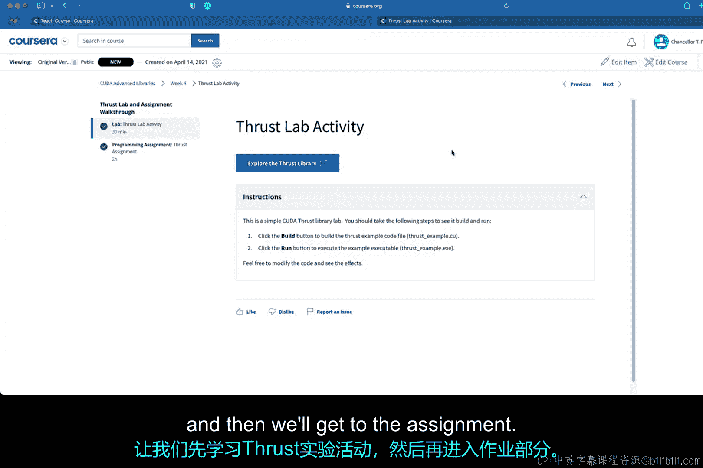
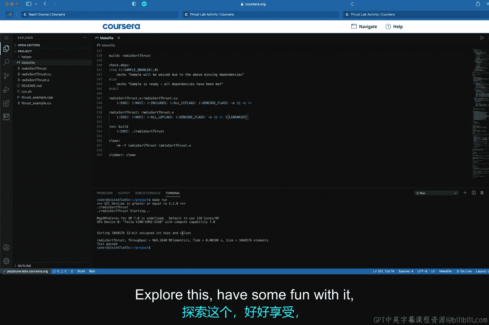
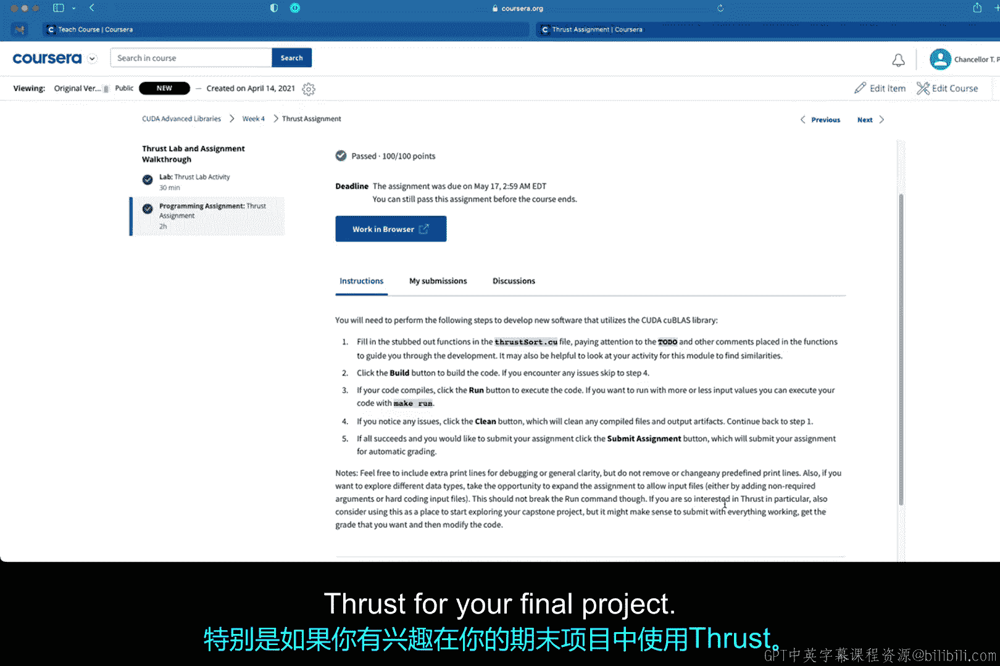
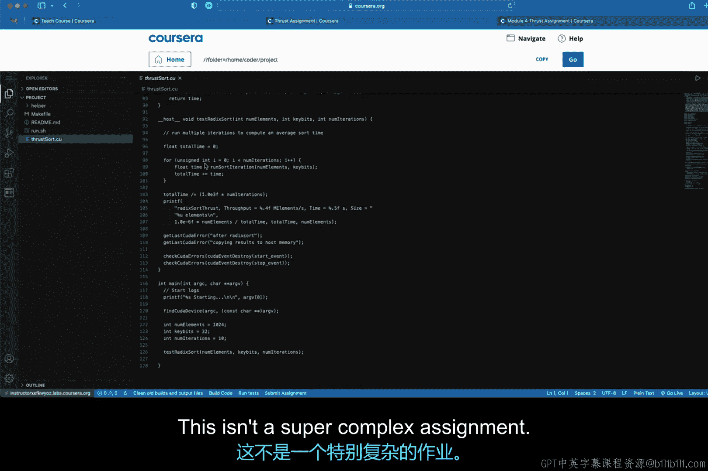

# 约翰霍普金斯大学《GPU编程（并发编程、并行编程、面向企业、CUDA高级库）｜GPU Programming》 p116 22_Thrust库实验与作业总览.zh_en -BV1a1421r7vw_p116-

So let's go through the thrust lab activity and then we'll get to the assignment。

So the lab activity， let's look at its make file。😔，It's pretty complex。

<|OTHER|>Let stuff up there and make sure。<|OTHER|>Everything is loaded in appropriately。

 but the most important part is that the build target will build rad X sort thrust。Which。😔。

Basically comes out。Yes。😔，CU file。😔，You know， its it's sort of one long bit of code。

 it's left up to you to decide if you want to break it up。

 but it does all the different steps I want it。Does is it sorts。

A key and a value set of vectors that are tied to one another， and it's sorted by the keys。

So you can look at this and explore it and get a better understanding it does。

A testing of the sort but you would click build。😔，It's going to compile the code。

Fingers crossed at it complete successfully。So the interesting thing to note is it actually did compile appropriately creating this。

😔，Radatic sort thrust。Executable， but then it in trying to make the directory。

 which the make file wants to make for all of the executables， the permission was denied。

 If you encounter this， this is pretty easy to do。So the first thing you want to do is you're never going to have anything。

At the level to up because you don't have permissions right there。

 so this cleaning of that doesn't need to happen。The next thing is you in this step。

You actually compile your code。😔，But then there's two more steps to create that pin directory。

And also to copy it there， we don't need that。Let's delete that。

Now I will say that thrust sometimes takes a long time to compile code。

 so we're just going to skip forward and run the code。It performed。Let's say， I over a million。😔。

Comparisons。Sorting two vectors。 that's pretty good。

 The throughput is pretty high and the time was pretty short。

 so I would say this is a pretty good implementation of sort。So explore this， have some fun with it。

 and then move on to the assignment。

So we're going to look at the thrust assignment。😔，Note that as always。

 there is a dot C file that I'll be given to you that's fairly empty。

With you needing to fill in what is indicated in the to do， then you build it， then you run it。😔。

<|OTHER|>Of course， if you build in， it doesn't work to Que backc and clean everything。

 which is the fourth step。When you do run， it executes to make run and if that all completes and there should be some。

 you should have some idea of the output that looks like it'll put it in output that TXT。😔。

When that looks good， click Submit assignmentsign， you should feel free to commit your work and submit it on a regular basis。

Now the other thing to think about is do not， as I always say。

Modify any of the print statements or seeouts。You can add stuff。

 but even doing that might have an issue。So just clean it precode thread in for make print statements。

Another that I'd encourage you to do is the assignment is not super deep。With thrust。

 so feel free to explore different data types， look at different functions。<|OTHER|>You know。

 after you've submitted， you can continue to use this just like the lab。

Especially if you're interested in using thrust for your final project。

So let's look at the code。So let's look at the thrust sortrt CU file。😔，This is based on NviDdia code。

 of course， copyright will be there。😔，This bunch of includes。

The main thing to look at is this generate device memory。

 It tells you all the steps and things you need to do to end up with。Deeve vectors of。Keys， values。

 And then what's。The host sorted keys， so keep that in mind， you'll have to populate that。😔。

<|OTHER|>Then there's the run sort iteration， so you'll be given the number of elements。

 the key bits， which is used to determine the radicalatic sort。And following along with those tos。😔。

And then the other part of this is to actually test the sort。

And that will go through and compare the values in keys。

And then give you the output that we saw earlier。And then。😔，The last part is that you're going to。

You know， your main argument will this is pretty well hard coded to work on a large number of elements。

 well actually in a huge， but 1024 is 32 Bs in in。😔。

Doing the ra sort for keys and do 10 iterations and then execute。They're at sort。

 So this isn't a super complex assignment。

