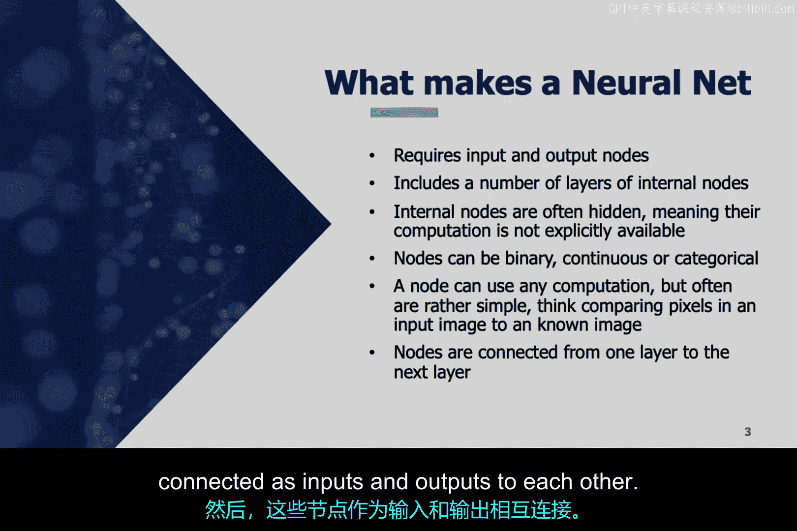
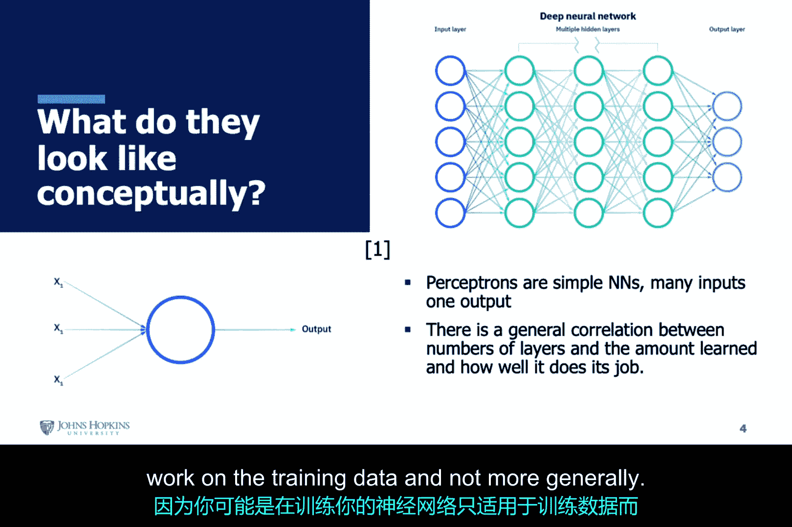
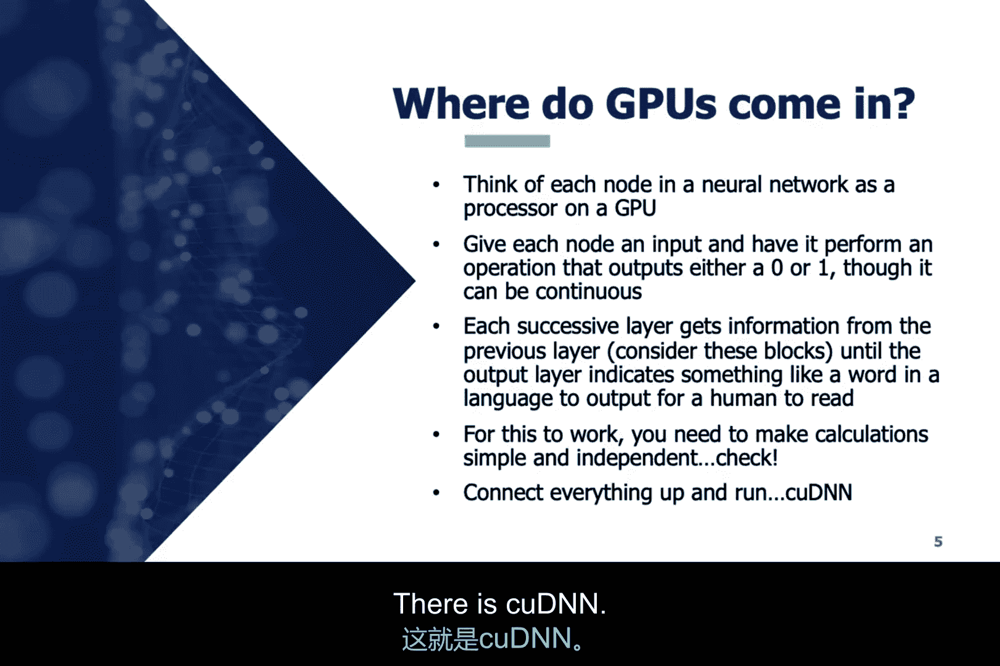

# 约翰霍普金斯大学《GPU编程（并发编程、并行编程、面向企业、CUDA高级库）｜GPU Programming》 p117 23_神经网络入门教程.zh_en -BV1a1421r7vw_p117-

So now we're going to talk about how to do machine learning using GPUs in the QUuda advanced libraries。

 so we're going to focus in on neural networks， which are built on the idea that these networks reflect how our brains work。

And they allow us。To have computers。Respond。To certain problems by recognizing patterns。

This is very commonly used。In AI machine learning， deep learning。They've been around for a while。

 There are some variations or things that are similar。

 They use slightly different mathematical operations or slightly different representations。

 they've been used。For things such as processing human language。

Looking at images and video and recognizing objects， collision detection and autonomous vehicles。

And they're not really well built to run on CPUus， because CPUs handle。Very big problems。

On one or multiple cores， but not many， whereas neural networks need to calculate lots of small computations。

And do them constantly and the GPU is a much better tool for that， what constitutes a neural network。

Well。They always have to have one or more inputs and outputs。

 and those are nodes think of this as a graph that's laid out from left to right。

Where on the left side there are inputs， there can be one or more。

 you could think of it as if you have pixels， each pixel is a specific input to a neural net。

 and then the outputs are generally something like what the。

Confidence that a specific pixel or this image in general is part of say're in there。

 there's an object like someone who's walking out between cars。In an autonomous vehicle use case。

The inputs and outputs are layers and there are layers in between。

 and what layers are is a collection of nodes that get fired sort of at the same time sos a sequence from left to right。

Sometimes layers or individual nodes are hidden， that means we don't expressly say what the computation that it will be doing is it can change over time before we get to that idea of deep learning。

So nodes can have inputs and outputs that are binary， either true or false1 or0。

 they can be continuous， think of a number between 0 and 100，0，1，234。

 they can be categorical bin often if you're doing you're trying to identify a type of object in image that's a categorical output that has a value。

 associated with it。You can use pretty much any computation you think of。

 but they run better when they're simple and by better I meet faster。

There can be some computations that need to be complex to get a more knowledgeable output。

And then the nodes are all connected as inputs and outputs to each other。

So let's think about this here again visually， like I described before， theres an input output layer。

 this is what's shown in the top right， this is a complex deep neural network that has multiple hidden layers there are shown in green。

 and you can see all the connections， pretty much every node should connect to another node though that's not necessary。

😔，On the bottom left you see the simplest example of a neural net， which is a perceptron。

 which is given multiple inputs， it has one output。

 you could think of this as part of a more complex neural network， but it can stand on its own。Now。

 the more nodes and especially the more layers， the better the performance is from a qualitative perspective。

But the more layers， the more the larger the model。It can be slower。

 so you have to consider and you don't also want to overt or have way too many layers because you may be training your neural network to work on the training data and not more generally。

 So how do we use GPUus with neural networks。 Well。

 think of each single processor as a node in a neural network。

Now they can output a 01 or a continuous value based on inputs that are given。They can。

 they need to run in successive layers。 So maybe blocks that output values into a stream or that are synchronized in other ways。

 such that。Specific layers only fire after the previous layer is completed。

The simpler the calculations， the better， and they should be independent of each other。

 they should be given an input and generate an output。

 so that's pretty much what GPs and Ka we've been learning about the whole time。

And the really nice thing is to connect all that up and to do a lot of the work for you。

 there is CU DNN。

