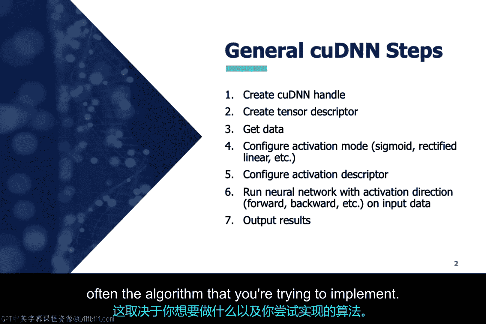
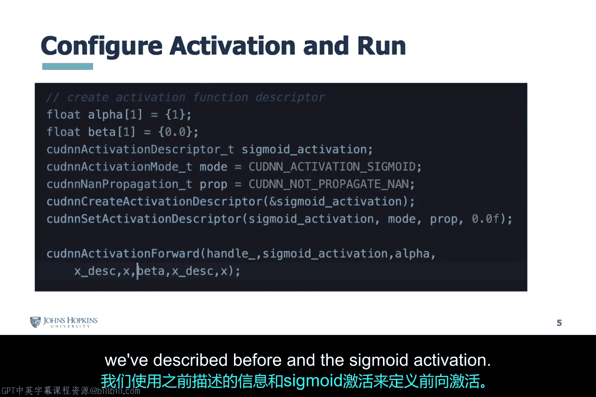

# 约翰霍普金斯大学《GPU编程（并发编程、并行编程、面向企业、CUDA高级库）｜GPU Programming》 p118 24_CUDNN语法详解视频.zh_en -BV1a1421r7vw_p118-

We're going to now discuss the CU DNN or coDNN syntax。

 and I want to make a point before we continue to note that many， many libraries such as Tensor flow。

 P torch， torch， use C DNN under the hood， so the steps for using CU DNN are very similar to other libraries you need to first create a handle in this case。

 a co DNN handle。😔，Then you need to create a descriptor for the tensor。As always。

 you need to get data to two， three， and one。You know， three can go between one and two if you want。

Then you want to create an activation mode， which is how you define when a node is activated。

 so there's a number of。Of functions like sigmoid and rectified linear that come out of the box。

Ting you have to create as a scripture for the activation。

Then you run the neural network with a direction， and that means how nodes are activated either forward or backward。

 sometimes you want to。Improve previous layers by getting the output。

 the confidence interval roles often from one layer and propagating that backwards or forwards。

 it's based on what you're trying to do and often the algorithm that you're trying to implement。😔。

And then you output the results。So let's talk about describing the tensor。😔，So first。

 you have to determine what data type is going to be used throughout。Your neural network。

 in this case， we're going to use a float。Then the format is。😔，Whether it's going to be。

<|OTHER|>WellThere's a number of options there we're just going to choose for this case。

 CoudDian and Tensor and CHW。Then you have NC， H and W， so that's where those come from。

 the number of images you're going to take is input the C， which is the feature map or。

The number of features that will be identified in an image。

And these are sort of generically defined unless unless you create specific ways to say what the features are。

And then H and W are the height， which is the number of nodes in a layer and with the number of layers in your feature map or your neural network。

😔，So yourter number of elements is all that multiplied。Then you create the descriptor。😔，And。😔。

You set it with。Both that descriptor value， the format。The data type。The number of elements。

The number of features and the height and width of the feature map。

And now you have a tenser descriptor。In this case， a 4D tensor descriptor。

 So now we have to define how we're going to activate and run。Hour。

Neurural net or what we've described as a tensor， and that was described previously。

So now we want to define。😔，The activation in this case， sigmoid， so continuous activation。

 not a step function that either goes from zero to1 or something along those lines。

 it's a continuous activation this is good when you have confidence intervals or something you don't want to say 100%。

 but you want to say on a range， so in our case it's from zero to 1。We set the mode， like I said。

 for the activation to via sigmoid。Seet。😔，The not a number propagation to not propagate。

 such that if Nn is calculated， does not output anything in either direction。So we set that up。

 we create the activation descriptor with that information。

 we define the activation going forward using the information we've described before and the smoid。

Actation， we can now run the neural network。

