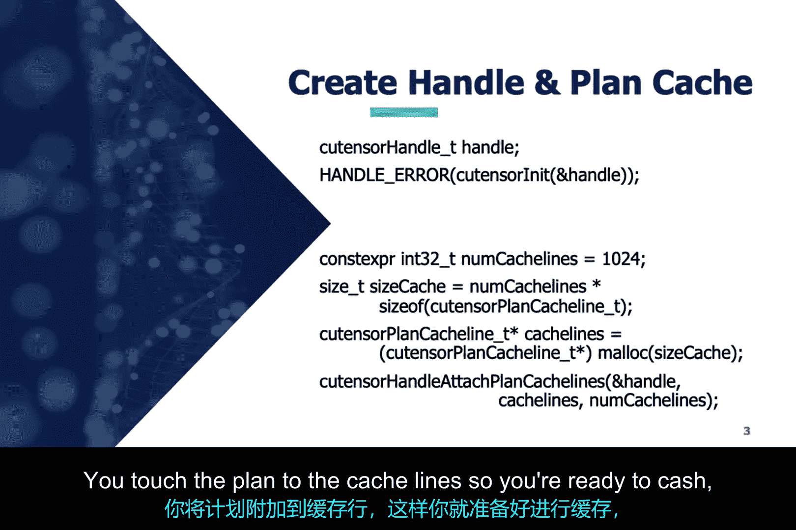
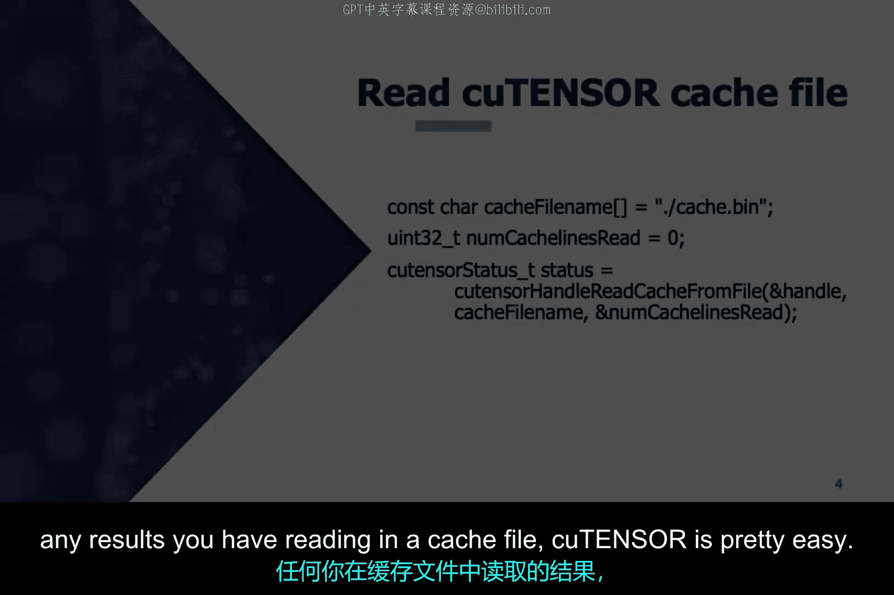
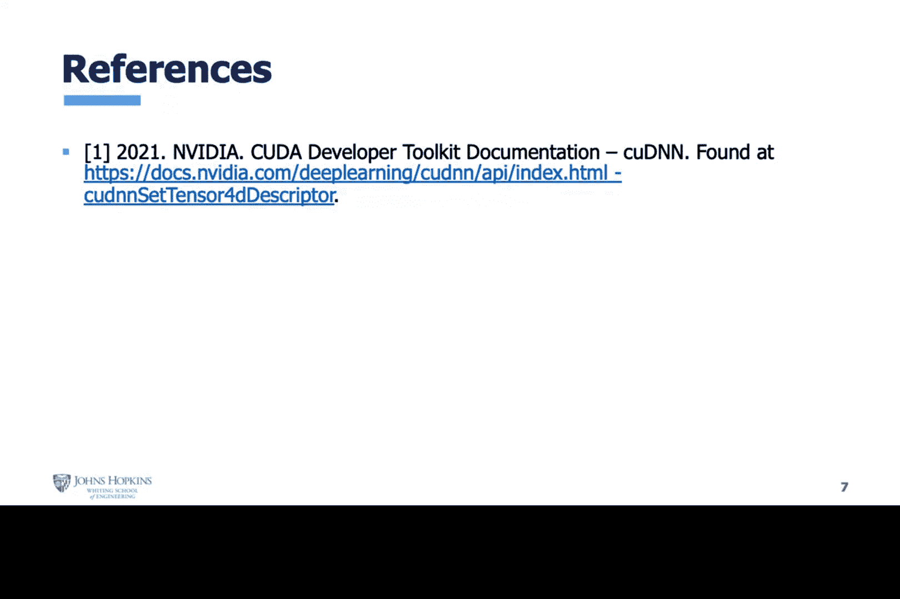

# 约翰霍普金斯大学《GPU编程（并发编程、并行编程、面向企业、CUDA高级库）｜GPU Programming》 p119 25_CUTENSOR语法详解(上)视频.zh_en -BV1a1421r7vw_p119-

To go through the first part of our discussion of coup Tensor and its syntax。

 So let's go over some terminology。 We're going to start with the tensor that is an ndial array or matrix。

😔，A mode is one of those arrays， or if there's a sub matrix for a tensor。

The extent is the size of that mode。In x and Y or。And then a stride is the distance between one memory pointer and the next。

 so generally that's the size。Of the data type that it's managing。

 but you don't necessarily have to have contiguous。Data。And then。A plane cache works to encapsulate。

The model at any point of what it's doing， it handles some things like writing and reading from files。

Dealing with thread safety and minimizing the cost of rerunning。A algorithm。Or in general。

 a plan to develop for couptensor， these are the steps you should follow。

 create a handle just like you have in other libraries。Then create a plan cache。😔。

Read a cache file if you haven't already started from scratch。

Create one or more of these coup tensor descriptors based on that cache。And based on contraction。

 so following iterations of co tensor execution， determine which algorithm you're going to use。

Qury the workspace， createate a contraction plan。😔，Get data， perform the contraction。If you want to。

 this is a good place to cache results or do checkpoints。And then output results。 and note。

 you can restart。And a point from step 3， because you have that cash file。

While creating a handle is fairly simple。You basically call the kuptensor in knit。

Passing a reference to that handle that you've initialized previously。😔。

<|OTHER|>Then you determine the size of your cache， which in this case has 1024 lines。

 you determine the size， you go through all this， you attach。The plan， the cache lines。

 so you're ready to cache any results you have。

Reading in。😔。

A cache file couptensor is pretty easy。 You pass it a cha Ray， which has the。

Relative or absolute location of the file。You pass that into the cotensor handle。

 read Ca from file with the reference to the handle， the file name， and then。

The number of cache lines sell be。Creating the tensor descriptor。

Is a little bit more complex in couptensor than other descripts。

You have to in knit the tensor descriptor passing in a reference the handle。

The descriptor that you're going to create， the type of mode and extent of the data that you're going to input into。

The tensor， you can define a stride。😔，<|OTHER|>And then the type of operational identity that you want to handle。

 and then given that， you can then create an alignment。For the required input from。Ai。

So the important thing we're doing now is we have to create the descriptor for the contraction。

 which is the most important part of this whole process。

 it's actually where the work is done the contraction is the tensor。😔，<|OTHER|>Actually。

 activating it similar to the activation and coy in it。This。😔，Contraction takes three inputs， A。

 B and C， and outputs the result。😔，Into C。😔。

