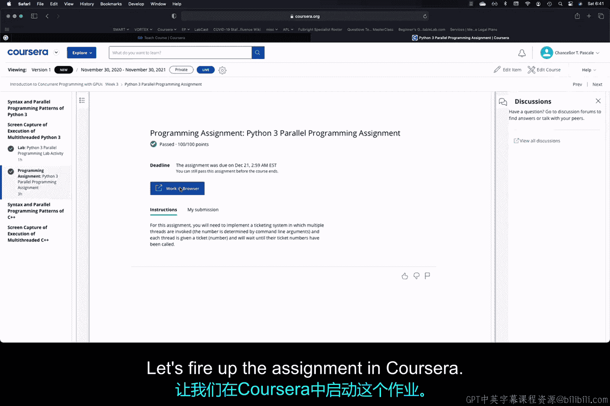
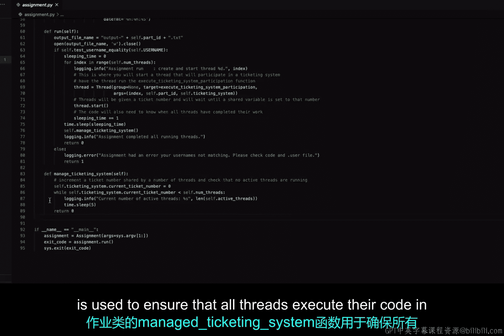
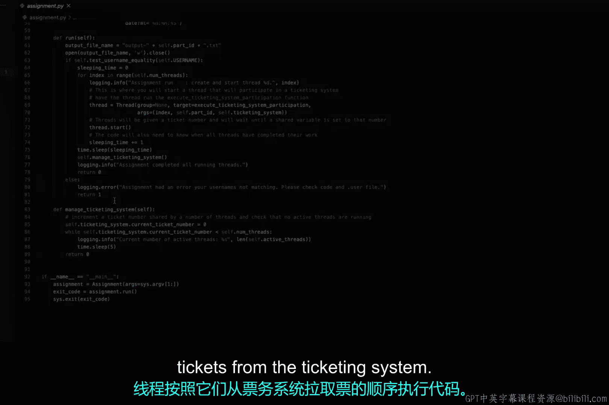
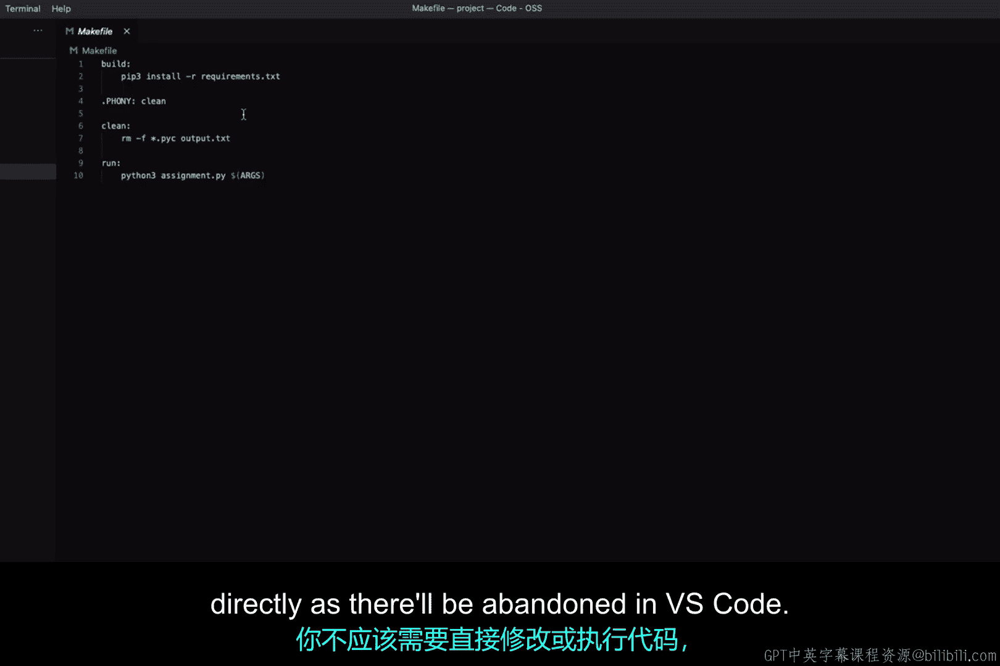

# 约翰霍普金斯大学《GPU编程（并发编程、并行编程、面向企业、CUDA高级库）｜GPU Programming》 p12 11_第2课 Python3作业项目结构视频讲座.zh_en -BV1a1421r7vw_p12-

So now we're going to go over the assignment project structure。

 So let's fire up the assignment in Coursera。

Yet again， a lot of the structure and names of files will remain the same from the lab。

 You will notice there have been some changes to the Qua dot Py file。

 The new core object has variables for number of threads， user name file。

 the CI argument past username， and the Coursera assignment Part I D。😔。

The read user file and test user name equality functions are used to verify。Submitted code。

The parse arguments in this case now part of quoda P Y and not in example Python file。

Adds arguments for number of threats， username and part I。The structure of the predefined classes。

And functions that are part of the assignment IP UI file should not be modified。

But the non logging code should be filled out with any functional code that you need to implement a fully working ticketing system。

The execute ticketing system participation is a function that is available to any code within the assignment A Py file。

 It takes a ticket number， the current assignment part I D， and a ticketing system object。

It will perform any steps required to have numerous threads execute the critical code。

The order that the tickets were pulled。The ticketing system should manage access to tickets to make sure that any number of threads can pull tickets。

 and this is used in connection with the assignment class。Specifically。

 the managed ticketing system function。Of the assignment class。

Is used to ensure that all threads execute their code in the order that they pulled tickets from the ticketing system。

The make file shown here is useful for making the assignment W PY file execute correctly。Run。

 make clean build to remove any compiled Python files and install any required Python packages。

The last step you'll need to run is make run Ags equals dash N No threads， dash U username。

Dash P part Id。You will need to either set the environment variable for numb threads， username。Py。

 or just replace them in the the make command example with values。

You should not need to modify or execute the code directly， as there will be a button in VS code。

