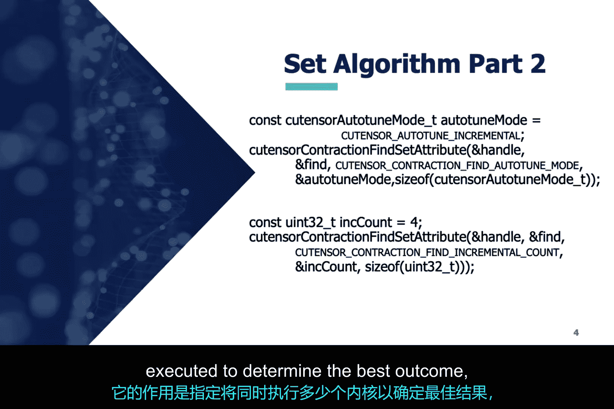
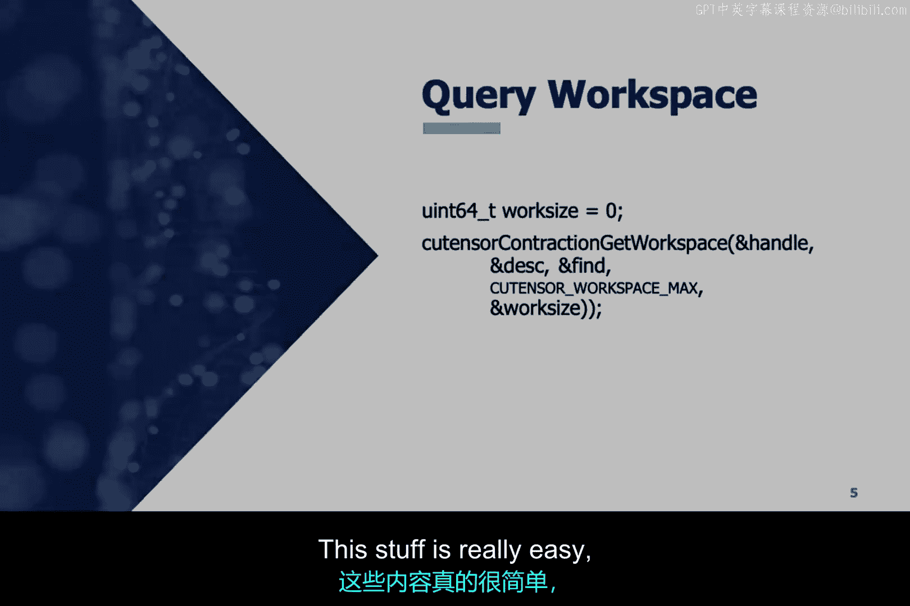
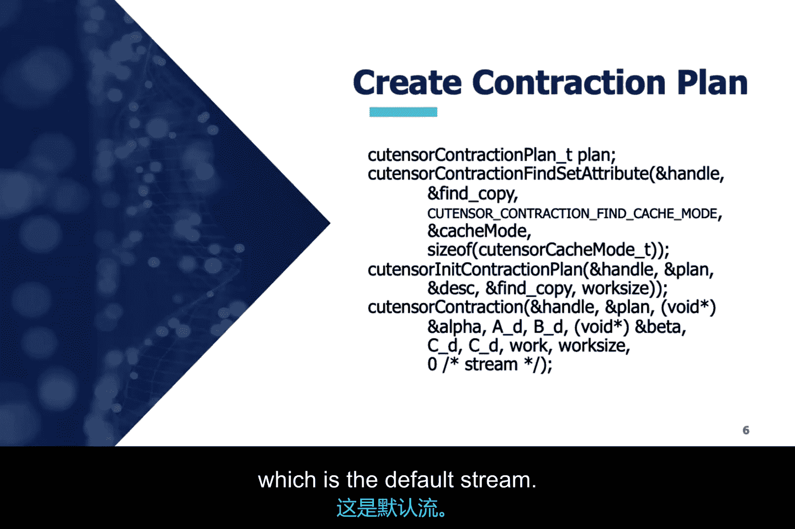

# 约翰霍普金斯大学《GPU编程（并发编程、并行编程、面向企业、CUDA高级库）｜GPU Programming》 p120 26_CUTENSOR语法详解(下)视频.zh_en -BV1a1421r7vw_p120-

Now we're going to walk through the second set of steps that make up a typical coup tensor。😔。

Application。So I want to show you the steps for the application。😔，Note we're starting on step 5。

 where we're going to determine the algorithm all the way out to outputting results。😔。

So in this example。😔，To find the contraction， which is like the main work。That a tensor does。

 that's the output or activation。You get the handle， you define。A find。

And then you tell it the default type of algorithm you're looking for。

Then you want to set the cache mode and in this specific case， we're using pedantic。

 which means there has to be an exact match。In the cash of all the properties or attributes。

I then you set that。Attribute of the cash mode。To that for the handle。

 and it should find an algorithm that works either based on the cache that exists or a new one。

So these steps shown here， they do two things， they say。😔，That the。Tsor itself。

After each contraction will auto tune and so each of the iterations of the plan。

Will be able to be saved and then retrieved。And this。Incremental count。Attribute。

 what that does is it says how many sort of simultaneous kernels will be executed。

To determine the best outcome， which is part of the audit tuning step。

Now， this step is really easy。 It just determines the maximum size for your workspace and retrieves it。

 In this case， we haven't set a maximum size。😔。

If you would want to have that size be larger than。Whatever data structure you need to represent。

 in this case， we sort of punted on it。Now we actually perform a contraction or we can think of it as iteration of a tensor。

So。We set up the cache mode。😔，They create the plan based on the work size。😔。

And then the actual contraction is executed with references to those the handle of the plan。

All the device memory。😔，And anything else like the stream that we're going to execute it on。

 which is that last property， which is set to zero， which is the default stream。

