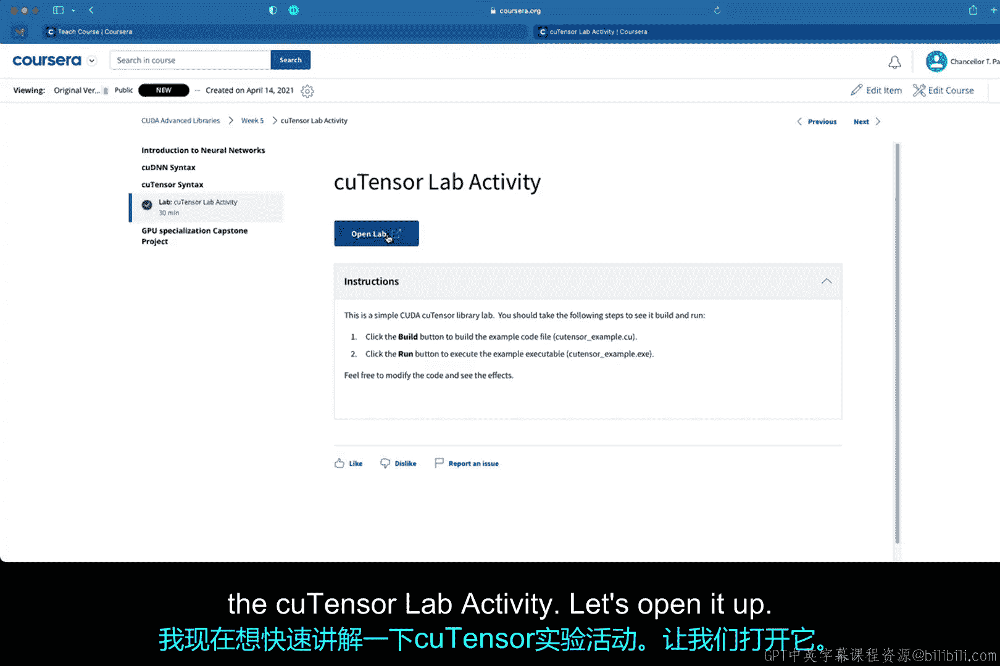
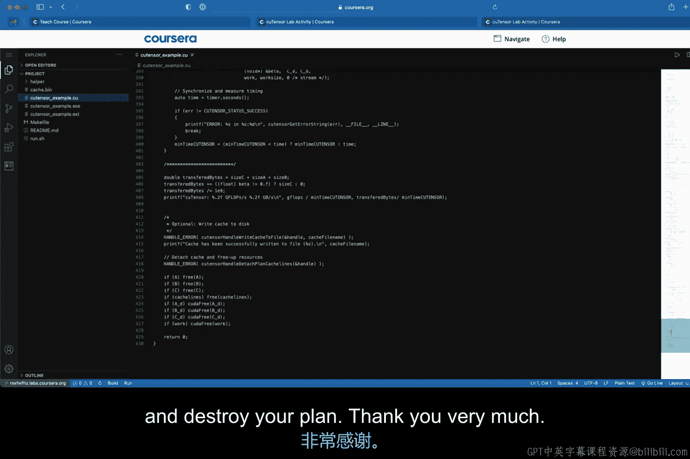

# 约翰霍普金斯大学《GPU编程（并发编程、并行编程、面向企业、CUDA高级库）｜GPU Programming》 p121 27_实验活动总览视频.zh_en -BV1a1421r7vw_p121-

I'd like to now quickly go over the coup Tensor lab activity， so let's open it up。😔。

So as it activates extensions， we're going to look at the code。😔，Of course。

 it's in coup Tensor example。 C。Fitting that pattern this is。

Based on an invidious sample code that you get from the co tensor。Documentation。There's， of course。

 some stuff for。Some macros for handling errors in general and related to Kuta specifically note that coot Tensor isn't。

Deployed or installed directly as part of the coup。'm sorryrry， the couda。Deployment or installation。

 you have to install separately。 So there are some errors that are specific to Kuda that arent that。

Would be reflected in coutensor and vice versa there's some things that are in couptensor that are specific to its installation。

There's astruct for doing Gy timing， and then a rather large man。A function， which。

Follows all the steps that we went through， defining the modes。😔，The sizes of things。😔。

Allocating data。Installing or initializing the data。Based on giving it random values。

<|OTHER|>And then we start to look at ks where we create a handle。We set up that plan cache。

 which takes a few steps。Then rec createate the various。😔，Tensor descriptors。

And align memory to each of the tensors remember we're going to have A and B， B inputs and C。

 B for outputs。😔，Then we start considering contractions。😔，And algorithms。

<|OTHER|>We get the query space， which remember I set to zero， but you could make it。

You could explore options like you could set a very large number to see if。😔。

Allocating a lot of memory for the workspace makes things work better。

 note sometimes the larger things are coup tensor， coup D。😔，They can perform better。

 but they may be slower。<|OTHER|>And then your contraction plan actually running the code。

<|OTHER|>And then you're outputting， this is us going through and running it for each of the iterations。

And remember， there are four increments。So that makes sure that each of those sub iterations。

Finds its best result， does the other tuning， and then you're save to the cache。

What you're doing here， and then you you could restart this at any point if you're used to things like tensor flow or other。

😔，Machine learning models。😔，You could consider。The playing cache is a way of storing a checkpoint。

And always remember to free up your memory。No matterrow what you do and destroy。😔，Your plan。

Thank you very much。

