# 约翰霍普金斯大学《GPU编程（并发编程、并行编程、面向企业、CUDA高级库）｜GPU Programming》 p122 28_毕业项目视频.zh_en -BV1a1421r7vw_p122-

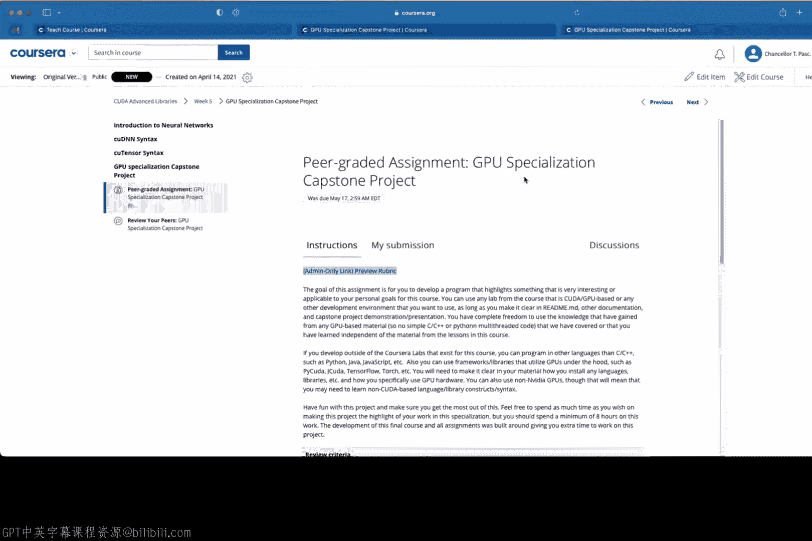

So I want to talk to you about your GPP specialization capstone project。😔。

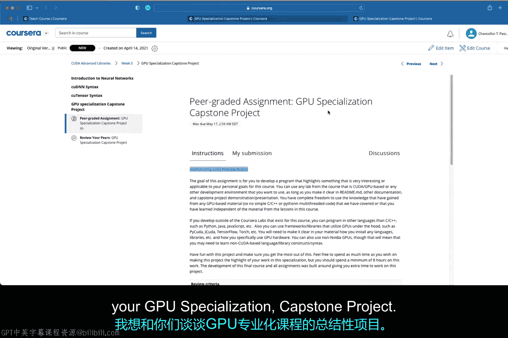

This will be your second， peer reviewed。

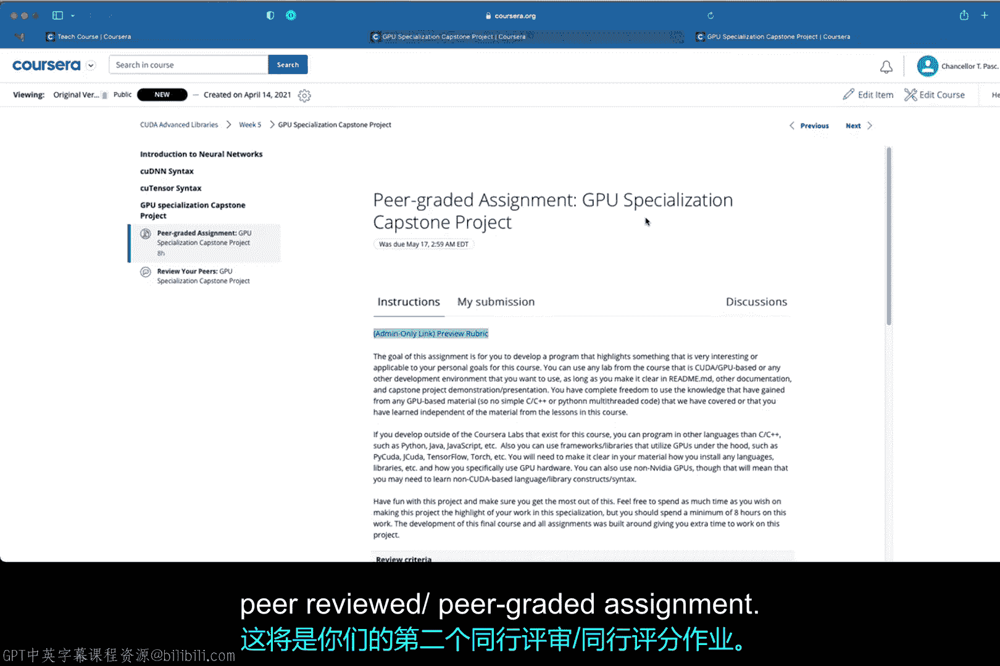

Slash peer graded assignment。😔，There's a description for your general instructions about what you can do。

😔。

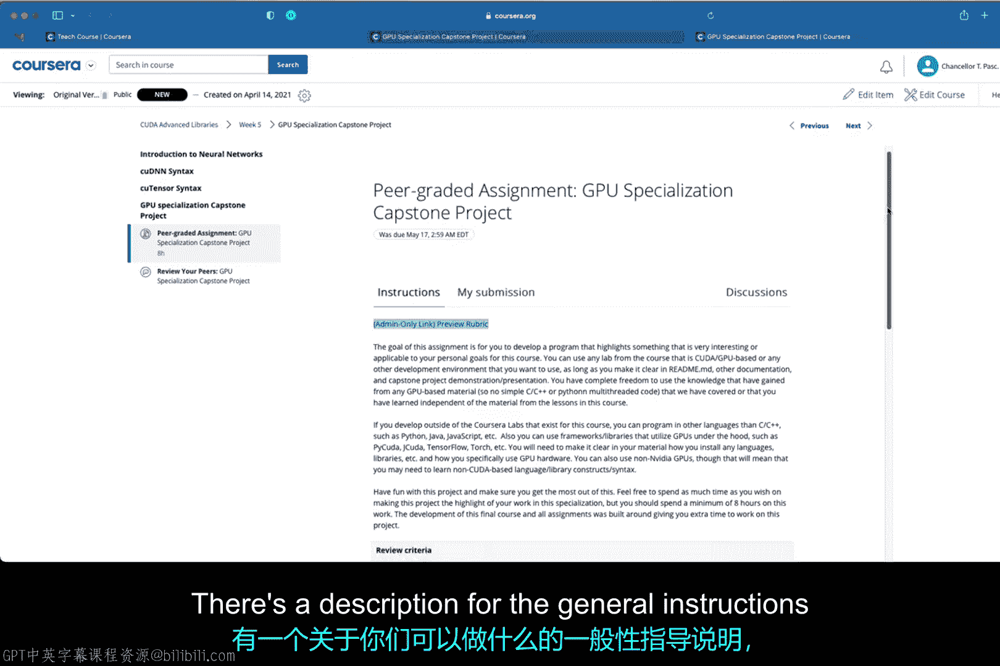

I'm very open to using other libraries or languages as long as you make a point that they have to use GPU hardware under them。

😔。

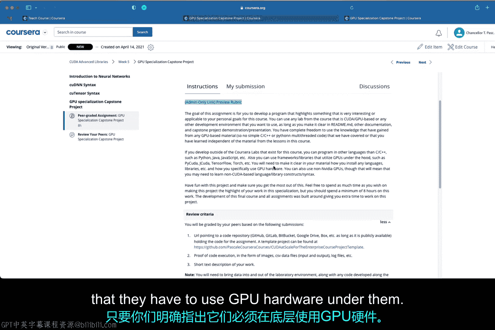

um。A classic example of this is。Torch and Tensorflow and such can run onCpss。

 but they're much less performant。

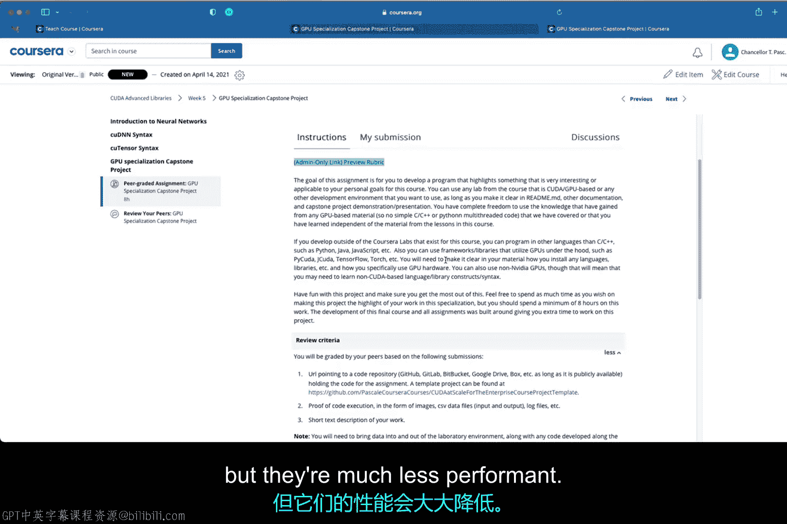

<|OTHER|>And to be honest， the purpose of this class is not solely as a machine learning class。

 so find something you're interested in。

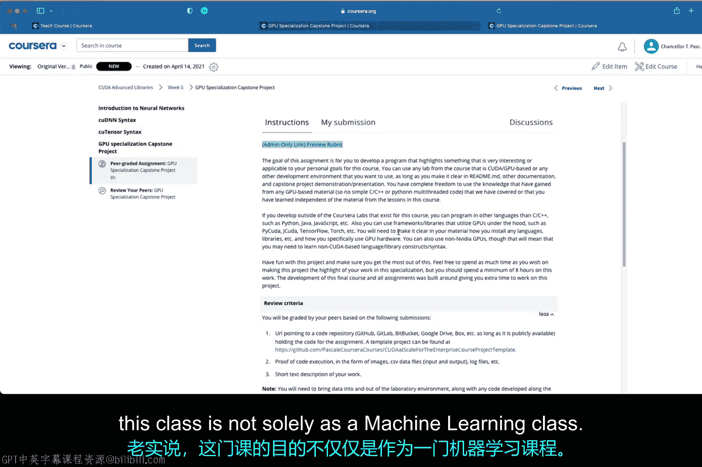

They uses GPU hardware and document that。😔。

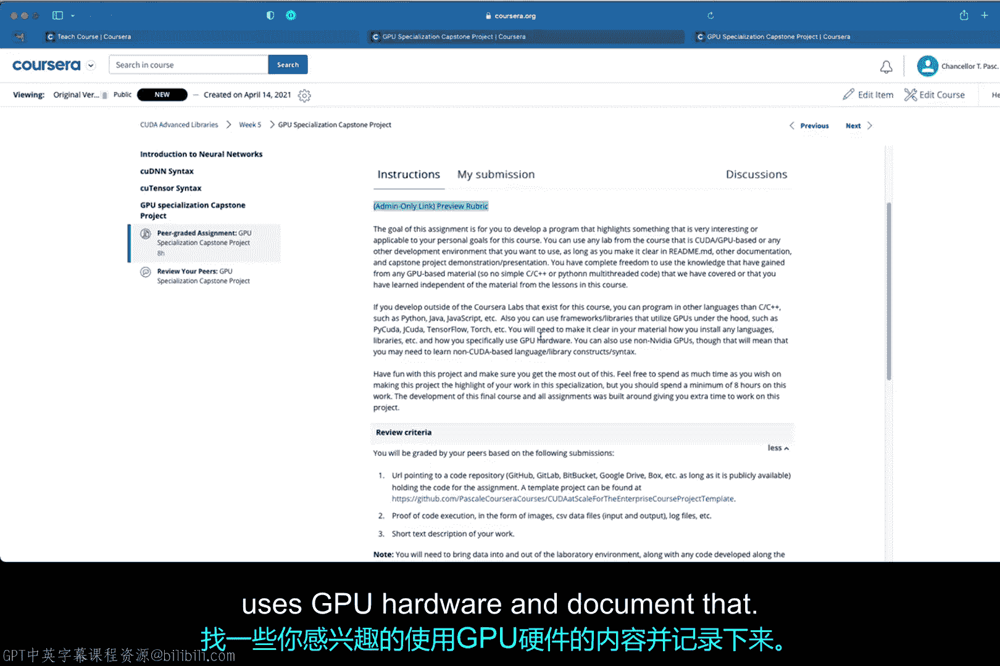

So I want to talk to you about your GP specialization capstone project。😔，This will be your second。

 peer reviewed。/lash peer graded assignment。😔。

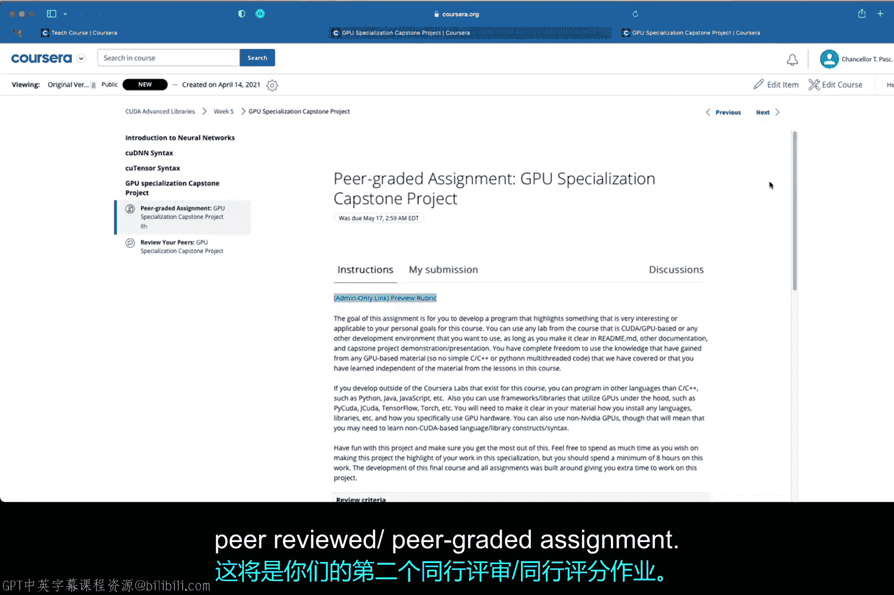

<|OTHER|>There's a description for your general instructions。About what you can do。😔。

I'm very open to using other libraries or languages as long as you make a point that they have to use GPU hardware under them。

😔。

U。A classic example of this is。Torch and Tensorflow and such can run on Cpss。

 but they're much less performant。

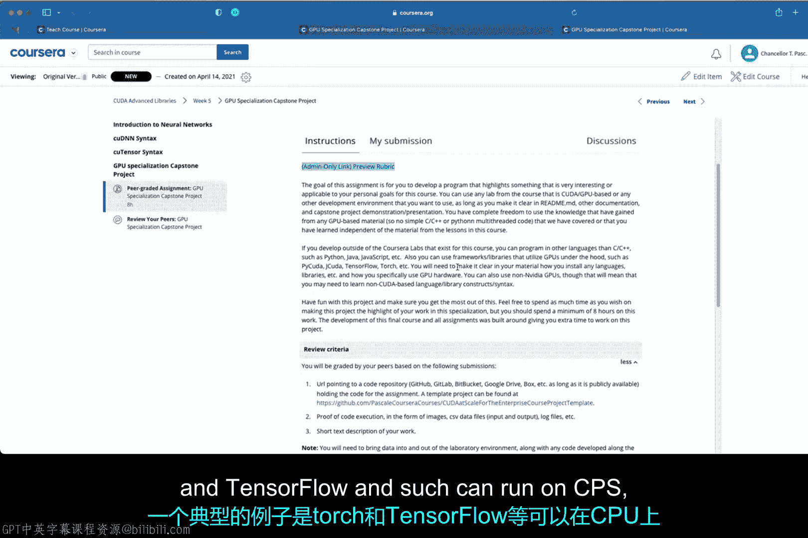

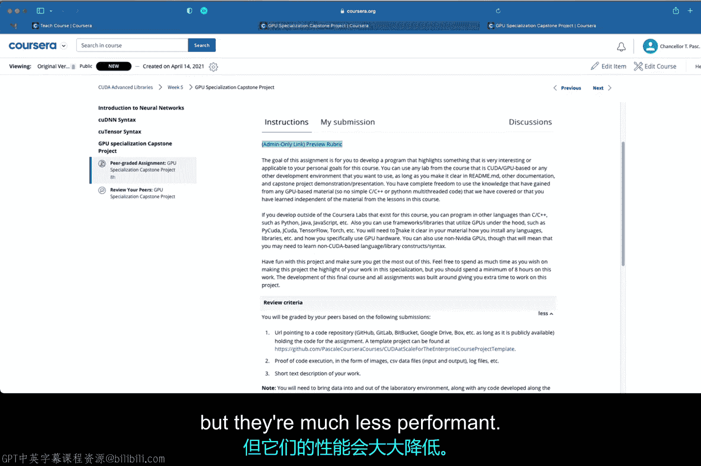

<|OTHER|>And to be honest， the purpose of this class is not solely as a machine learning class。

 so find something you're interested in。

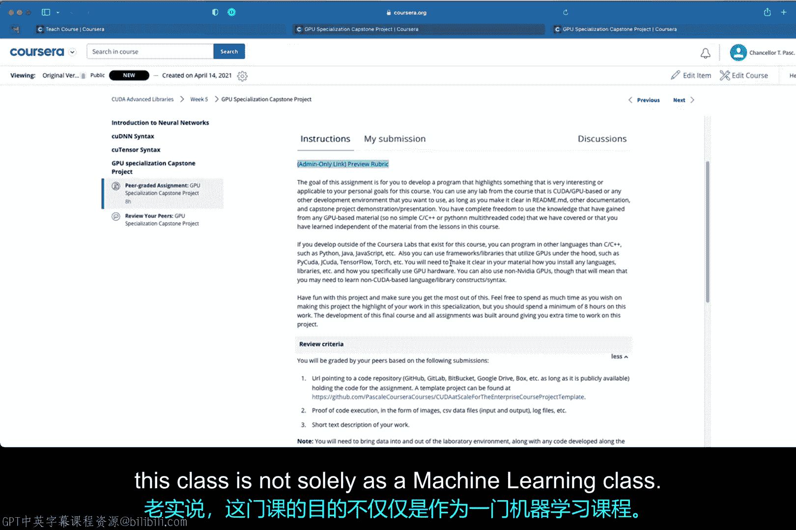

They uses GPU hardware and document that。😔。

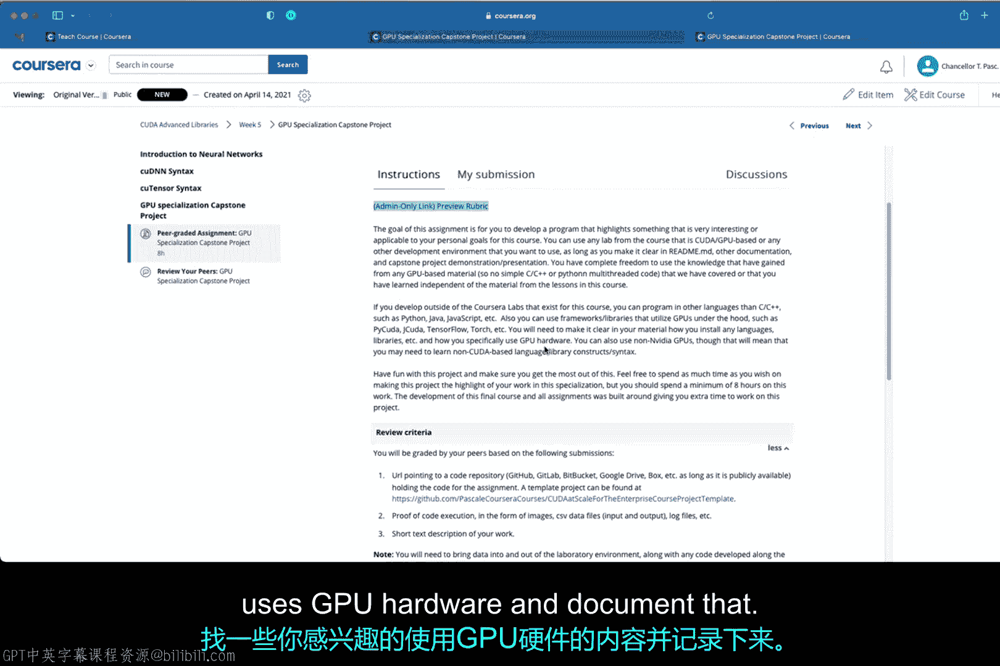