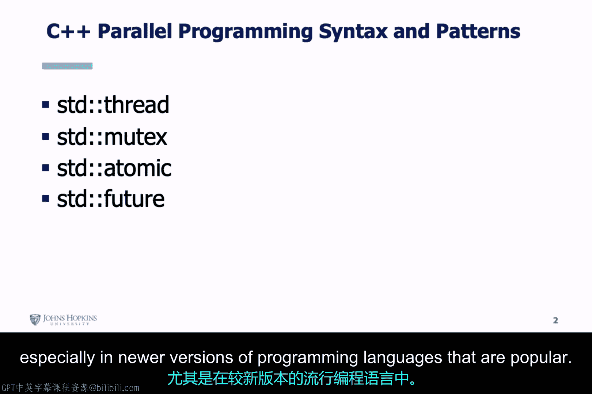
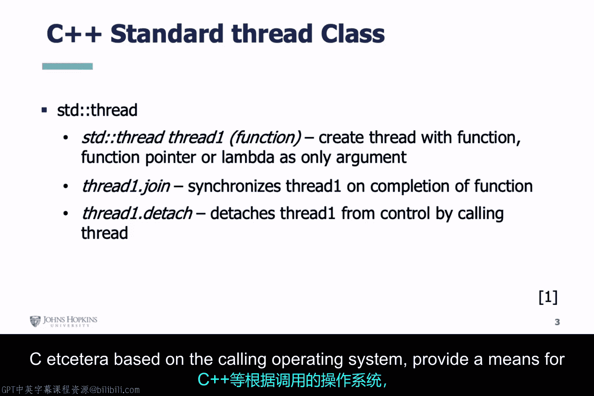
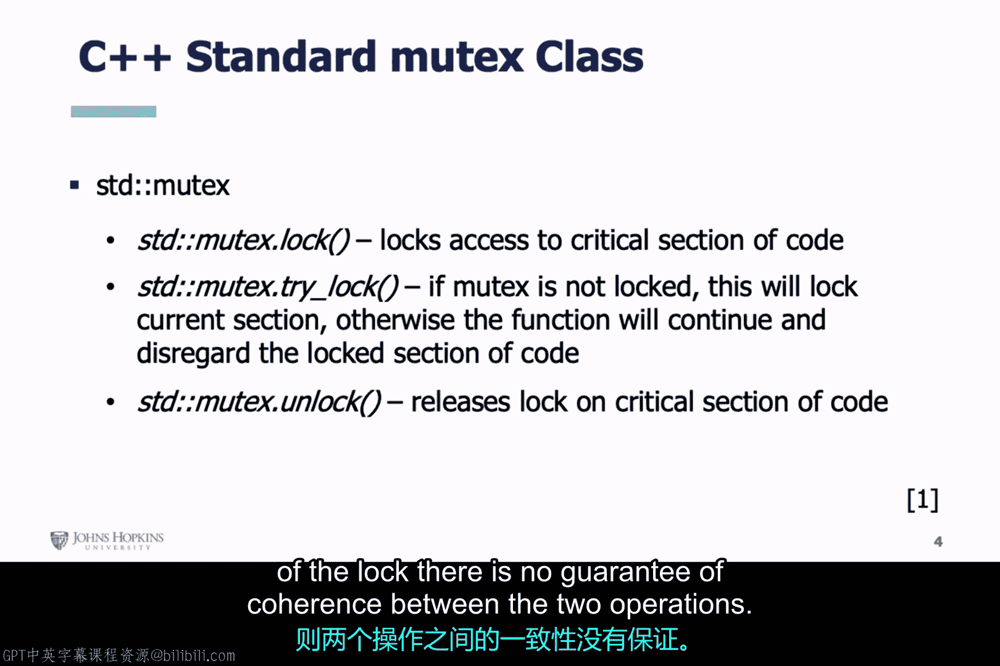
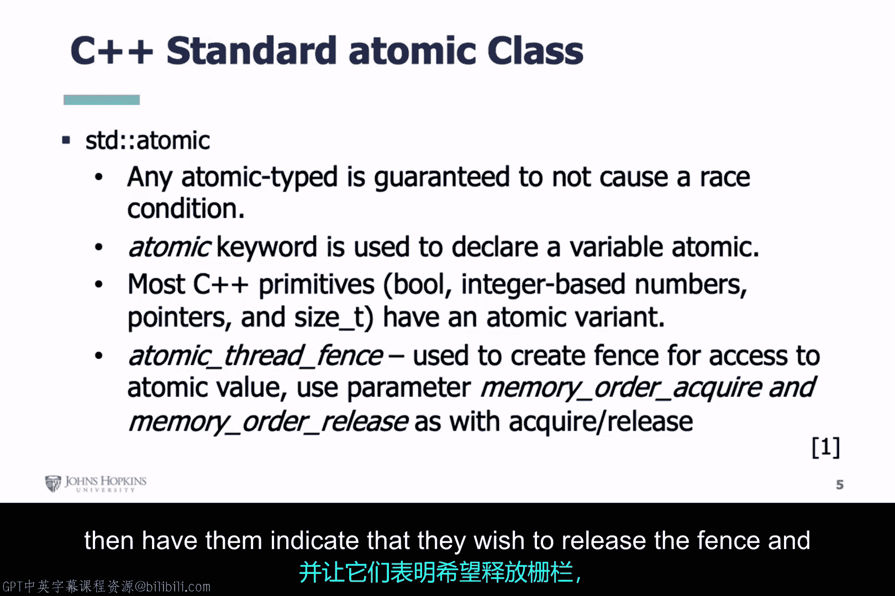
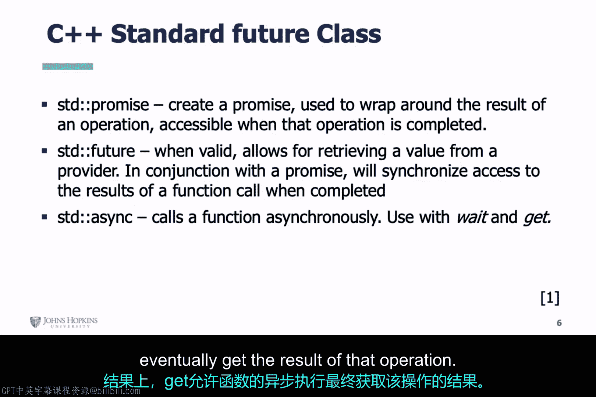

# 约翰霍普金斯大学《GPU编程（并发编程、并行编程、面向企业、CUDA高级库）｜GPU Programming》 p13 12_第3课 C语言并行编程语法与模式视频.zh_en -BV1a1421r7vw_p13-

Hello and welcome to the video lecturecture on parallel programming in C++。

There are four major concurrent programming classes in the C++ Standard Library。

As you may have noticeded， they are all names spaced with the letters S T D。

Which is the namespace for Standard library or STL。The names for each class match to their usage。

So the classes support threads， new textes， atomic data and futures。

Which may be new to some with less of a development background。

 especially in newer versions of programming languages that are popular。

The thread class has the responsibility of creating in CSslingo construction。

Joining and detaching threads， using the pattern of standard thread。

 name a thread variable and the function that will be executed by the thread and create an instance of a thread within the current operating system process。

The thread will start to execute independent of the context in which it was invoked。

The join method holds the continued execution of the calling context， the code that call the thread。

Until the thread associated with the variable name completes what it has been tasked with。

If you want a thread to execute completely out of the control of the calling context。

Use the detaach method of the thread variable。This will allow a thread to continue to operate until its work is done or the calling process is executed completely。

Usually via Sig term or Sig kill signal， which can be achieved via the control C， Control D， command。

 C， etc cea， based on the calling operating system。

Provide a means for mutually exclusive access to a specific section of code。

Consider like a barrier to any thread that comes。While the meat is still in effect。

 because are not variables that are passed around， you utilize the static methods of lock。

 trylock and unlock around sections of code。They only affect any thread that attempts to access the critical section。

That the Mutex locks， a normal pattern of use for metes is to identify a critical section of code called the Mutex lock function before entering the critical section to block concurrent access to the same section of code。

And then call， unlock when it is completed。If you would like a thread to move past a critical section of code and not wait for a lock。

 using Trilock will allow a thread to try to get the Muex lock and if it fails。

 continue its execution。A use of this might be and threads can execute a number of unrelated tasks。

Maximizing their processing， or the thread might want to indicate that a lock was attempted to failed。

Log the try and then sleep pattern。 If used correctly， can limit thrashing over the critical section。

But can go badly if a thread sleeps for too long and is underutil。Also。

 note that if the variable is modified inside of the lock and possibly outside the lock。

 there is no guarantee of coherence between the two operations。

Atomic variables allow for more coherent access to data。

 Atomic variables mean that a variable cannot be accessed or modified until the current operation on the variable is completed。

Think of this when you want to increment variable。 that is at least two operating system level operations。

 adding to the variable and then saving the value。Without autoity。

 two interleaved increments could result in only one effective increment。

Most primitive types in C++ can have the atomic keyword applied to them。

I is not good practice to make all variables atomic。

But if you believe that two threads will access the same variable and you want to ensure that all operations have their intended effect。

 then this is a good tool。Also， a fence can be used to ensure that all threads have access to an atomic variable。

But do not proceed until all variables have reached the fence。

Atomic thread fence is a way to acquire and release。

To give all thread access to the fence variable and then have them indicate that they wish to release the fence and therefore proceed when appropriate。

Futures are a more modern parallel program and construct。

 allowing threads to continue with execution of its responsibilities while still being able to interrupt。

That other thread， once the result of an operation is completed。In modern languages。

 they use network communications， This can be when a request is made outside of the context of the current thread。

 rather than wait for an answer。 a promise is made to respond when a result is returned。

To gain access to the results of a promised operation， a future is returned。

If you would rather have threads wait for a result， functions can use。

Aync to indicate that a function will continue outside of the calling context and at a later point。

Execute。Using weight allows for calling context to halt continued execution code until a call function returns the result。

Gett allows asynchronous execution of the function to eventually get the result of that operation。

