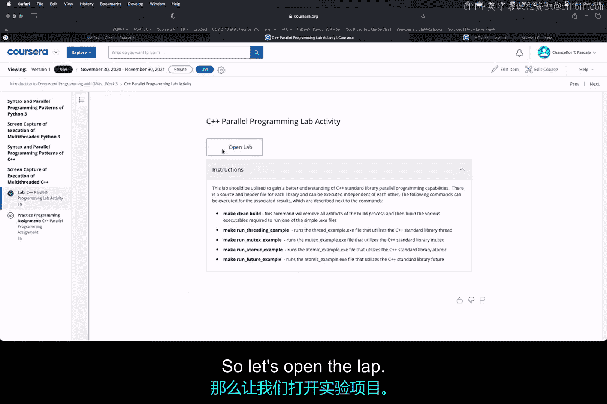
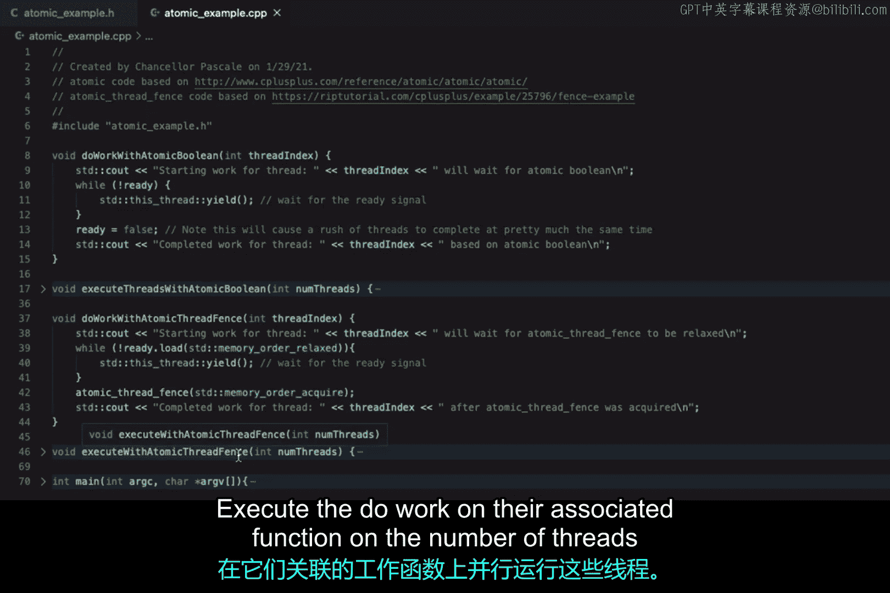

# 约翰霍普金斯大学《GPU编程（并发编程、并行编程、面向企业、CUDA高级库）｜GPU Programming》 p14 13_第4课 C语言实验项目结构视频讲座.zh_en -BV1a1421r7vw_p14-

So let's open the lab。

This directory that you see here， which is called Project。😔。

Will be under the coders user project folder。😔，What you will notice are there are four pairs of do cPP C++ source files。

And header files。 So they are for threads。New Texas， futures。And atomics。

So the headers show things like constant variables and the signatures for functions and C++ files show the actual code。

An important other file that you'll see here that we'll go over in a little bit is the make file。

Which describes a number of ways that they make command。Well。Change files， compile them， etc。

 so let's open the make file。The make file for the C++ examples manages compilation of code。

 running of associated executables， and then the cleaning of artifacts such as object and executable files created during the build process。

For each of the four examples， there is a build。And a run。Target。

And then there are overall build and run all targets for building and running all of the examples。

The all target。Execcuts all the applicable targets， so cleans everything， builds it。

 and then runs it all off the two open thread example files。

 you'll see the left tab is the header file。It contains function signatures for the three non main functions。

In the right tab， you see the thread example， CPP C++ code。There are three functions。

That have been implemented。 do work。Execute threads。And execute and detach threat。

Do work is a function that holds the exer work for a thread， in this case。

 logging the thread that is being run。Execute threads。Execcututes a predeterminant， in this case。

 three。Number of threads in parallel。And then joins them。Execute and detach thread。

 executes a thread in detach mode， meaning it is no longer bound to the calling context。Now。

 let's go over the Mutex example。In the left tab is the header for the Mutex example code。

It includes the shared meex variable and the four nonma functions。Now let's look at this C+ pluscard。

There are four functions that you will see。Do work with Mutix Lock。Execute threads with mutt lock。

Do work with Metex' Trilock。And execute and detach threads。With Mutex Stlock。

The two do work functions， the do work with MutexO， and do work with Mutex Trilock。

Do the work of a single thread with respect to the shared muttex。The two execute threads。

With Mutex lock and execute and detached threads with muttex trilock functions。

 execute the do work on the number of threads passed as a variable。

 So let's move on to the example code for futures。 The left tab future example at H。

Is the header file for that example， and it has four non main functions。

 There are four functions that have been implemented。 Do work with futures， Ex threads with futures。

 Do work with async。 Ex with async。 The two do work functions。Expanded here。

Do the work of a single thread with respective futures and integers as inputs。

 The two execute functions， execute the do work。Based on either a predetermined or past number of futures。

 executing the do work with asynnc function asynchronously。

 So let's move on to the example code for atomics。 Atomic example dot H here has four non mean functions。

 Atomic example that CP has the example code for atomic variables。

 There are four functions that haveve been implemented。 Do work with atomic boolean。

 Ex threads with atomic bullolean。 Do work with atomic thread fence。 Ex with atomic thread fence。

The two do work functions， which are expanded here and here。

Do the work of a single thread with respect to the used atomic variable， in this case。

 dealing with an atomic boolean in the second implementing an atomic thread fence。

The two execute functions， execute threads with atomic boolean and execute with atomic thread fanss。

 execute the do work on their associated function。

When the number of threads passes a variable， running them in parallel。

