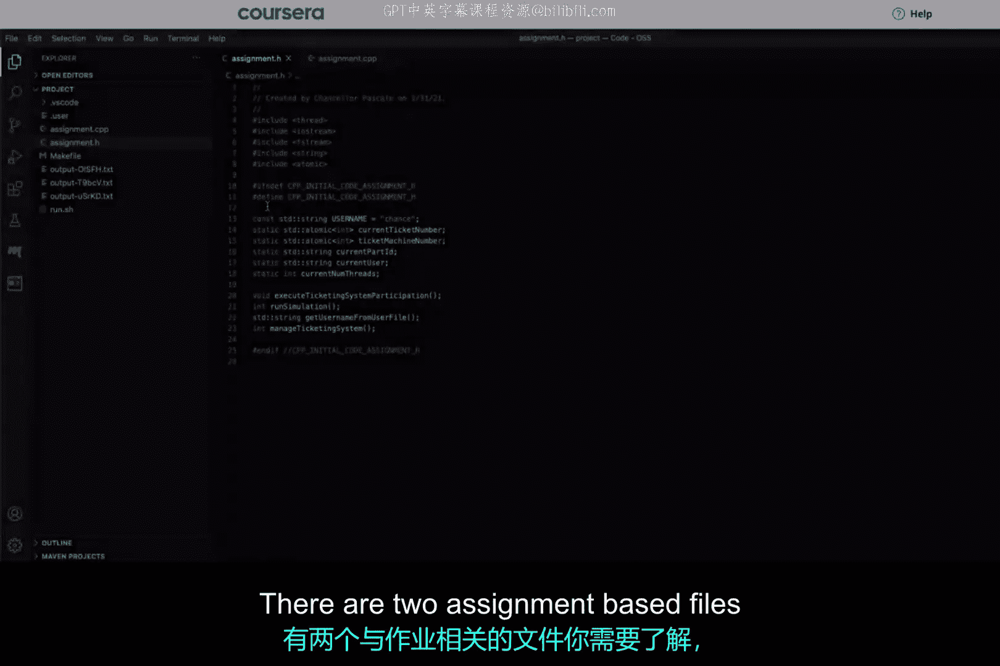
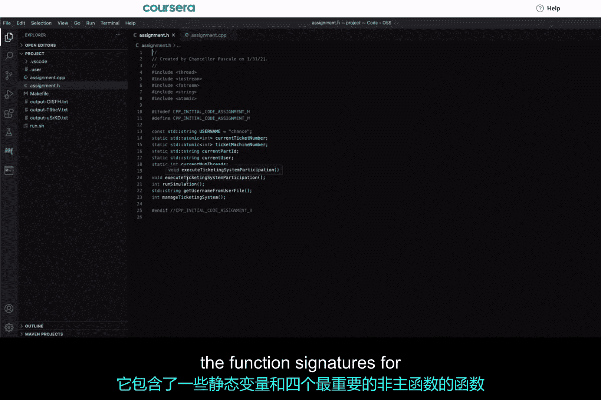
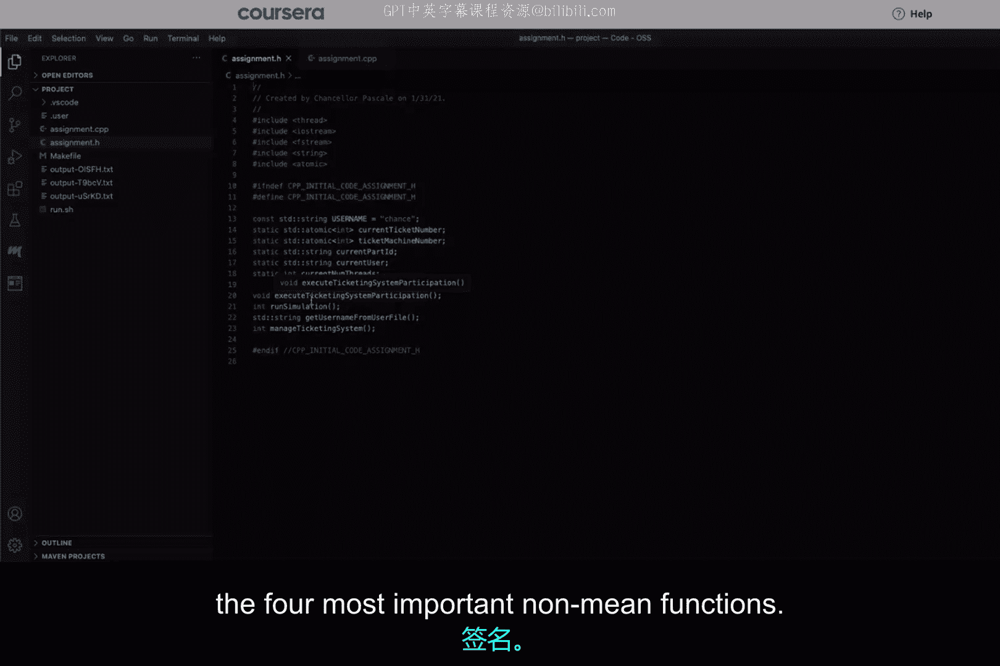
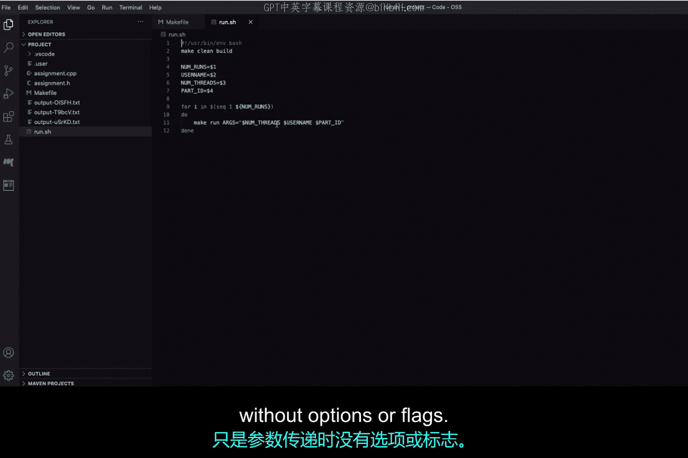

# 约翰霍普金斯大学《GPU编程（并发编程、并行编程、面向企业、CUDA高级库）｜GPU Programming》 p15 14_第4课 C语言作业项目结构视频讲座.zh_en -BV1a1421r7vw_p15-

Now we are going to go over the structure of the project for the C++ assignment。All right。

 so let's work in the browser。So there are two assignment based files that you will need to know about the assignment dot H。

 the header file for the assignment。

It contains a number of static variables。And the function signatures for the four most important nonma functions。

When the right tab is the main source code for the assignment assignment cP。

 there are four non main functions of interest， execute ticketicking， system participation。

 run simulation， get username from user file。And manage ticketicketing system。

 the run simulation function execute a run of the assignment simulation based on the previously identified static variables in the header file within the run function。

 the first function that is called is the get user name from user file。

 which retrieves the user name value from the user file， then based on the number of threads。

 the execute ticketicketing system participation call is executed on detached threads。

 and then lastly the managed ticketicketing system manages how those independent threads interact。

With the ticketing system， note， the goal of the managed ticketing system is to make sure the ticketing system works such that threads execute their work in the order that the tickets that they have pulled from the ticketing system。

 There are two support files required for the assignment。 The first is the make file。

 It contains the typical build， clean run and all target。 The other is the run out S H。

 which is very similar to the run out S H for the Python 3 assignment。

Except that the arguments are passed without options or flags。

