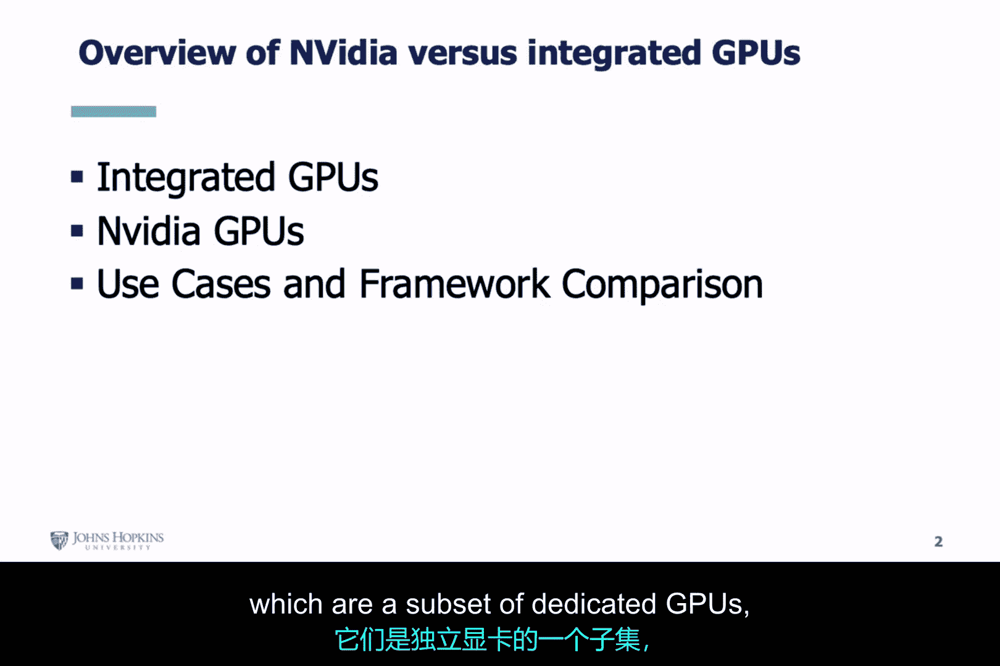
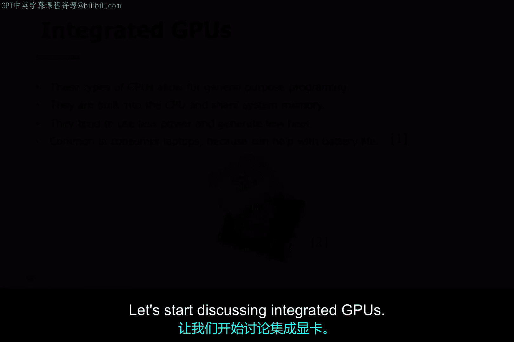
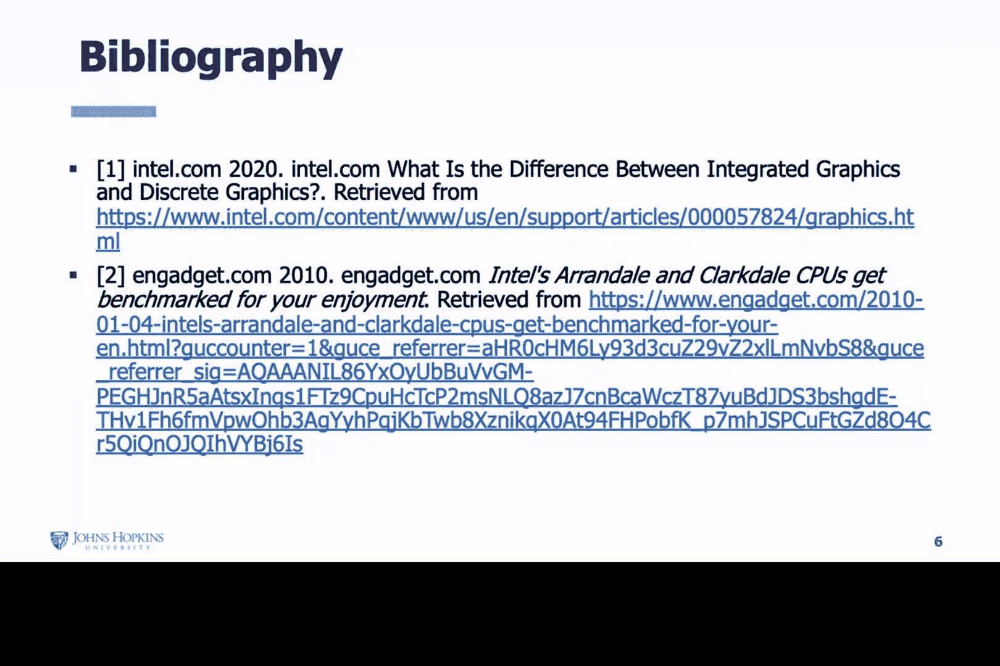

# 约翰霍普金斯大学《GPU编程（并发编程、并行编程、面向企业、CUDA高级库）｜GPU Programming》 p16 15_集成GPU与独立GPU对比.zh_en -BV1a1421r7vw_p16-

Hello and welcome to the first lecture of the fourth module of this course。

We will focus on defining the capabilities and differences between integrated and dedicated GPUs。

The three topics for this video will be concerning， learning about。

Both integrated and invidia G viewss， which are a subset of dedicated G viewss。

And some use cases in framework comparison。

Let's start discussing integrated chief views， so most base versions of consumer laptops and desktops。

Are configured with this type of hardware。 They don't support vendor specific programming frameworks such as Kuta。

 but can be used with general or heterogeneous programming frameworks such as Open CL and Open ACC。

Often the same company that makes it CPU for machine。

Will make the integrated GPU that it uses since the GPU is on the same chip。

That is what integrated means in this case， integrated with the CPU。

Positives are that they are physically close to the CPU in shared system memory。

They also get less hot and use less power。So they help with battery life。

Downsides are that they're much less powerful。Lalagging well behind dedicated GPUs since they must be co residentnt with the CPU。

NviDdia makes the most commonly available programmable GPus。 By that。

 I mean that AmD makes their own GPus that are very powerful。

 but they don't have the same level of adoption of programming directly on the GPU。

They are more oriented to video and gaming applications。

Andvi and GP pes are getting better in getting more processing with less power consumption and therefore。

 less heat。Powerful laptops can be built with NviDdia cards included。

 but they are more commonly found in desktops and servers。Unfortunately。

 you cannot get a Mac with an NviIDdia GPU， only AMD。

Which is probably related to their lack of interest of support for Open C L and Kuta。

 focusing more on their own GP P programming framework， metal。

A common use case for integrated GPs is under less defined programming or heterogeneous workflows。

Since a GPPU might or might not be used， and therefore。

 the cost of the hardware and extra power consumption is lower。

Dedicated chief views have become more heavily used under use cases such as。Cryptocurrency mining。

 verification。Natural language processing。And computer vision。In the case of NLP and computer vision。

 programmers are often either directly or indirectly using neural networks。

 since they map really well to the NviIDdia hardware。Performing。

When there are many processors doing a small amount of work。

If a program needs to take advantage of different types of hardware for different tasks。

Open C is widely used， open source computing software。

That is built around programming as many hardware platforms as possible。

Open C L code is in separate files， or compiled into。

C or C plus plus code as text that is then sent to the hardware， compiling in place。

The follow on to Open C is Open ACC， or Open Acccelator。

Which removes a requirement to have separate code， but rather。

 has developers use macros around sections of code that can utilize accelerators such as GPs and field programmable gate arrays。

Cuda is the most widely adopted framework and gives more access to the developer throughout the NVIdia hardware。

