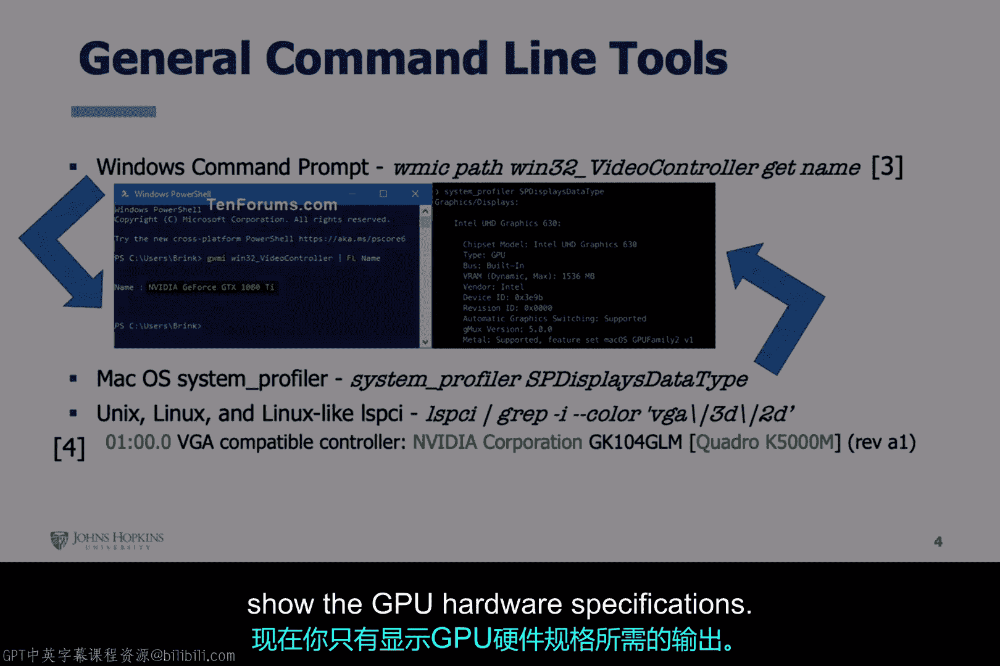
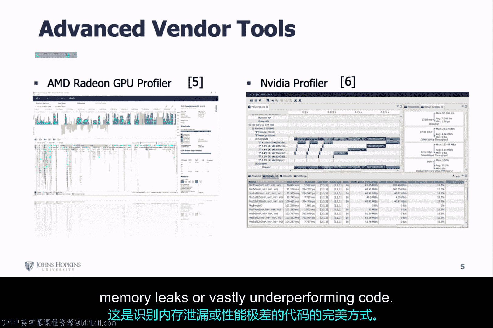

# 约翰霍普金斯大学《GPU编程（并发编程、并行编程、面向企业、CUDA高级库）｜GPU Programming》 p17 16_GUI-CLI工具识别GPU硬件.zh_en -BV1a1421r7vw_p17-

Hello。😔，This lecture will show。😔，GoI and CI tools that can be useful for you to determine。

Which GP you hardware and specifications you have on your current machine。

There are three classes of tools that we will show in this video。

 operating system provided tools for hardware profiling。

 command line tools that are generally available， and vendor specific tools for more detailed information about the hardware that they have created。

The first hardware profiling tool is the Windows device Manager。

Its interface is a large tree like structure they will need to navigate to find display adapters。

And under that， you should see any installed GP view hardware。

Next is the Linux Ss Info tool installed by default in Ubutu and mint Linux distributions。😔。

On the applications left side you will see categories for CPUUs system。

 which is for operating system， GPUs， etc If you have a Mac OS complianceant system。

 the about this Mac tool will show information about GPUs under the display tab。The Windows， command。

 prompt or power shells， W OM IC or。GWMI commands will show a plethora of hardware information。

With the W 32 video controller flag， you will get GPU information specifically。On Macs。

There is a system profiler， CLI tool。That which you can pass the S displays data type。

To narrow down into GPs and displays。Most Linux distributions provide the LSPI tool for listing PCI information。

Like， most common。Linux commands， LSP， I can be strung together and use the G command。

 which will pull out lines matching a pattern。You can see the G command here。I have added that。

Color option for use of color to make things a little clearer。

Pippe the output of LSPI into the G command， and now you have only the output needed to show the GPU hardware specifications。

The two biggest players in dedicated GPs， AM D and NviDdia have their own profilers。

These tools are very helpful in determiningring which operations such as memory copies。And hardware。

Streaming processors， et ce， are being actively used at any point。

These tools are great for taking code that is running and identifying what is happening at any point。

Which can be a perfect way to identify memory leaks or fastly under performing code。

