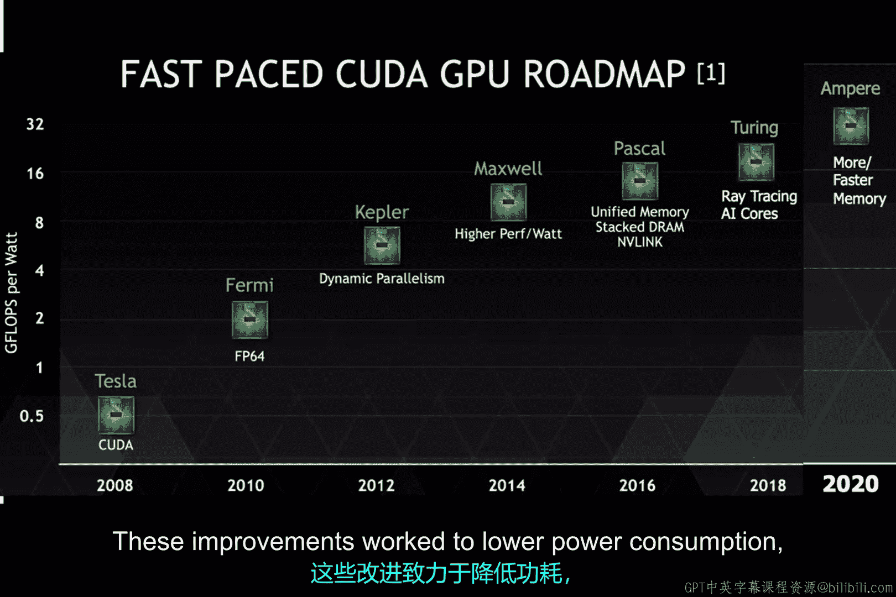
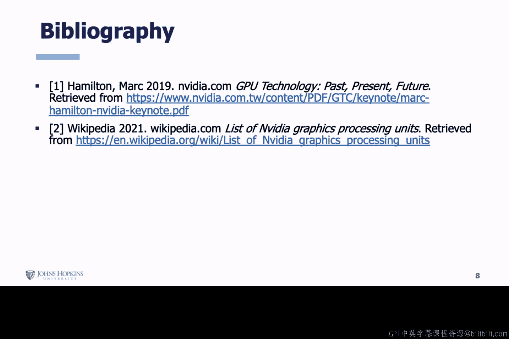

# 约翰霍普金斯大学《GPU编程（并发编程、并行编程、面向企业、CUDA高级库）｜GPU Programming》 p18 17_NVIDIA GPU架构解析.zh_en -BV1a1421r7vw_p18-

This will be our first venture into Nvidia specific hardware and software capabilities。

So as of early 2021， there have been seven major generations of GP hardware。

That allowed for kudup based programming。It all started with the Tesla Archit in 2008。

And up to the current Ampere hardware architecture note that with each generation of hardware。

 there were improvements with performance and software capabilities。These improvements worked。

To lower power consumption at the same time， increasing processing power。

The seven NviIDdia GPU architectures are listed here。Each is the main architecture。

That Nvidia is manufacturing for approximately two years。

We will go over two per slide in the next few slides。

 so covering around four to five years worth of hardware per slide。

Tesla and Fermi architectures were produced from 2007 to 2012。

Tesla was the first architecture that allowed for co programming。

It ease a small number of courses with a large power usage。For the Fermi architecture。

 the most popular GP card in the architecture is shown here。Quadrupling the number of cores。

 doubling memory。And improving the memory speed by 33% as compared to Tesla。

While there is only a small increase in power usage and output heat。

Keper and Maxwell architectures were manufactured from 2012 to 2016。😔。

The major efforts in Kepler were to make GP's more programmable， double cores and memory。

Memoory's feed was lowered， along with overall power consumption。Maxwell cards again。

Nearly doubled cores while increasing memory bandwidth and lowering power consumption。

 Note that in these two generations， you should not only see power consumption going down slightly。

But since more cores are available， the performance per watt is effectively doubling with each generation。

Pascal and Turing。The two previous generations of GPO hardware。

Prior to the latest generation were produced from 2016 to 2020。

Pascal worked on making the memory model more unified， so less worrying about memory configuration。

And added envy link， which makes memory transfers faster and easier between host and device。

There was a small bump in the number of cores， about 50 per generation。

 the power usage improvements are slowed in these architectures。Card memory is much higher。

It is almost twice as fast as the Maxwell architecture。A Pier is the current harbor architecture。

It introduces tensors and ray tracing from touring and creates more dedicated cores。

An almost doubling of course occurred while halfing wattage。

 which means quadrupling of performance per watt。Memory bandwidth has maintained。

Or slightly lowered based on which specific card was installed。😔。

