# 约翰霍普金斯大学《GPU编程（并发编程、并行编程、面向企业、CUDA高级库）｜GPU Programming》 p19 18_CUDA Linux安装指南.zh_en -BV1a1421r7vw_p19-

Hello and welcome to the fourth lecture of this module， which will go over KUa Linux installation。

So as we record this， we are just before NviDdia GTC 21， which is in April。

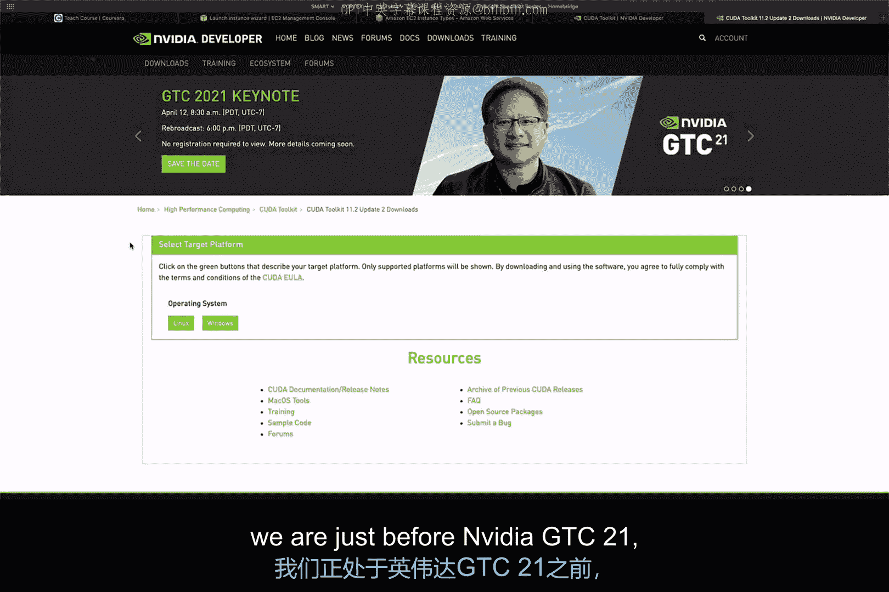

2021。SoWe're going to install for Linux， so we'll choose that in the target platform。

 then we're going to choose an architecture which is X86。

which our AWS EC2 instance will be and then a major decision is which distribution of Linux we're going to use in this case we're going to use UBuntu because it's fairly common and well supported and we're going to choose one of the long term supported versions which as of now is 2004。

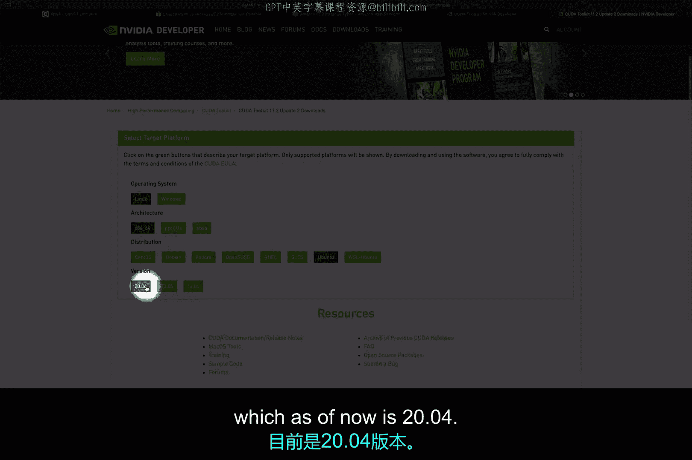

Now the last step。Is to choose which installer type we're going to choose。

The Deian package manager version， which will pull everything down over the network。

And then once you click that， you will see the base installer commands。

 So there are six commands you have to execute on a deian package manager。

 The first is W getting the binary installer。 I paste this command into the Linux command line and get the binary installer。

 The next thing I do is move that package manager information into the app commands preferences directory。

 I'm then going to add the public key for the distribution。😔。

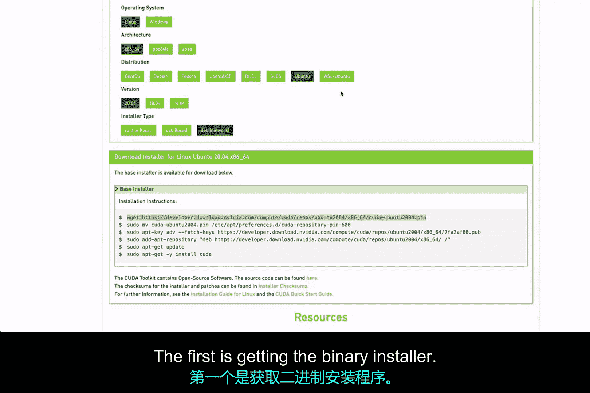

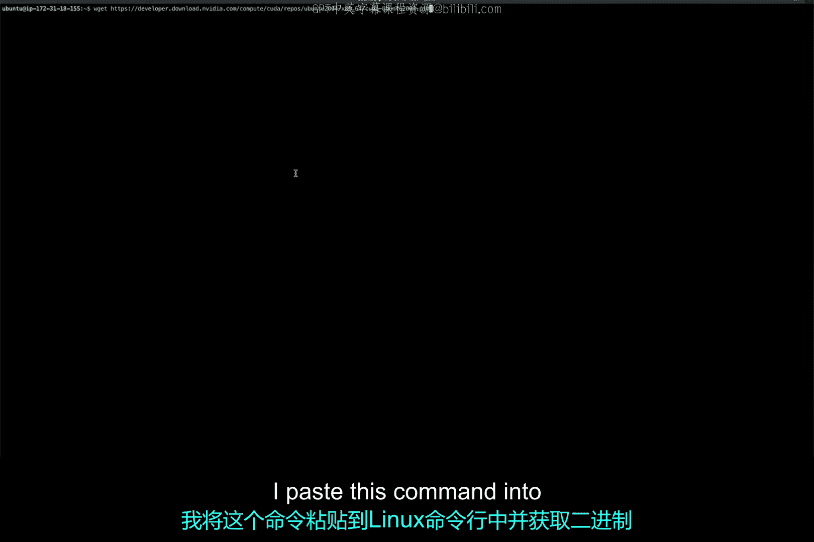

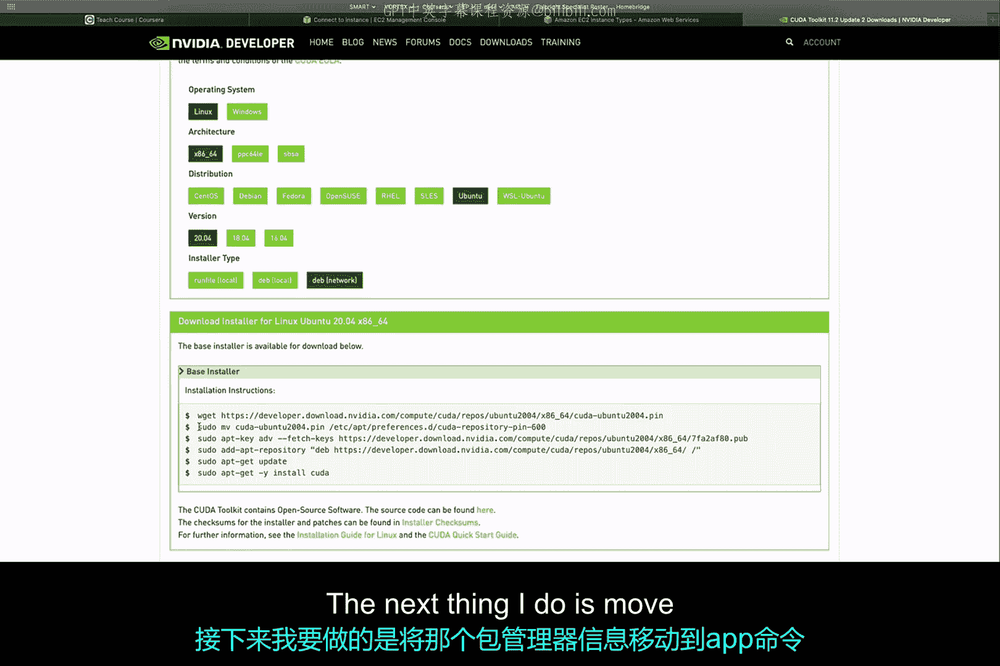

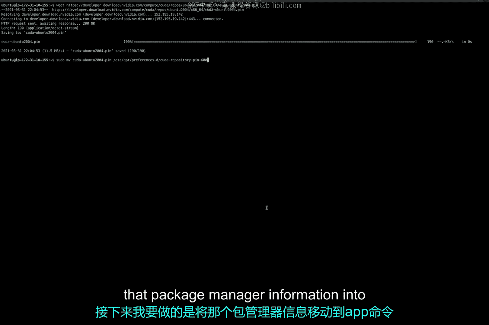

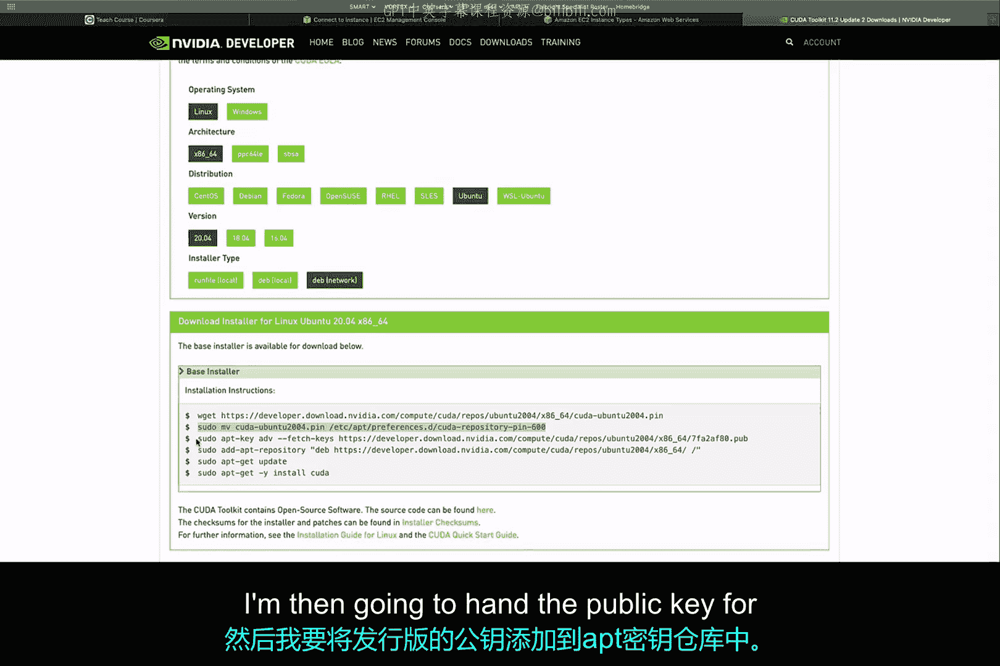

Into the app key。😔，Repository。😔，Next， I'm going to add the repository associated with that public key to the app command。

 so now that repository with the couda installation information is now available。😔。

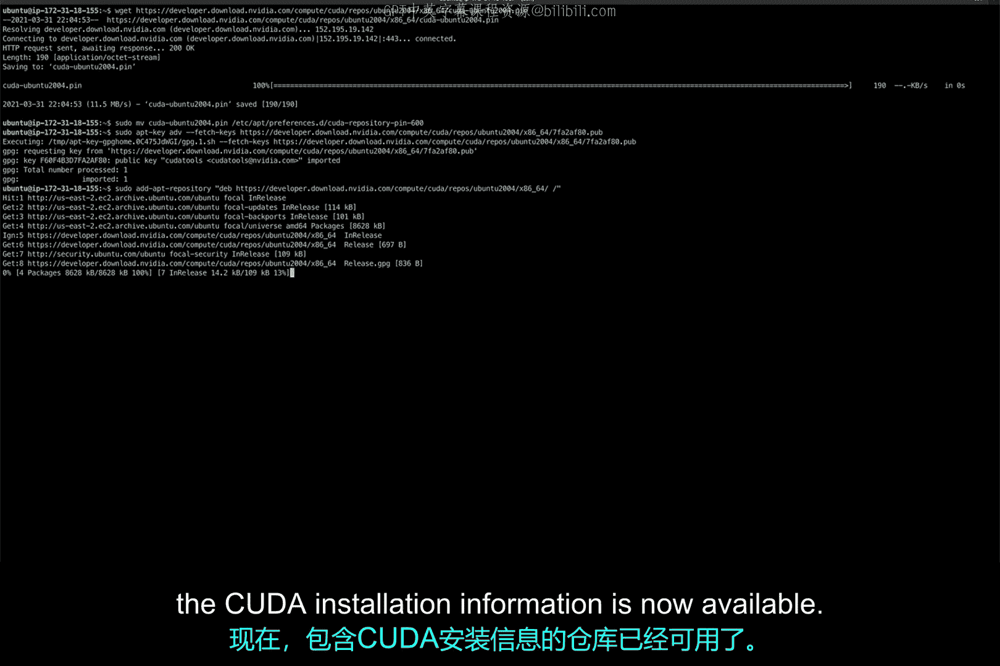

I'm then going to update the app repository with the latest information from the newly added a repository final step will be to tell the app command to install the Cuda library will also install a number of dependent packages such that the very end of this command you will be able to execute the required commands like NVCC and also you will have the C libraries may also be necessary to run the app install command trying to get the NviIDdia Kuda toolkit sometimes KUa does not come distributed with NVCC so just do this just in case and this always install the NVCC command So now let's view the test at CU Kuda file using the Vm editor in Linux。

😔。

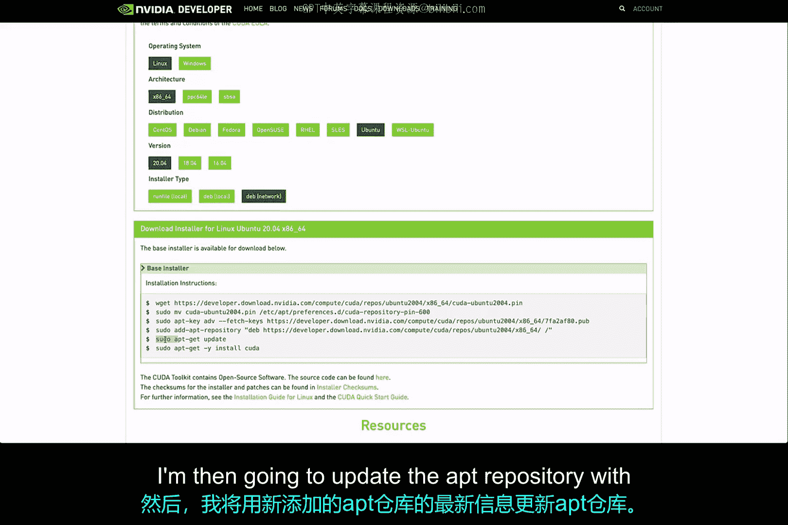

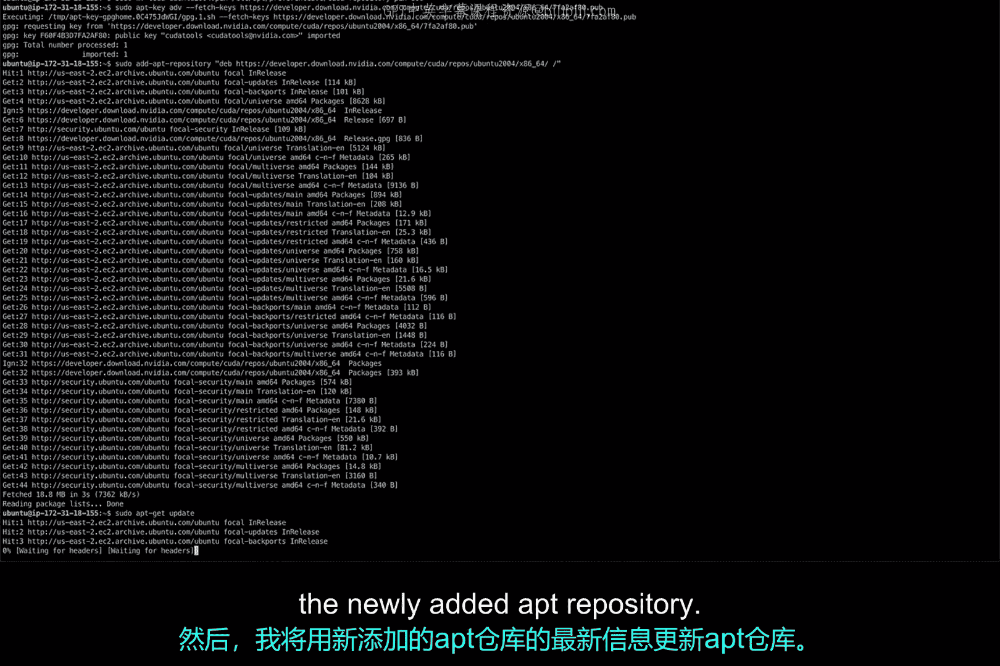

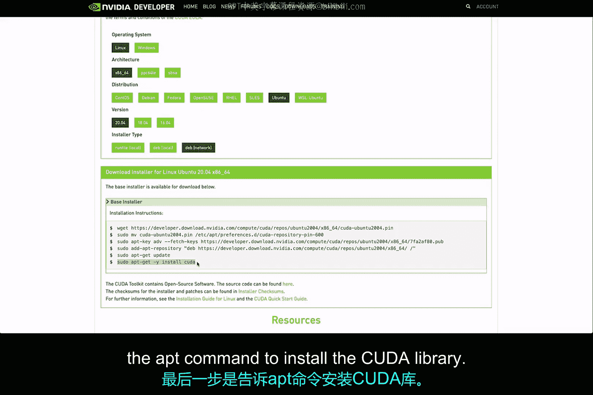

You will see that there is a global kernel at the very top that has a method with the global Dunder named。

SACax PY， which is a simple mathematical operation， there is a main。

 which is a rather large operation which does allocation and copying in both directions of memory while performing the operation。

 it then prints out the maximum error it sees in the calculations that have been run we are then going to compile the test do using the Nvcc command and output the test。

 EX executable。We will then run the Test E using the dot slash Linux command。😔，You'll see。😔。

Output of max error， which in this case is zero。

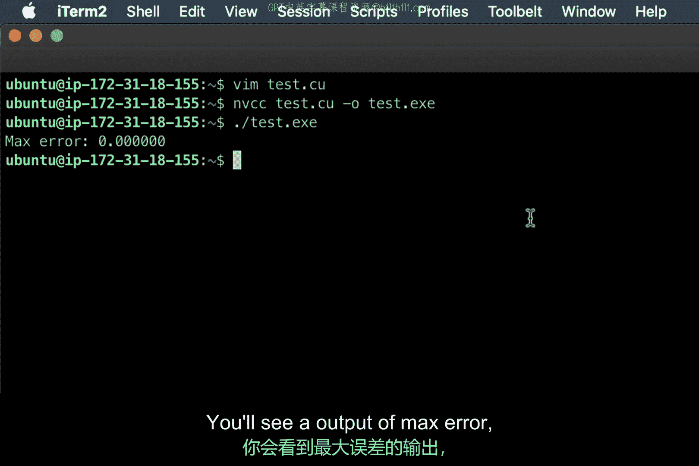