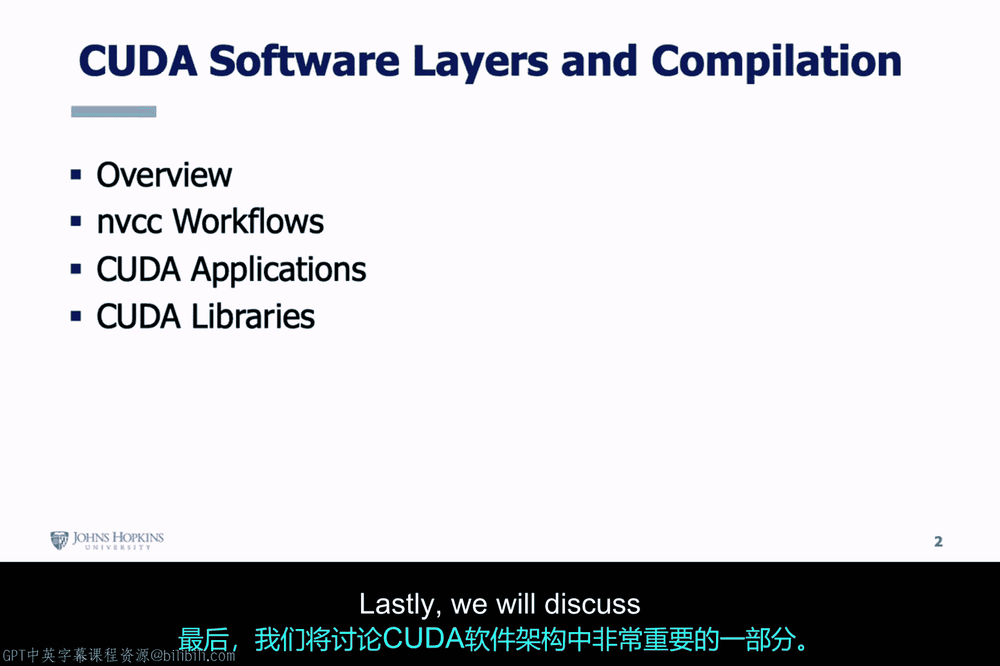
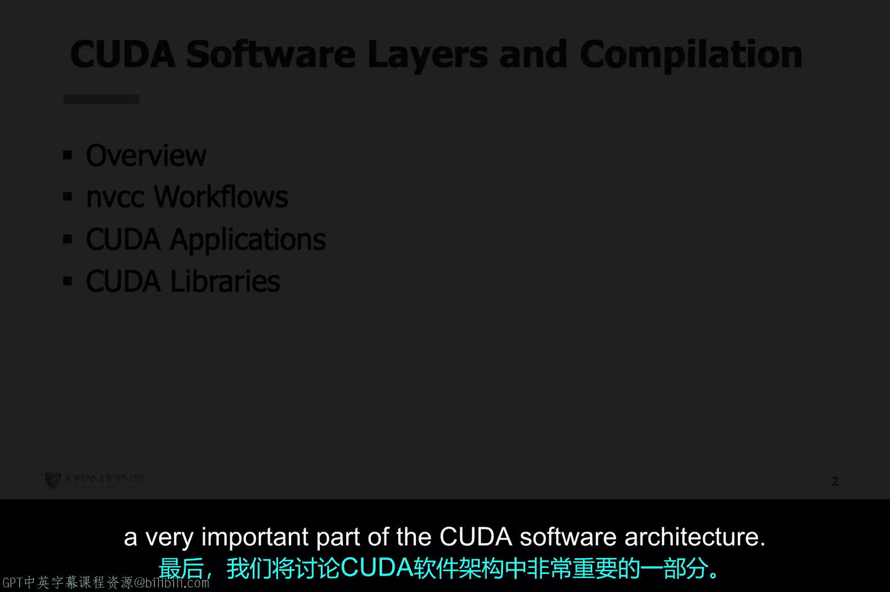
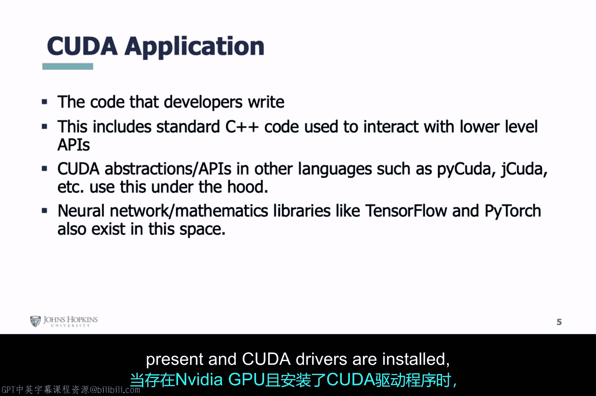
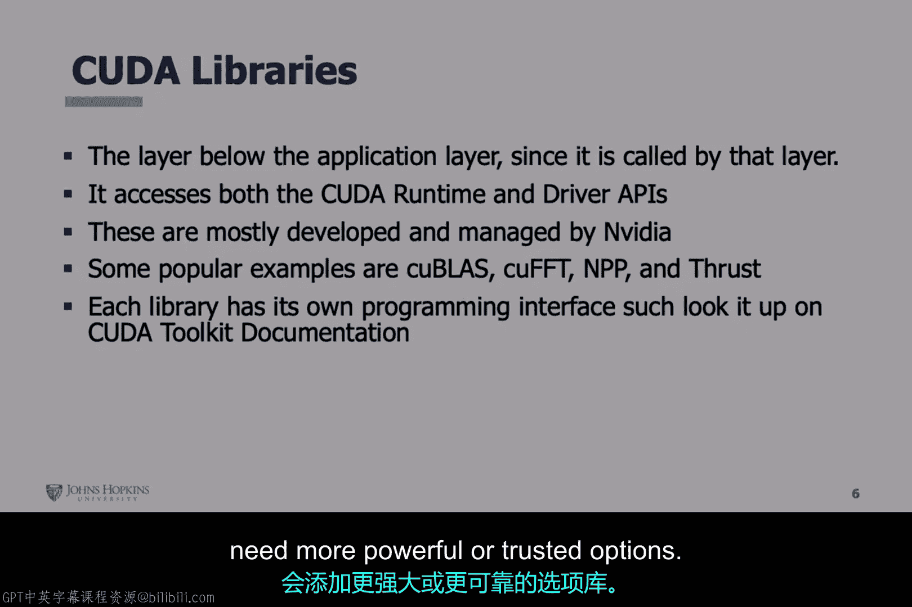

# 约翰霍普金斯大学《GPU编程（并发编程、并行编程、面向企业、CUDA高级库）｜GPU Programming》 p20 19_CUDA软件层级架构.zh_en -BV1a1421r7vw_p20-

In order to determine how you use the Cuda developer toolkit。

 you will need to understand it in more depth。 that is the goal of this video lecture。😔。

We will start by discussing the general communication between various software layers Next we will talk about the two main workflows for KUa code compilation via the NVCC command。

 the next topic at the top software layer， the application layer。😔，Lastly。

 we will discuss a very important part of the Kuda software architecture。

We will use the Kuda software Layers diagram to show how different parts of the development process interact。

😔，For this discussion， the CUDA application that you develop will communicate to either the runtime or driver APIs。

The decision of whether you like to have your code more directly communicate its desires to the underlying hardware will be very important。

That decision will define what your code looks like and how it would be compiled the intermediate files you。

 if you have chosen to use a higher level access pattern via the runtime API。

 then you can embed GPU code inside of host code to do this。

 you will need to compile both types of code via the NV CC command。 once the host。

Code is linked to the GPU PTX or CubBN files they can interoperate。

You will still need to use a host oriented compiler such as GCC or G++。

 which will output inexecutable， thankfully this workflow can be simplified via the NVCC command to have it output hostt base executables。

 which it does by default。This is the most common use of NviDdia for most users and what we will use in this course。

 If you are targeting the driver API， you will need to。

Compile the GPU and CPUU code separately and then have the host executable interact with the GPU code via the driver API。

 This is less commonly used since the process is more specific to hardware and compiler combinations。

 whereas the runtime workflow can generate more generally usable executables。

You are going to be developing the co application very soon。

 so let's look at what you need to consider when you are starting to write code。

Your application will be part host based and part GP targeted code。

 which can coexist in the same file or be separate。

Though any code files with Kuta code should have the dot C or dot C H code and header。Extensions。

You can definitely write code in other languages via language specific abstractions or APIs such as P Kuda or J Kuda。

They will use kudo within them， but you can write normal code that matches the language's development patterns。

To very popular libraries that create neural networks and other mathematical constructs are Tensorflow and Pytorch。

 When NviDdia GPSps are present and Kuta drivers are installed。

 these frameworks will use Kuta as well。

A common way to use KUa capabilities is to use the NviDdia KUaDevelop toolkit libraries。😔。

Some are designed to remove the need to write complex CUuda code or to make complex data structures and algorithms available within your Cuda code。

😔，They are almost all maintained by NviDdia。And new libraries are added as new use cases or domains need more powerful or trusted options。

