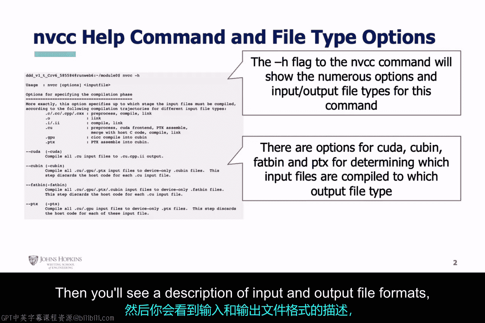
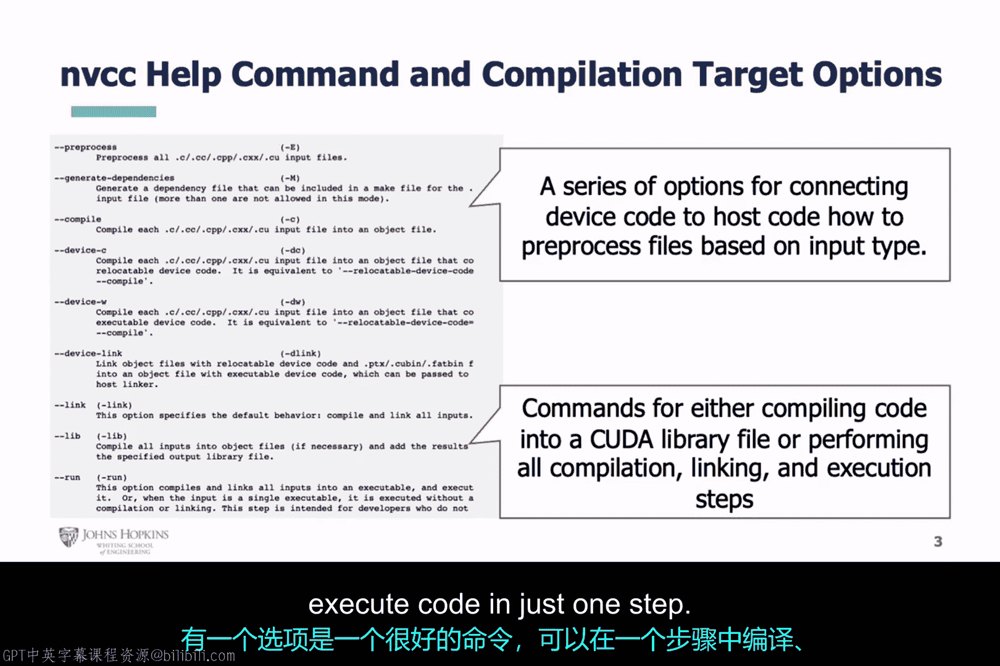
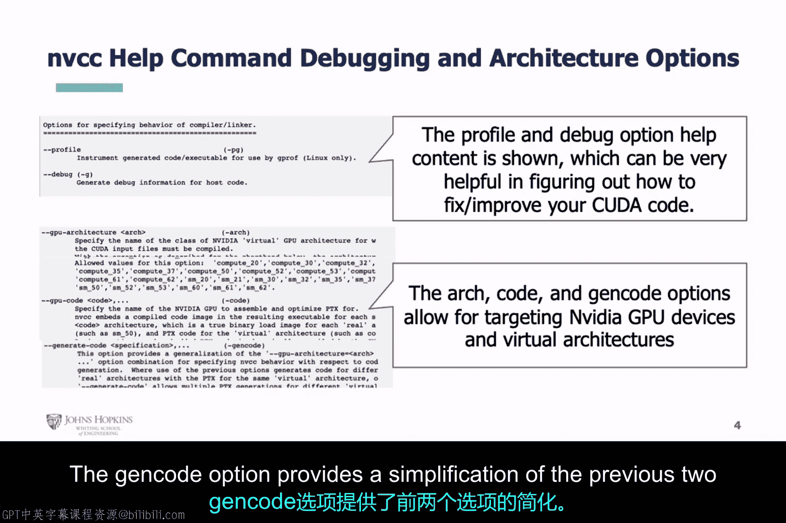
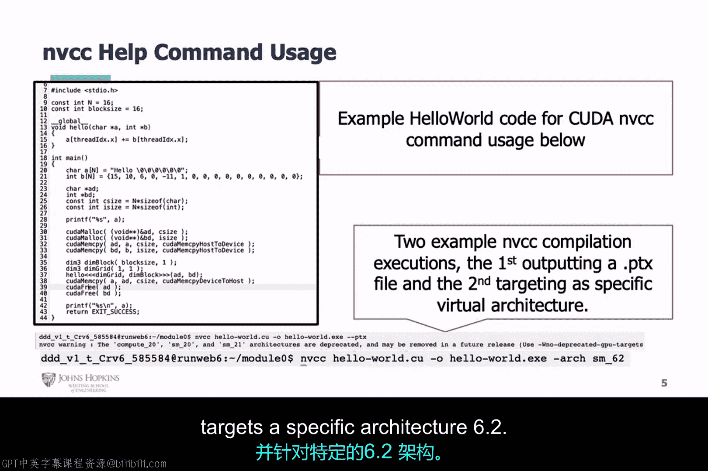

# 约翰霍普金斯大学《GPU编程（并发编程、并行编程、面向企业、CUDA高级库）｜GPU Programming》 p21 20_CUDA代码编译原理.zh_en -BV1a1421r7vw_p21-

Hello and welcome to the video lecture that will go over the compilation process in KUuta using the NVCC command in order to understand the NVCC compiler。

 we need to investigate the various available options for the command。😔。

One of the easiest ways to know various parts of this command is to use the dash H option to indicate that you would like to see its help content。

😔，The first thing that you will see is the usage pattern for the command。

Then you will see a description of input and output file formats filed by command options for handling them。

The next important area to investigate is how to handle linking the device and host code into one executable。

 make sure to pay attention to whether the linked and compiled code will create a relocatable。

 executable。😔，Another command option， LibB， allows you to compile all output。

Fileles into a library file， which can be very useful for large or shared projects。

Theron option is a good command to compile link and execute code in just one step。

The last two categories of options are those for debugging profiling and output architectures By default。

 output code does not allow for profiling of GPU code or debugging hostcode。

 The profile and debug options allow this type of additional content to be included with excurs。

If you would like to target specific hardware and software architectures， the arch。

Code and J code options will be required。Real architectures determine how the code is generated。

And how it will be compiled for specific hardware architectures。

 While virtual architectures are about the features associated with different compute versions。

The arch option allows you to determine which GPU hardware architecture your code will support。

The code option can be used to determine how embedded PTX code will be compiled for use of specific real and virtual architectures。

The Gen code option provides a simplification of the previous two options。

All right， let's bring this all together now。 So on the left side， you will see some example。

 Hello world code。That is intended for use with Kuta using the NVCC。Command。

There are two examples in VC compilation executions。1 that aims to have the P T X files generated。

 And youll also notice it doesn't do anything about architectures。

 So you see warnings about compiling for deprecated architectures。 the second command。

Outputs and dot EX specifically， and targets a specific architecture 6。2。

