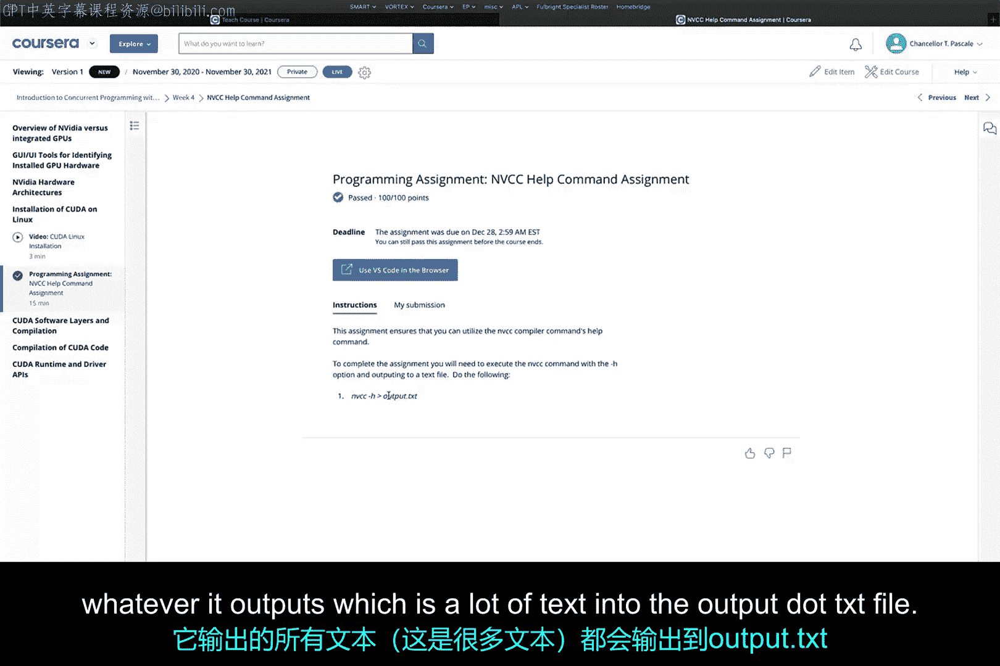
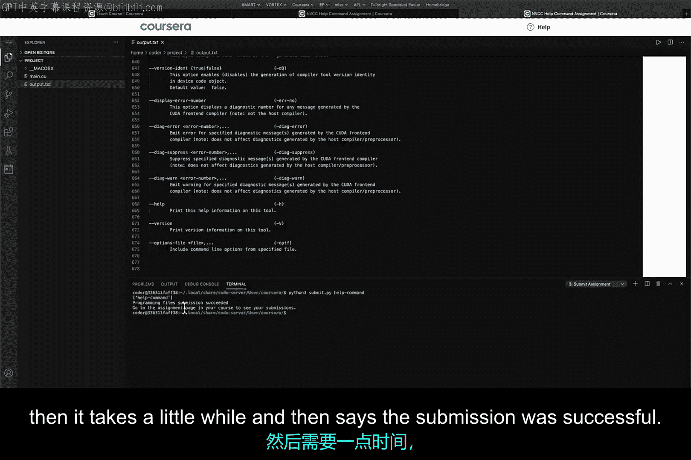
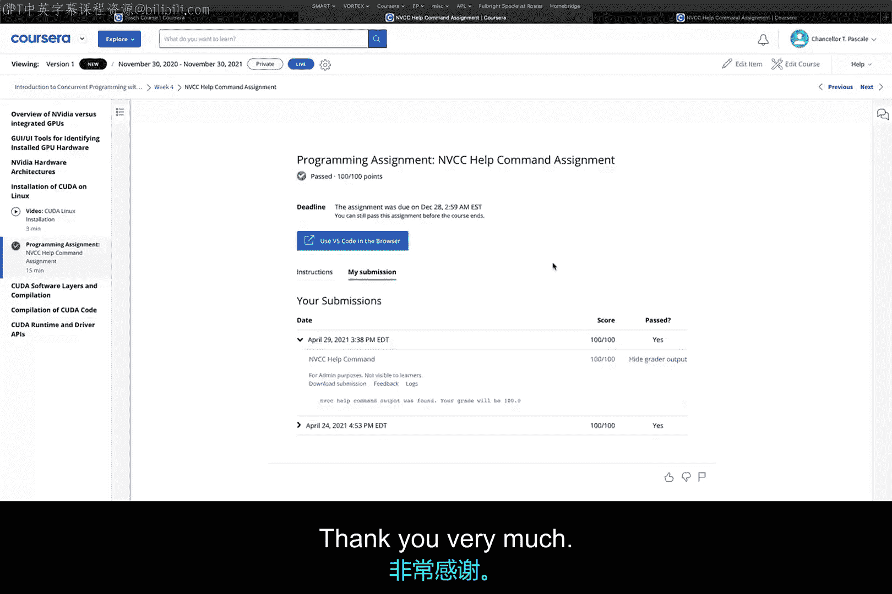

# 约翰霍普金斯大学《GPU编程（并发编程、并行编程、面向企业、CUDA高级库）｜GPU Programming》 p22 21_CUDA帮助实验与作业指导.zh_en -BV1a1421r7vw_p22-

So I'd like to quickly go over the content in the lab and assignment associated with the installation of KUuda on Linux。

 let's open up the assignment， so it's very simple assignment the lab is the same code so explore that as much as you'd like。

 but what you need to do is very simple you just need to run the NVCC command so the NviDdia cross compileilr with the help flag and output whatever it outputs which is a lot of text into the output TxT file so while everything gets set up in the VS code IDE in your browser。

I'd like to just give you an opportunity to look at the files now there's always that C file I want to give you the opportunity to explore with actual code and then the output TxT so this lab in this assignment。

Both require a certain level of usage of the terminal so let's open up a new terminal so by default it puts you in the project folder。

 which is what is shown over here and like I said this command that you have to execute is very simple it's just NVCC the help flag or option and then output that Tx Okay so now let's look at that file when you'll see is the help command content here and you know peruses as you wish it's no requirement for you to know all the ins and outs。

 but some of these things will be important like how do I create a PTX file or。

Ft bin or something like that。 so we'll go over those in more detail on the lesson and。

For the assignments associated。But those。Flags or options。

So you create this long file and then simply just click the submit assignment button and what it tells you is it's going to run this Python command。

😔，And then it takes a little while and then it says the submission is successful。

So now let's look at the submission note while this submission is being graded。

 it'll have this sort of amber color next to it and it'll tell you the time this is the actual greater output。

 which is says that。The feedback that I gave that the NVCC help command output was found in your grade of 100。

 as you see here。The lab is the same code。And the same command。

 except for you don't have to submit it。So feel free to explore in the lab。They'll probably get 10。

 I imagine， on this assignment， thank you very much。

