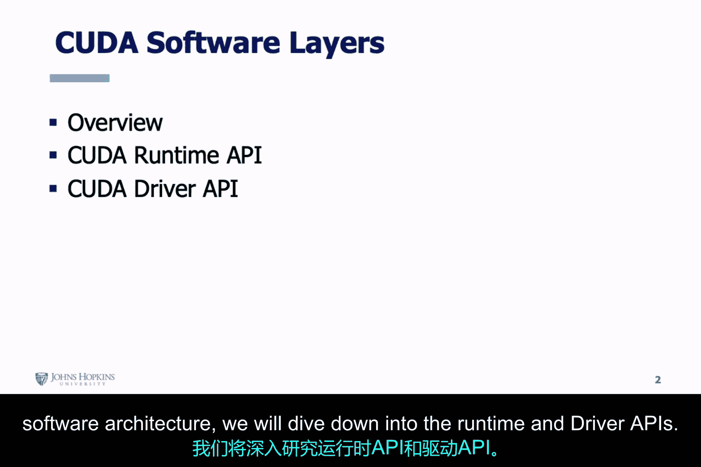
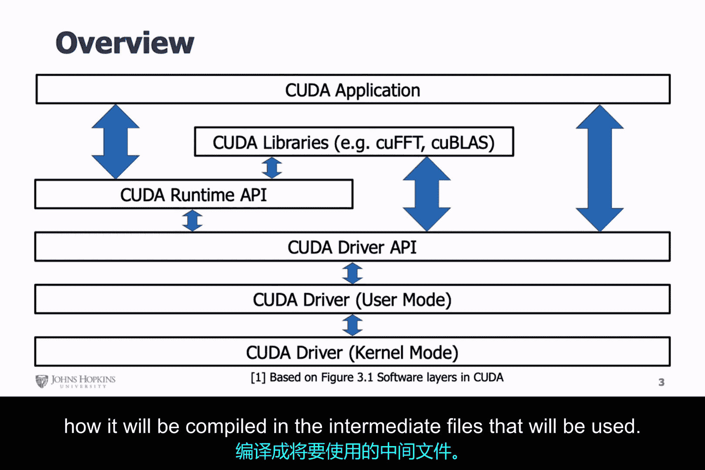
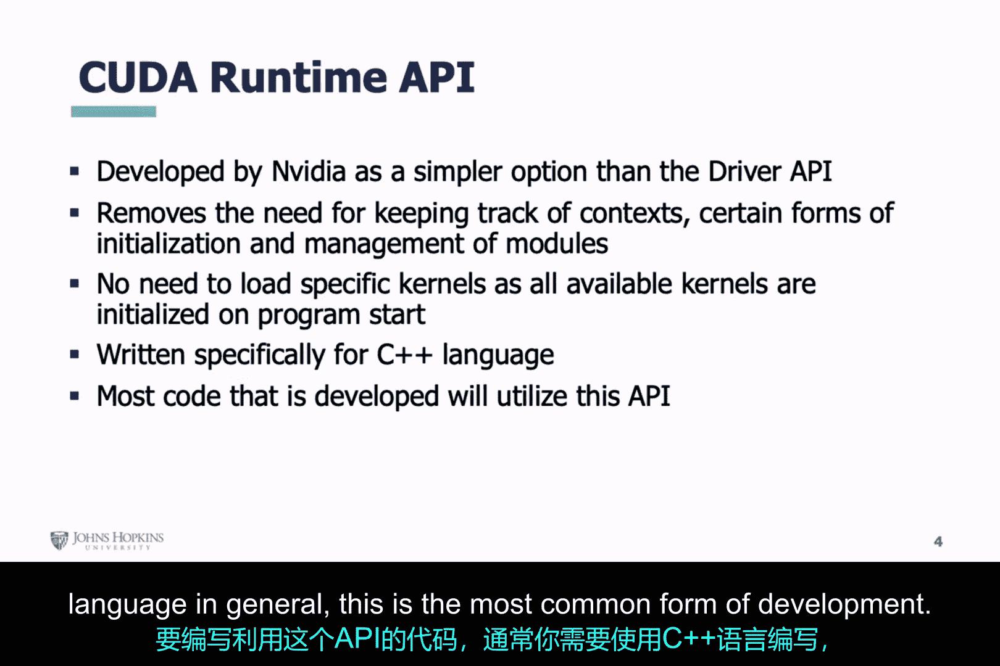
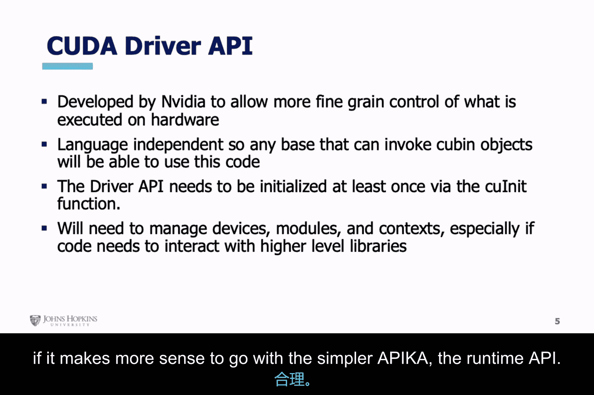

# 约翰霍普金斯大学《GPU编程（并发编程、并行编程、面向企业、CUDA高级库）｜GPU Programming》 p23 22_CUDA运行时与驱动API.zh_en -BV1a1421r7vw_p23-

We are going to focus this video lecture on the Kudo runtime and driver APIs。

Aside from revisiting the overview of the various layers of the Kuda software architecture。

We will dive down into the runtime and driver API。 Once again。

 we will use the Kudos softwareulfur La diagram to show how different parts of the development process interact。

For this discussion， the CUD application that you develop will communicate to the runtime or driver APIs。

The decision of whether you would like to have your code more directly communicate its desires to the underlying N hardware。

I very important vision will define what your code looks like and how it will it be compiled in the intermediate files that will be used。

The runtime API is an abstraction of the driver API， saving developers from T。

Like initialization of modules and managing context。

Another simplification is that in the runtime API， all kernels that were compiled into any As GPU code are available to hostcode。

 no need to selectively load modules and kernels into the current context。To write code。

 that utilizes this API， you will need to write in a C++ language。In general。

 this is the most common form of development。

If you would rather develop lower level code that allows you to exert more control over what the compiled code is。

And how it affects what happens in the GPU。Then the Kuda driverver API is your tool。

The most interesting feature is that even though it is lower level code。

It can be written in the assembly， but also any language that can link and execute do C U B I N objects can be used。

The API itself needs to be explicitly initialized in the host code。With the Q and it function。

The major complications in writing driver API code is that the major components such as devices。

 code modules， and the context in which the GPU code is executed must be managed by your code。

So consider if the X power is worth the other considerations needed to exercise that control。

 or if it makes more sense to go with a simpler API。AK， the runtime API。

