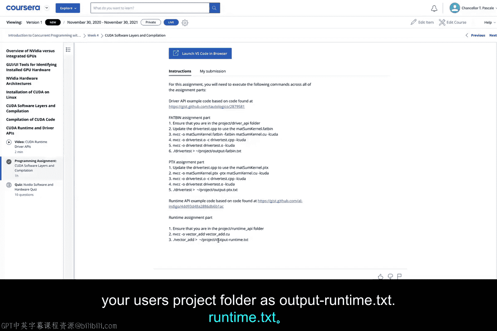
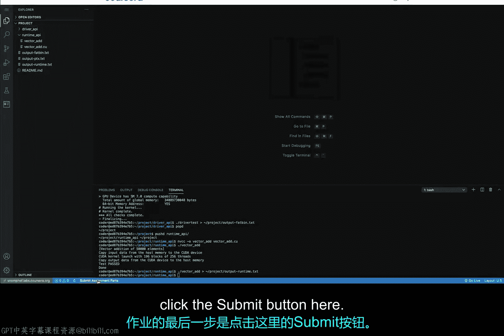
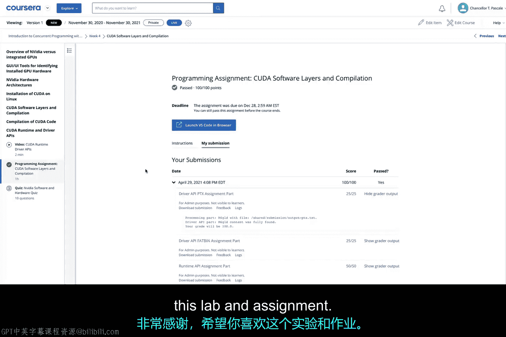

# 约翰霍普金斯大学《GPU编程（并发编程、并行编程、面向企业、CUDA高级库）｜GPU Programming》 p24 23_CUDA驱动与运行时API实验指导.zh_en -BV1a1421r7vw_p24-

So now I'd like to go over the Kuda Runtime and driver API's programming assignment。

 so let's open it up， the instructions here are pretty verbose it says the steps needed to take to get the fat bin assignment part to work the PTX assignment which are both part of the driver API and then the runtime API which is much simpler so the F bin assignment part basically you have to make sure you're in the driver API folder。

And then you're going to have to make some changes to the CP file。And then you'll compile。😔。

The dot CU file into the FAP in file， make sure to link in the KUuda。

 then you're going to generate this drivertest。0 by compiling the C code or C++ code。😔。

In driver test at CPP。That references the f bit， so that those that just like with the PTx。

 you need to know where。The F bit is， so keep everything in one folder， at least at this time。

 especially when you're writing drive API code。Once you have this output object。You can compile。😔。

That driver test。Into the executable driver test to execute。

 you just do dot slash and then driver test。You're going to execute the driver test。Command。

An output。Output。Standard IO to the your project folder as output。 fatbin。txc。

 the process is almost exactly the same with PTx except for you have the dash PTx。

Flag and also the binary files will be in that PTX form。

 which again you're going to have to change this driver to API to point to this mat sum kernel PTX。

 I'll quickly show you where to do that。And when you've done that。

 the last thing to work on is the run time assignment and that's a lot easier because the code's all there。

 you basically just got to make sure you're in project。Folder in your root。

And then go to runtime API under that， then execute MVCC O。Vectctor add。

 which creates the vector a executable。And。Point in at the vector a that C。Cuda file。

That creates the executable， which you'll execute in the next line。And output that。

Content to your users's project folder。As output dash runtime。 Txt， all right now。

That the extensions have been loaded and in a second you'll see that submitit assignment parts button show up near the very bottom。

 we can start talking about what exists where， so for the driver API it's all under the driver API。😔。

Folder。And note that I said that there will be a mat sum kernel kudaophil that you。

Basically you need to point to from yourcppP file， this is how the driver API works。

So let's open up the driver test that CPP file。Do you see right here there are two lines。

 one comment to that and one。Which will be executed。The one that's executable right now looks for。

The module in mat sum kernel up PTX， so it looks here。If you switch out what was commented out。

Like this。Now it will point to the fat bend。Now note， this is not about the。Any code。

 this is compiled Kuda。😔，Code， you don't want to look at this。Binary in nature。And then basically。

 you'll go through this when you can do this in lab or in your assignment。

 you can look through and see。The different steps are taken to create all the parts of a driver API。

Project。Okay， and then it executes them。So like I said。

 when you're doing the the output do dash F bin part， you're going to go into the driver API。

 you're going to compile。This into a fat bin， then you're going to compile that cP into this driver test that out。

 and then you're going to use MVC one more time to create the executable。

A lot of these files are binary， the driver test， the driver test at zero， I'm sorry that O。

The F minimum PTX file， don't waste your time opening them。U。

What you can then do is you can execute the command in the terminal。

 so let's open up the terminal and let's go down into the driver API。

And then what you should be able to do is that slash。I test。And we're going to see， you know。

 this isn't part of the assignment sorry， but we can see what it's doing。

 So it goes out gets some information and runs a kernel。 Now in the example of the。

Assignment you're going to do。<|OTHER|>You're going to output where you have into output and then type in。

 and then it'll output there。Now note， I've already done this for all three of the assignments。

Andvoa， it's there。You'll do the same thing for PTx from this folder。Then what you want to do is。

You're going to go into the runtime API， you' going to close out the driver API and then start working on the runtime API so you can whether you change directory pop D and then push back down into the runtime API。

The runtime API is similar， you pretty much just run。

And you don't have to do the dash O it just makes your life easier because if you don't do the dash O by default。

 these cross compilers make everything a out， which isn't you know a good practice for an individual project so you're going to name this。

😔，Fctor add， and then the input is。Yeah。Ex add see you。

<|OTHER|>So I'm going to take a little while to compile and then you can execute。Victor at。

And it's con while it's doing vector edition for 5000 elements。

 you see that the test passed and it's done。 The last thing for the assignment is to click the submit button here and it goes and submits the three part。

 Allright， so now we see that the last submission。😔。

Completed， so it doesn't have the ambra anymore。 we see the score and it was passed。

 Now let's you can look at individual greater outputs。

<|OTHER|>And says it was processed your grade and note that it'll say your grade for a part。

 and then they're weighted differently。So just keep that in mind for these assignments you need to get 75% correct。

<|OTHER|>Thank you very much and hopefully you enjoyed this lab and assignment it。

