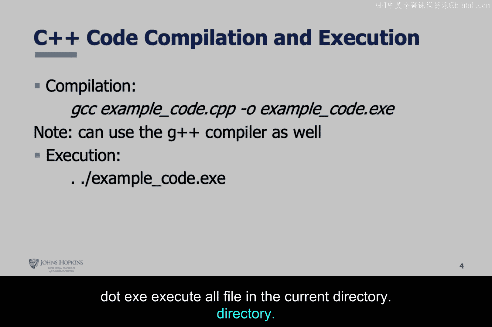
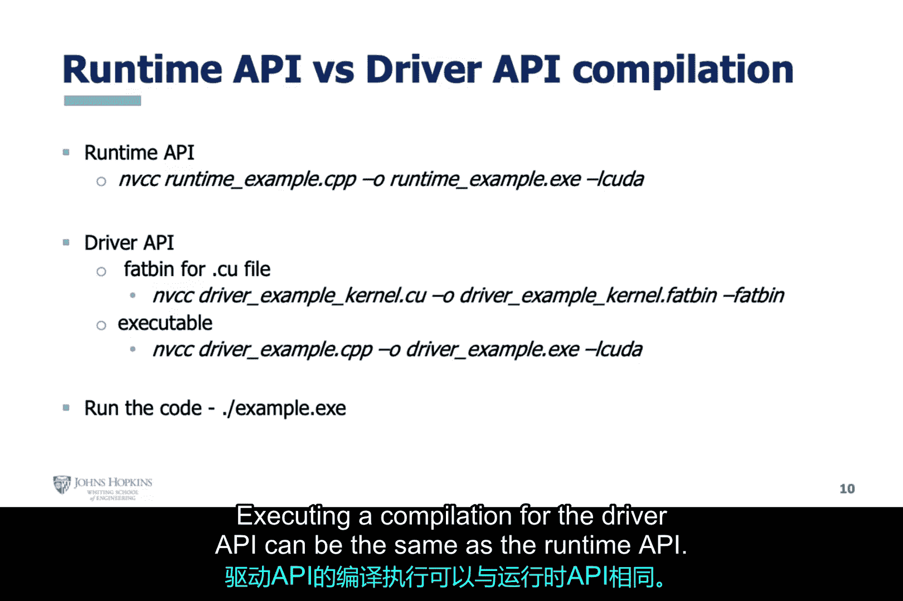
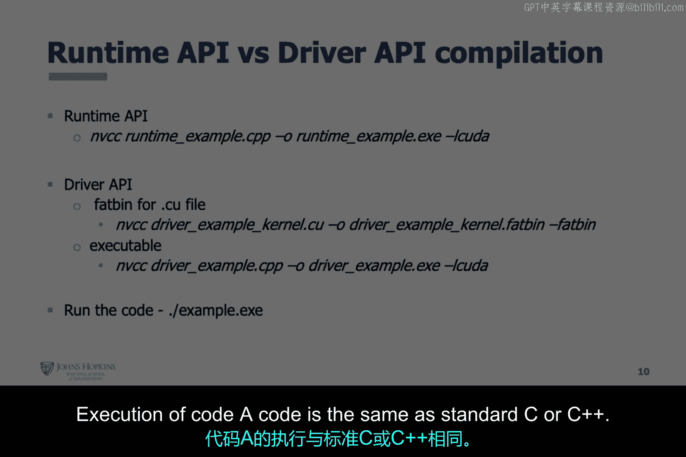

# 约翰霍普金斯大学《GPU编程（并发编程、并行编程、面向企业、CUDA高级库）｜GPU Programming》 p25 24_目标环境检测代码语法视频.zh_en -BV1a1421r7vw_p25-

Hello and welcome to the final module of the Introuction to concurrent programming with GPU's course。

This specific video lecture is going to focus on the practical aspects of taking coa code， compiling。

 and then executing it。This video lecture will have three main parts。 First。

 we will discuss the C+OS+ example， its compilation and execution。

Then we will explore the same cycle with the Cuda runtime API， and then with the Cuda driverver API。

Let's start with the main function of the C plus plus example code。

 The first few lines of code initialize the X and Y arrays， specifically with 1。0 and 2。

0 respectively。Then the add function is executed on the 1 million values in those arrays。

 followed by a test of what the max difference between the expected values of the updated Y array array and what is found。

 which both should be filled with3s。 So the output should be 0。 Finally。

 the x and Y arrays had their associated memory Dated in exits with the code of 0。😔。

The add function is a simple wrapper around the four loop that adds the first n values of the x and Y input pointers and places the values of each iteration back into the Y pointer。

Remember that the add function is running all and iterations of the loop in a single thread。

So is a very sequential set of operations。 Knowing the code， as you may have practice with。

 is just passing the input file to the cross compiler。In the above example， GCC。

Though G++ could just as easily be used in this case。

 and then naming the output object as example underscore code do EX。Execution is even simpler。

By using the Linux dot operator on the example code do EX。Excutable file in the current directory。

 This roundtime API kernel looks very similar to the normal C C plus plus sequential code with the exception of the global Dunder keyword。

We will go over this keyword later in this module。 So let's just say that in this case。

 it indicates to the compiler that the function should be compiled for use on the GPO。

 You execute the runtime API kernel。 You will need a main function like any other C or C++ code。😔。

Like with any C++ or C program， you will need to allocate memory in this case。

 in the form of a pointer to the six floating pointers。

Two pairs of three arrays for host and device memory。

Your next step will be to initialize the input arrays with values and then copy the host memory to the device or GPU memory。

 You execute the kernel。 Note that you are doing the worst case of it。😔。

Since you are allocating one block with one thread at a time。Generally。

 it would make more sense to pick a number of threads per block。 That was at least。

32 and always a multiple of 32 due to some constraints。With threads that we'll discuss later。

 if you are trying to solve a three dimensional problem， such as mapping or video。

 you might determine the number。Of blocks per grid to map to the problem face。Finally。

 you copy the memory from device into the associated host pointer and free up the memory。😔。

I do not show all the operations for all the memory。😔。

But a quick overview of the various operations just to give you an idea of what's going on。

Not much difference between this code and the runtime API example code。

You have access to the same information about threads and blocks。 in this case。

 we expressly state that this code is developed for C。

This is where things get a little bit more complicated for the driver API code。

 You need to initialize a number of things for Kuda and the driver API code to run properly。

 which is wrapped in a single function shown in the next slide。Like with runtime API code。

 hosts and device memory needs to be allocated。But note that you will need to specify all device memory as co device pointer type。

Launching driver API code may look a lot more like normal code。

No triple less than or grer than symbols。 just passing the function pointer。

 various block and grid sizes， memory pointers， and the size of the input memory。

 as one argument array after you are done with the memory， hosting GPU， always dealcate it。

 initializing the coa related properties， gives a lot of control that you do not have in the runtime API。

 but it is more complex。 You need to determine and set the device for couta。

 which gives a lot more information about the couta major minor version name of the vice， et cetera。

😔，Once you have the device， you will need to create the context for code to run on the device。

Then there is an intricate process of loading a module on the path to the fatman。

And getting a function for the module based on its name。And then finally。

 assigning the reference to the co function variable。

There you connect the co function pointer that was passed into the function。To the found function。😔。

Yes， that is very complicated。 Let me repeat that。You connect the co function pointer that was passed into this initialization function。

Into the found function， such that they are linked together。😔。

The runtime API's compilation can be very complex if you like it to be。

 but generally it is the same as C or C plus plus， except that you need to use Nvidiaious NVCC。

 cross compiler and link it to the couda drivers。 The driver API compilation has two steps。

 Gene of the Fbin binary for the couda kernel and then compilation of the executable。

Note that the init couda function needs to know where the fatpin is located。

<|OTHER|>So this should work， but only if the fatpin and the excutable are in the same directory and the path in the code is the correct directory。

There can be other strategies， but this is the simplest。

The executable compilation for the driver API can be the same as the runtime API execution of KUa code is the same as standard C or C++。

