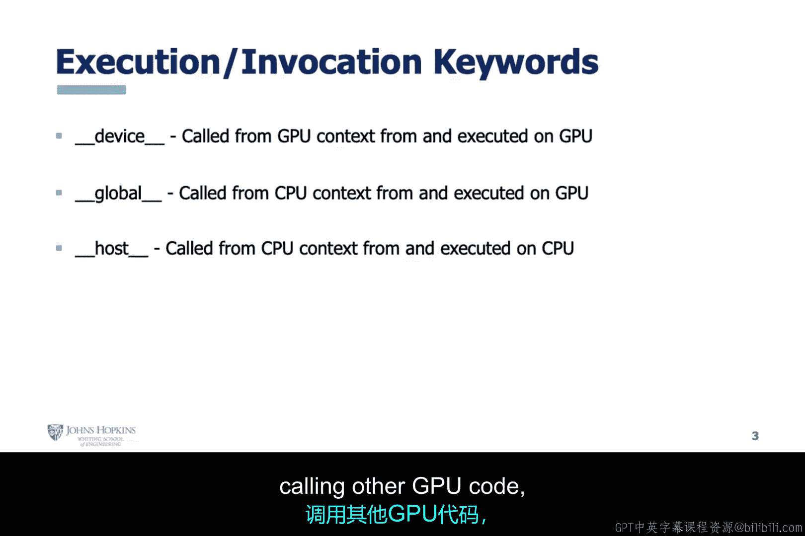
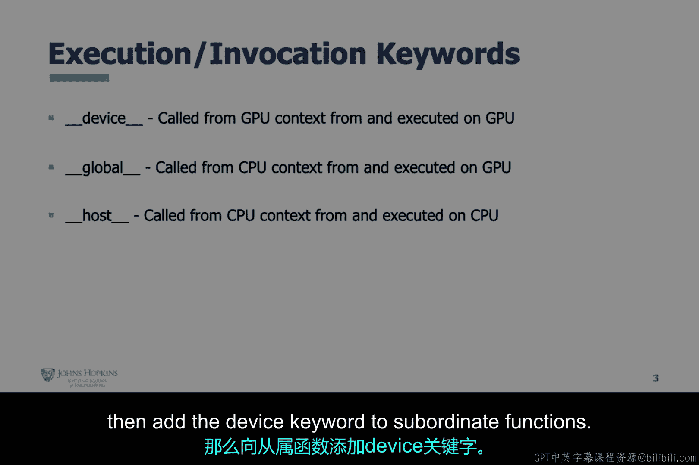
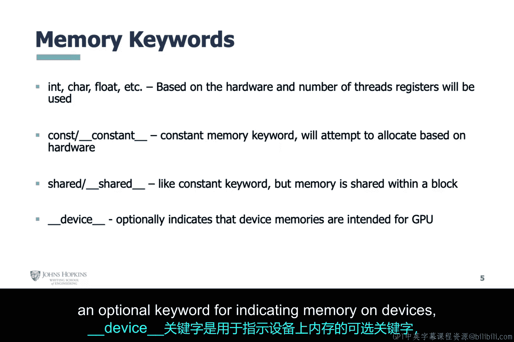

# 约翰霍普金斯大学《GPU编程（并发编程、并行编程、面向企业、CUDA高级库）｜GPU Programming》 p26 25_CUDA关键字解析视频.zh_en -BV1a1421r7vw_p26-

This video will focus on the coed keywords， which are required and also very powerful。😔。

There are three classes of couda keywords。 The first is a collection of keywords related to how and where Kuda code is invoked and executed。

The next are those keywords that describe the division of computationut on KUa hardware。And finally。

 the last set is a set of keywords。 There are those concerning host and device memory。

 If you want to make sure your code is called from the correct location and executed where you want it。

 You will have to pay attention to these keywords。 They show the flexibility of cota code。

 that you can use it somewhat interchangeably， in different contexts。

 These keywords are part of the function signature。Not how you call the function。

 If you want your codex suit on the CPU， then you should use the host keyword。

If you want codex heat on the GPU and be called from the CPU， then use the global keyword。Lastly。

 if you want to have hierarchical code in the GPU， GPU code， calling other GPU code。

Then add the device keyword to subordinate functions。

At the top of the slide， you can see the kernel with its three less than an then greater than symbols。

Showing that you use that to determine how many threads per block blocks per grid size of shared memory。

 and if you want to associate a couda stream to the execution of a kernel。

 to you'll understand how that impacts the execution of code on the GPU if you have N pieces of data and specify N threads per block or n divided by M threads per block in M blocks。

With inbox per grid。Then each invocation of the kernel will occur in a single thread on a GPU。

This is not always the optimal execution pattern。 Sa if you need to share data。

 memory across threads。Blocks are collections of threads。

 that chair memory and really should have multiple 32 threads。As their thread sizes。

Gds are three dimensional layouts of threads， which can be helpful if your data is three dimensional by nature。

 like video or maps。That's good of our final collection of keywords， those associated with memory。

Primitives using the classic C or C plus plus standard primitive data type keywords will attempt to use register memory as much as possible。

Using either the constant or constantunder keywords will attempt to use constant memory as much as possible。

😔，There is a similar pattern， with shared memory。Note that it is not guaranteed the shared memory will all be block allocated。

 shared memory can happen that the compiler has to push the data into global memory。

The device T a keyword is an optional keyword for indicating memory will be on devices and not oncp used。

