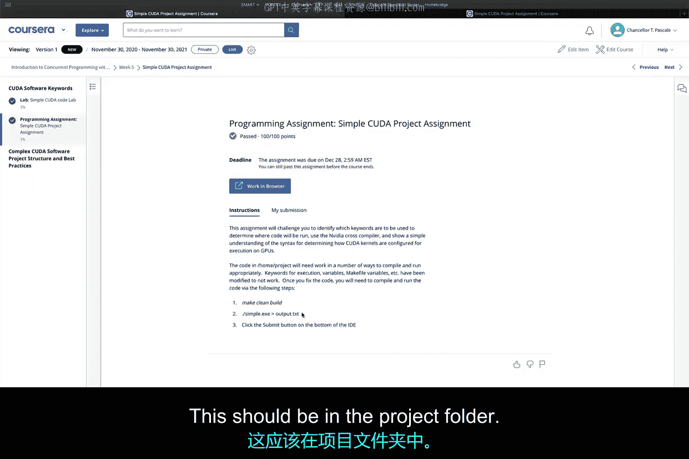
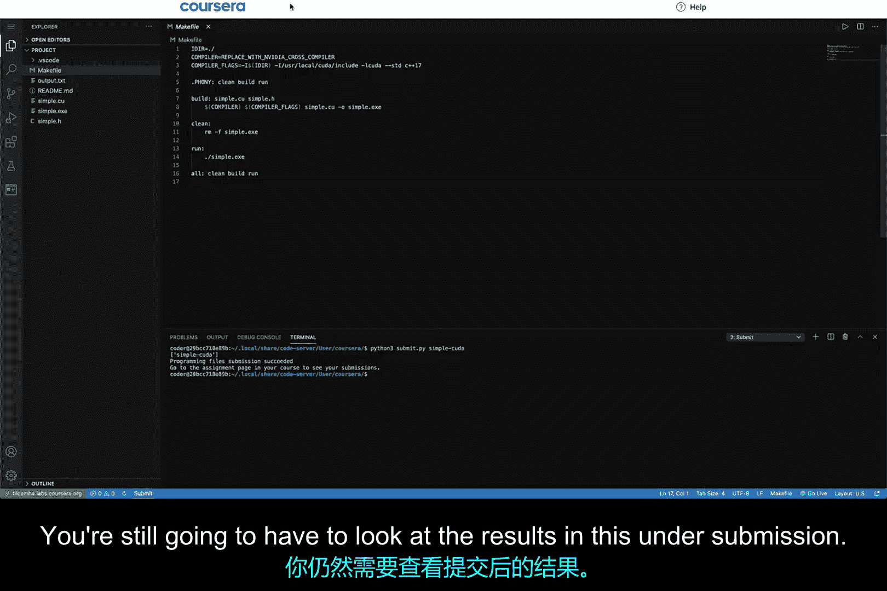
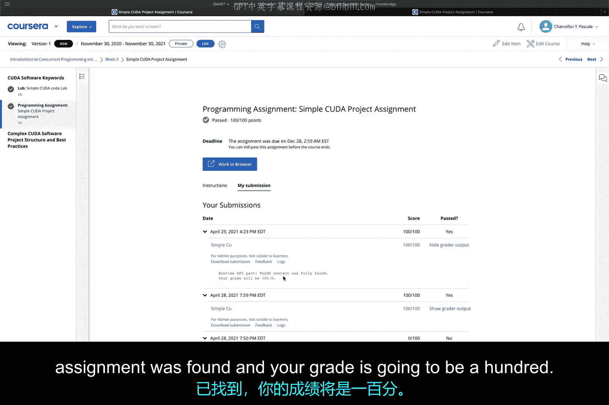

# 约翰霍普金斯大学《GPU编程（并发编程、并行编程、面向企业、CUDA高级库）｜GPU Programming》 p27 26_简单CUDA实验与作业指导.zh_en -BV1a1421r7vw_p27-

I would quickly like to go over the structure and the goals associated with the KUa softwareftware keywords programming assignment。

 note that there is a lab。😔，Associated with that assignment， which has all of the same code。

 so let's look at the programming assignment。Note that there are three steps to you completing this assignment。

 you're going to have to make a bunch of changes before them。

 but once you think you have everything running， you're going to have to execute make clean build。

 and that needs to complete successfully， then you're going to execute the simple dot EX。

 which is built by the previous step。And output it into output do TXt。

 This should be in the project folder， then you'll click the submit button， so let's look at that。

 All right， so let's explore what is in the VS code environment。😔。

good first thing to do is always to open up the terminal that's probably one of our most powerful tools here in the project folder。

 aside from some VS code。Metaadata， there's the make file note that many of these files are slightly obfuscated or broken on purpose to challenge you to complete them。

 So an example would be the make file。While， much of it。Is written correctly。

 the compiler that you will use。Has sort of a placeholder here。

 You're going to have to know which cross compiler， which I've mentioned multiple times。

 is used to compile。InVDdia code I've already run this through and completed the assignment so there's a dot Txc file here that would not normally be then there are two files that are important there's a simple do C which has all the actual code and for the most part the major things you'll have to modify are associated with these keywords。

 but another place that you'll need to work。Is headaway execute the kernel。

 This function is written pretty much as you need it， except for it has these X。

 Y and z variables here。 and then the sort of text here is this number of blocks in a grid。

And then replace with the number of threads in a block。That's pretty close to that same line code。

 you'll just have to copy in the appropriate。Variable names and the same thing here somewhere you'll need to find。

Pointers。To float。Primitives and pass them in appropriate search that the addition of vectors or multiplication in this case can be done appropriately。

 So when you're done that。Thankfully， have this make file here when you fix this。

Yeah just be able to run。Take。Clean and clean just get through of any executables that were previously created once that's done。

 you're able to execute the executable that's done via。Something like this。

Then you're going to output to。Hit enter here。And then once that's done。

 you click Sub and says that the submission was done successfully。

 that does not mean you got 100% on this assignment， you're still going to have to look。

At the results in this under submission。

All right， we've got our results back， says I have a square of 100， and it says that I passed。

In since this is a very simple assignment， there's only one part and you have to get 100% on it。

Now let's look at the output from the greater， it's very simple， it says。That。I run an API part。

 which is the only part in this this time was found。And your grade is going to be 100。

