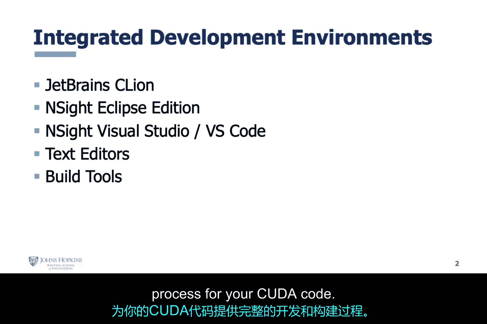
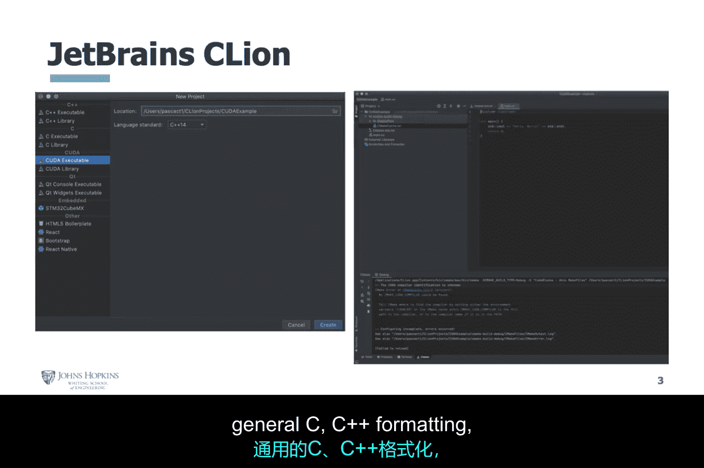
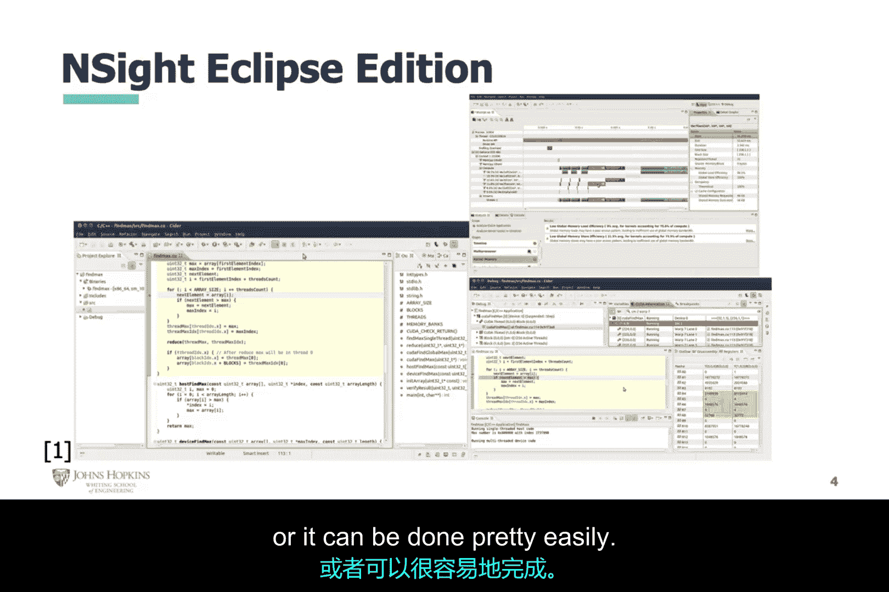
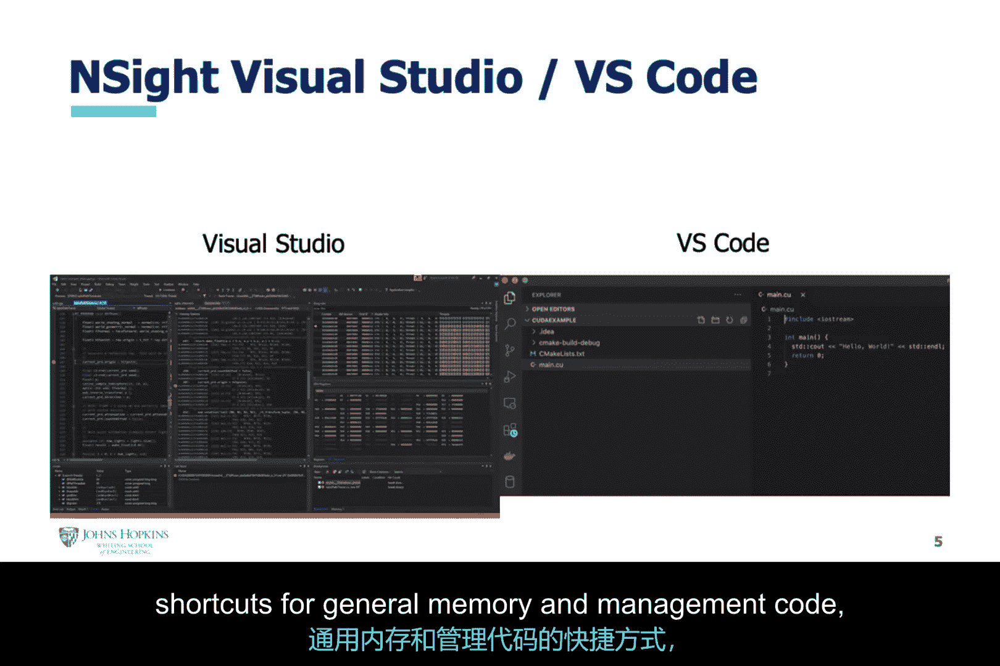
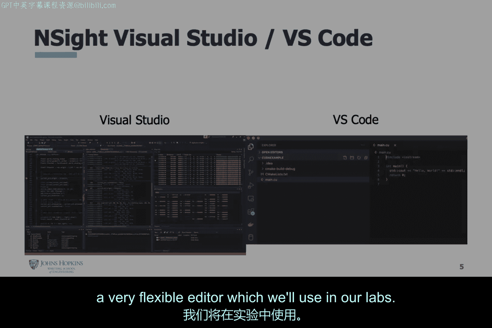
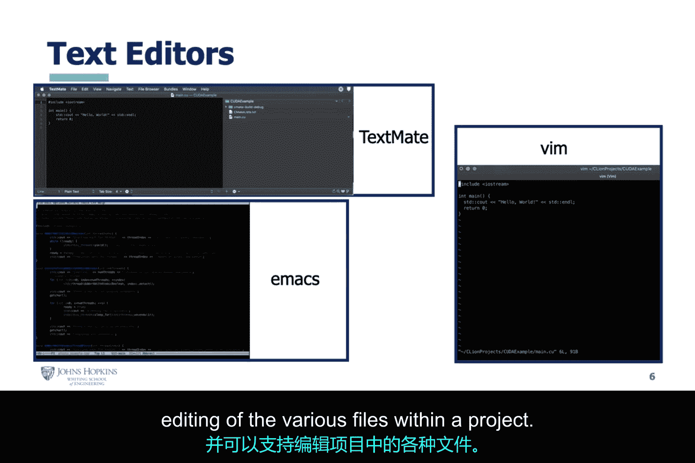
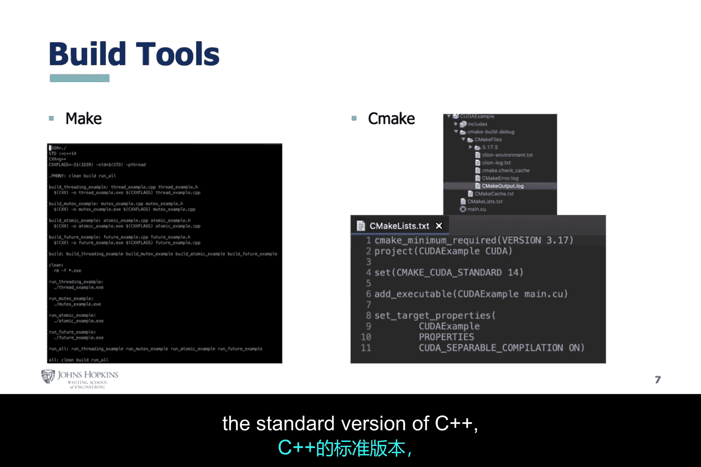
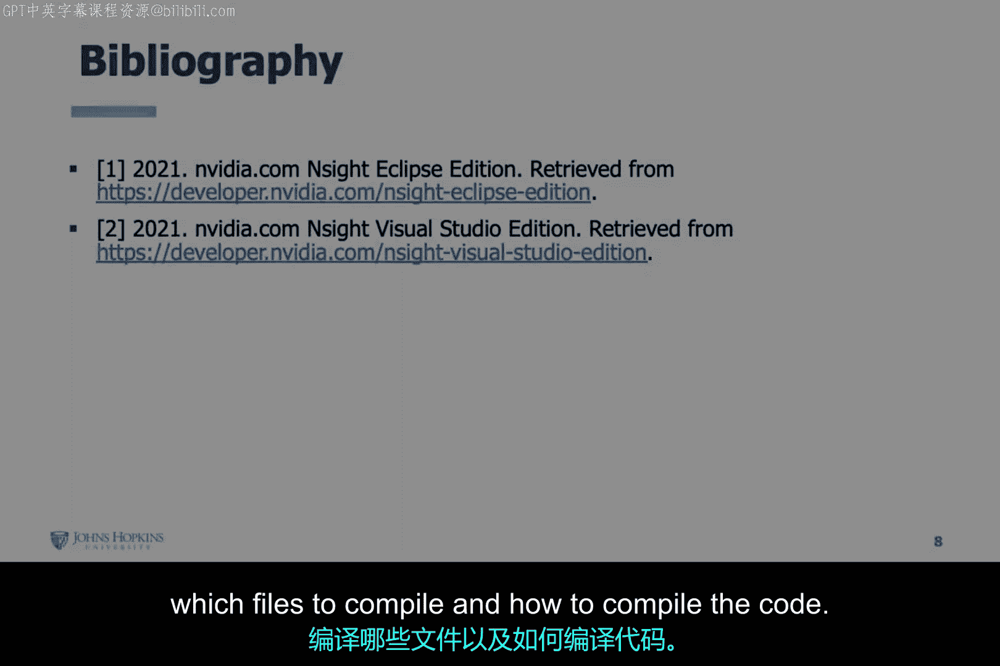

# 约翰霍普金斯大学《GPU编程（并发编程、并行编程、面向企业、CUDA高级库）｜GPU Programming》 p28 27_CUDA IDE编程实践视频.zh_en -BV1a1421r7vw_p28-

As a longtime developer， the city lecture on ID programming for Kuta is of particular interest to me。

 and I hope to you as well。😔，The first three IdeE options are the most advanced and popular environments for coa development。

While they have less spelllls and whistles， text editors have a very important role in co development。

And though they are not editors of code， build tools in conjunction with IDs。

 and editors make a complete development and build process for your couda code。😔。

Bet brains， sweet， hidey ease include sealine。Which doesn't include any specific capabilities for debugging and profiling Kuta GPU code。

 but is a general C C+ plus IDE。<|OTHER|>It does include integration with the CMake build tool and includes a new KUa project wizard for creating the basic structure for a KUa program。

With CMake build files included。Along with project structure。

 the IDE also provides capabilities such as code completion， General C， C++ formatting。

 and other aids to the development process clips， while originally a Java IDE has numerous variant。

 including one that allows for profiling and debugged and Kr projects。

With the inside plugins。A major advantage of this editor is the ability to take。

One IDe and apply it to different projects in different languages and have the view of those projects change automatically。

 as you can see， there are numerous tools and views specific not just to a project。

 but your goals within a project。😔，<|OTHER|>Jal will need to be installed on the machine to run the ID but for the most part。

 this is pretty common these days， or it can be done pretty easily。

Microsoft provides two options。 The first Vi studio is a fully featured IE。

It includes numerous integration points for acced development。

 including profiling and debugging via the insight plugins。

 it is probably the best option for development on Windows based machines as it is most fully featured。

V S code is a supercharged tech editor built for general use。

 with many plugins available via the marketplace place that allow for syntax assistance。

 shortcuts for general。Memory and management code， and just in general， is a very flexible editor。

 which well use in our labs。 X editors don't often provide all of the features of Is。

But they can be augmented with plugins。Bas on your preference Vm and or Emax are two very good Linux。

 command line tools for editing your code。They can make tasks like code replacement。

 syntax highlighting， and project structure navigation easier。Textmate and similar Gui text editors。

Are available for most Os and can have support。For editing of the various files within a project。

Buildiled tools， take the code for a project and their own configuration files and compile the code according to targets。

Make use is a single make file that includes bash style environmentviron variable declarationation。😔。

Rejectex based identification of code， object files。

And bash scripting to execute simple to complex hierarchical builds。😔。

CMake is a more modern and programmatic build tool option。😔，In the example。

 CMake is told which version of CMake to use the standard version of C++， which files to compile。

 and how to compile the code。😔。

