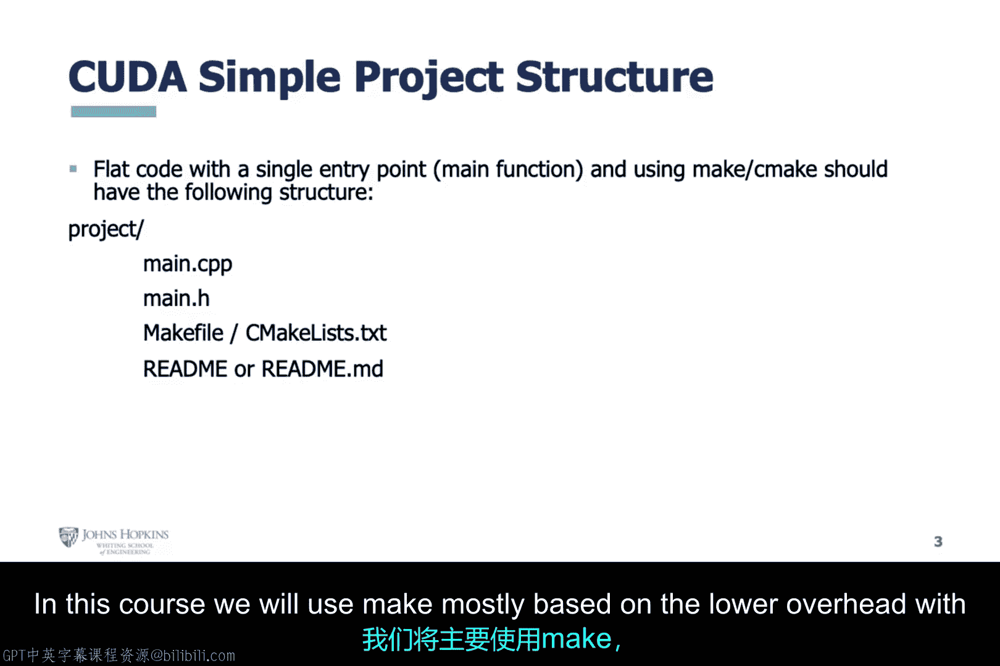
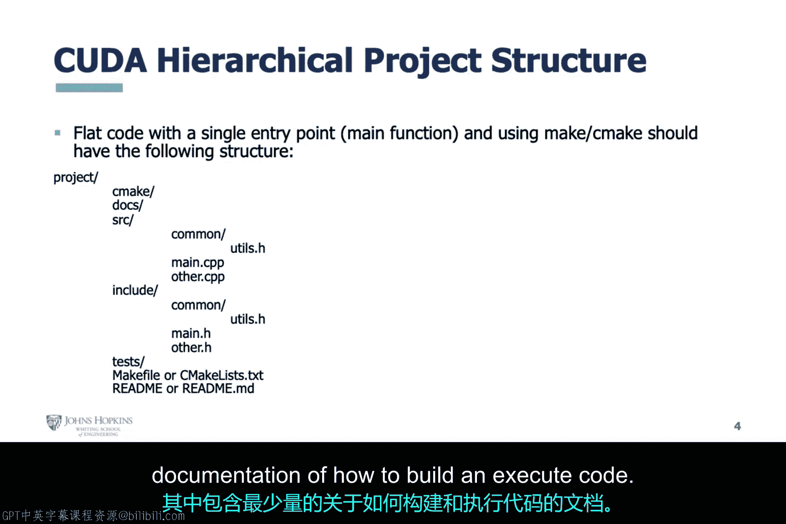
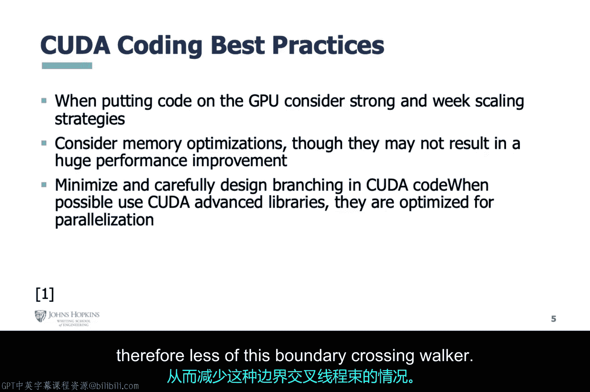
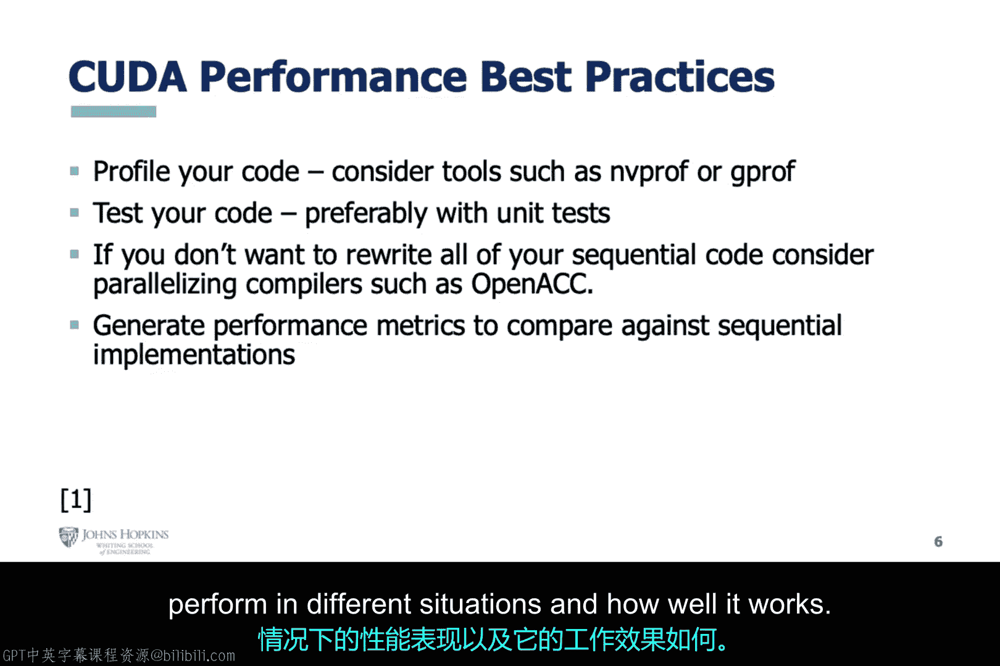

# 约翰霍普金斯大学《GPU编程（并发编程、并行编程、面向企业、CUDA高级库）｜GPU Programming》 p29 28_CUDA项目结构与最佳实践.zh_en -BV1a1421r7vw_p29-

In this lecture， we will work on how to create a project。

And develop in general to create code that is understandable and maintainable。😔。

Writing good coup to code for complex problems is not necessarily easy。

 and making it so others will be able to understand it can be a challenge if you don't consider a few things。

😔，Two main areas that can help with understanding of your code and its performance。

His consideration of project structure and best practices。

Many of the practices that you should adopt are generally applicable to all C or C++ projects。😔。

Since Kuda code is a subset of capabilities of these languages。

Simple projects generally are structured in very flat manner。

 all code and header files can exist directly under the project folder。😔。

While Mar projects can have many different configurations and support files。

The only one that should be included in all projects in any language is a read me。😔。

It can be a very simple text file， or better yet a markdown file it allows for more advanced formatting。

 and Gi servers can interpret them directly。😔，The remy should contain documentation of at least how to build and run the code。

Based on the build system that you would like to use， you will either need to make。😔，A make file。Or。

😔，A C make list at the X you using C make in this course。

 we will use make mostly based on the lower overhead with developing build configuration files。😔。

Once you have a truly complex project， you will need to make the full structure of your project indicative of its purpose and also to outline the modularity of source code。

😔，By this， I mean that source， header and associate test code will be reflected in any import statements and should be divided into their own folders。

You should make a practice of documenting a code， both in the code itself and in separate documents such as design documents。

 user documents， and not any other complex instruction。

Or installation practices that are not handled by the build system。

A major change from the simple structure of the previous project is that the source and header code。

Is separated into source， and include folders。Also。

 it is good to organize all code that is used by other code files。😔，Into files in a common directory。

😔，A major reason for this is to manage cyclic dependencies。😔。

If you have complex CMake configuration files， then it should be placed in its own CMake folder to make the main project folder unpolluted by non source code。

😔，<|OTHER|>Of course， if you are using make， then the make file is all that you need。

 and that can be placed in the root of the project， yet again。

 always create a read me with a minimum amount of documentation of how to build and execute code。

Now let's talk about coding best practices for performance。

Strong scaling can be measured by Amah's law。Algorithms are easily paralyzable。

 and this should be the first consideration。Examples of this can be on rolling of four loops to be executed on on a per thread basis。

Week scaling as way in increasing the number of processors does not necessarily have a linear effect on performance。

Consider this when you need to process the same data points by multiple threats。

 such as image filters。More threads mean faster performance。

 but you cannot divide the data up to map one to one with number of threads。

Memory optimizations can have an effect。But the difference in speed ups between data types is not orders of magnitude between different types and often faster memory。

Such as registers are limited by the number of threads and available resources。

So it is a good idea to make your code run faster using memory optimizations。😔。

But don't expect it to make your bad code or hard algorithms run constant time。😔。

A very important thing to know is that branching。Such as an if， do， while， etc ce。

These types of branching can be really costly。 This is because of one of the 16 threads that make up a half orp。

Wps， makeup threads。 remember when I said 32 was the multiple of threads in a block that's because of half warps and warps。

If one thread。😔，Falls into a different branch。Then all of the other threads in the half orp will pretty much run twice as long。

So avoid casually branching， a way to handle this is to pre processces info。😔。

To fall along half or pounds， this can be taken code that operates on EN or odd data。

And moving them to the beginning or end of input data。 and therefore。

 less of this boundary crossing will occur。

Profiling your code is a great way to identify memory bottlenecks sections of code that are underperforming。

Testing your code throughout the development process。Well find bugs and other issues earlier。

 which can save your project。If you cannot write Kudta code for all sections of your code。

Or as an interim solution， while moving completely to Kuda。

Consider using compilers such as OpenCC to make portions of your code instantly use the GPU code。😔。

They commonly use pragma around forlips。😔，Lastly， but not laly。

Outputting performance metrics as a part of your execution of your code。

Can show how your code performs in different situations and how well it works。

