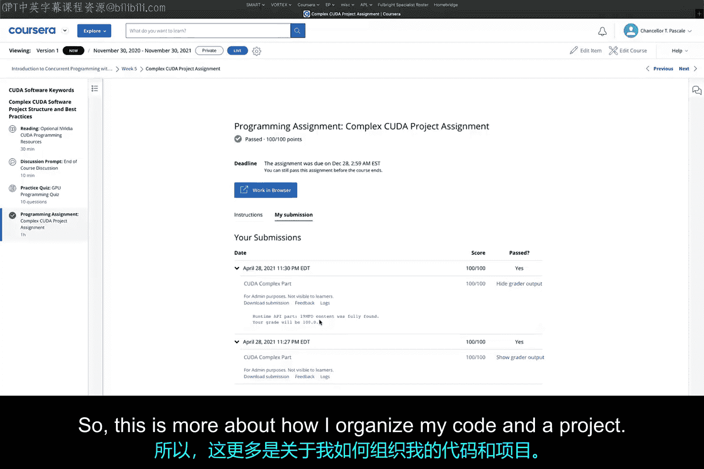

# 约翰霍普金斯大学《GPU编程（并发编程、并行编程、面向企业、CUDA高级库）｜GPU Programming》 p30 29_复杂CUDA项目作业解析.zh_en -BV1a1421r7vw_p30-

So in this video I'm just going quickly go over the steps that you need to take for the programming assignment associated with complex through a software project Now there's about five steps you have to take I'm not going to go into detailed and go through it in the IDE I just want to walk you through the steps verbally and make some point so the first point is that the code that I've put into the lab is almost completely correct except for I have move around some of the file。

 the source file， the header file you're going to need to make changes to the make file to include the appropriate includes directory as an environment variable used by the make command and then you're going to run make clean build as you've done before it will build a complex EXE file executable in the route of like whatever folder you are in which should be the project folder then you're going to execute the complex that EXE command and direct。

That output to output TxT and then you'll click the submit button when you do that you'll see your results and it basically said it found what it was looking for。

 you may have points in there where things fail， but I really want you to know that for the most part this assignment is about putting。

😔，The different parts of the code， the header。And then understanding how to use a make file to get everything to work。

I have subdivided the code to make it cleaner。To follow along some of the practices that companies like Google enforce。

 So this is more about how do I organize my code and a project， It's still fairly simple。

 but it's enough to get you started。 Thank you。

