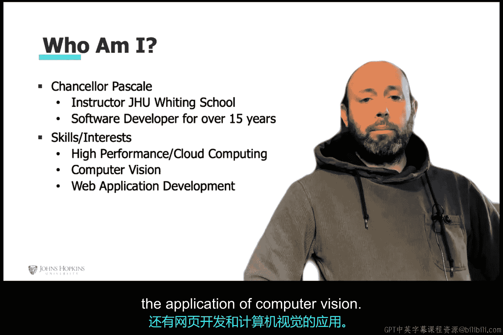
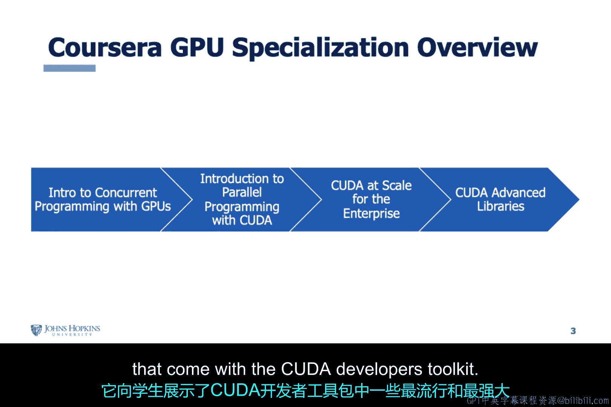
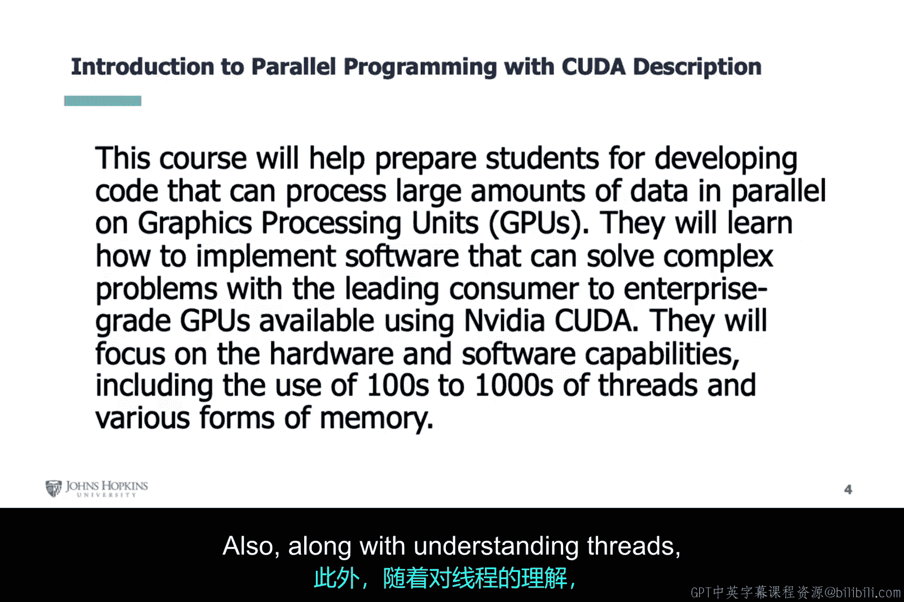
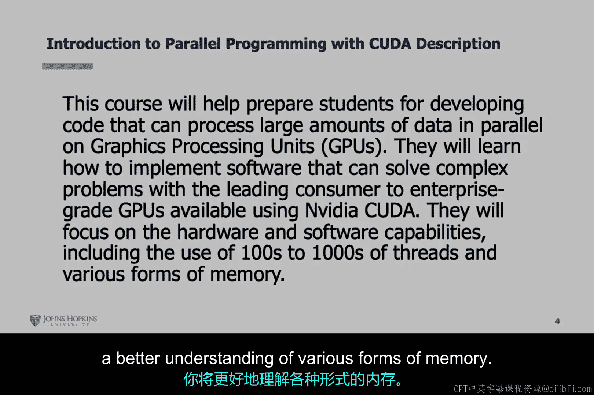
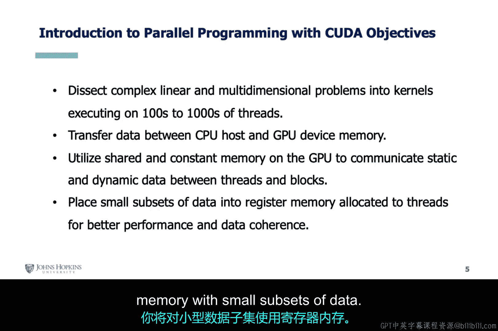

# 约翰霍普金斯大学《GPU编程（并发编程、并行编程、面向企业、CUDA高级库）｜GPU Programming》 p31 0_GPU编程专项课程.zh_en -BV1a1421r7vw_p31-

Hello and welcome to the first video lecture of the introduction to parallel programming of Kuda course。

 We are going to focus in on the GPU programming specialization in this video。Or who am I。

I am Chancellor Pascal。I' have been an instructor for 10 years at the Johns Hopkins。University。

 Whiting School engineering。A software developer for 15 years。

Ht performance and cloud computing are interests of mine。

Along with web development and the application of computer visions Now I would like to give you an overview of the Coursera GP specialization。

The first course which you are currently in is In to concurren programming with GPs。

 which I will describe in more detail in the next slide。

The next course in this specialization is Intro to parallel programming with Kuda。

 This course focuses on the basic hardware and software capabilities that Nvidia GPus and the Kuda programming framework provide。

 The third course is Kuda at scale for the enterprise。

It goes into more complex capabilities of Kuta and how they can be applied to scale beyond the programmer's machine and on to enterprise hardware。

 The fourth and final course in the GPU specialization is KUuda Advance libraries。

It exposes to the student a number of the most popular and powerful libraries that come with the KudaDevelop toolkit。

 So how would I describe the introduction to parallel programming of Cuta course。

Well， we're going to help prepare you the student develop code that can process a lot of data。

 We're talking about hundreds of thousands of points of data。

 maybe millions even on GP's graphic processing units code， which you will develop。

 will solve complex problems on。😔，Consumer to enterprise grade GPUs from NviIDdia using the Cuda framework。

Also， along with understanding threads， you're going to get a better understanding of various forms of memory。

 Let's go through the objectives for this course。

You'll be able to dissect complex， linear and multidimensional problems into kernels that execute on up to thousands of threads at any one point you'll transfer data between CPUU hosts and GPU device memory。

 you'll learn to utilize shared and constant memory on the GPU。

 which allows for transmission of static and dynamic data between threads and blocks。

 preciselyly for better performance in data coherence between threads you're going to use。

Register memory with small subsets of data。

Well that's it for this presentation。Hopefully I started you to think about what you'd like to do in this course and the GP specialization in general。

