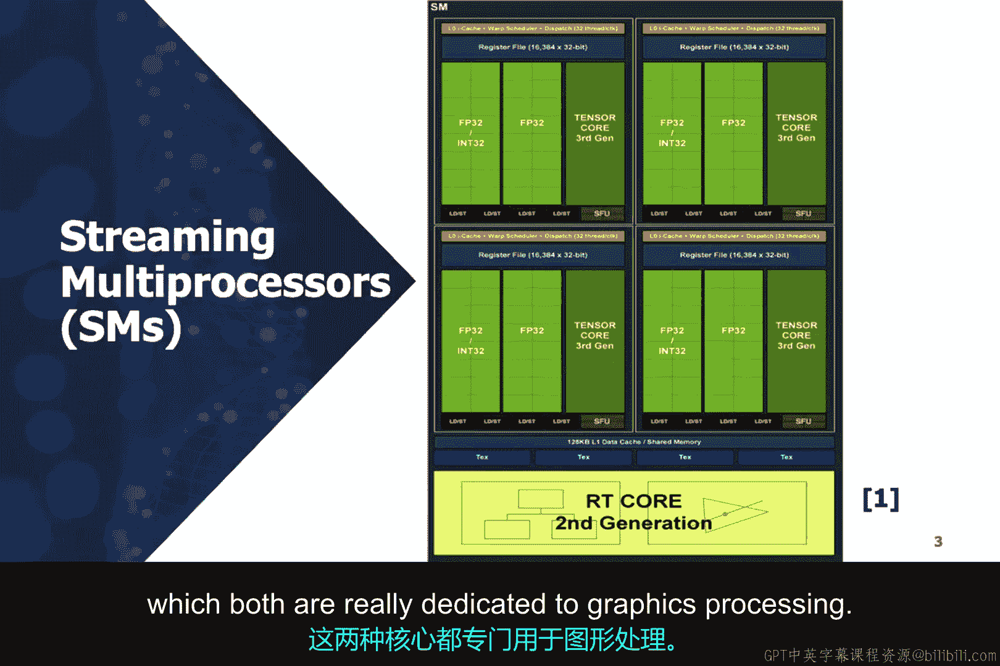
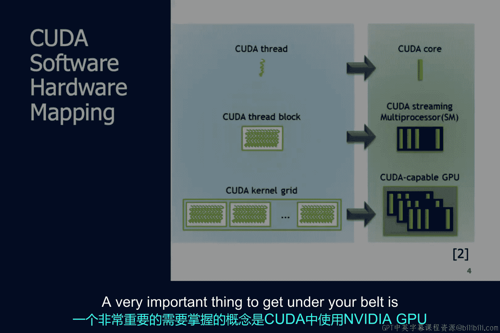
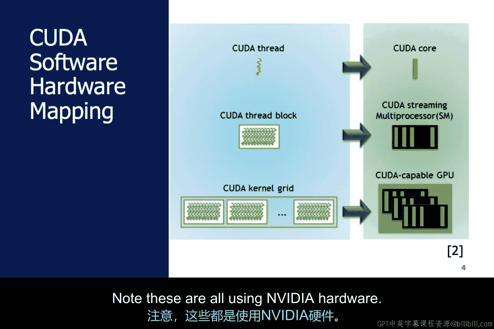
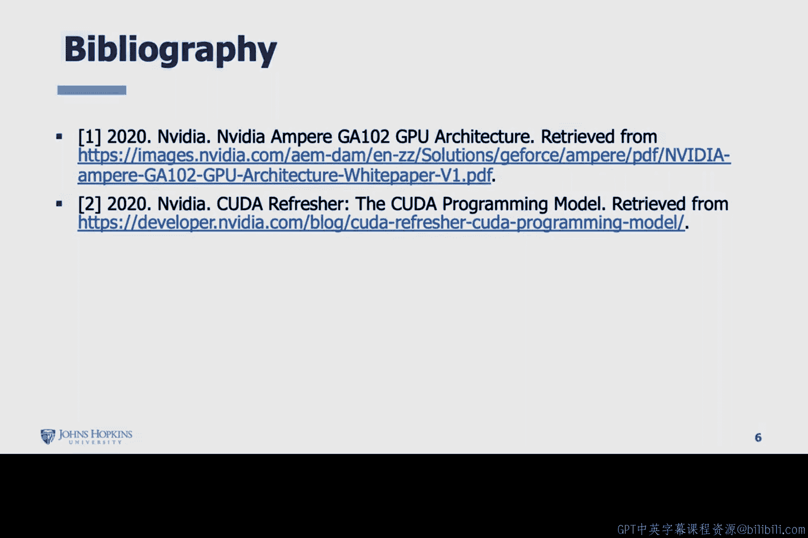

# 约翰霍普金斯大学《GPU编程（并发编程、并行编程、面向企业、CUDA高级库）｜GPU Programming》 p34 3_核函数执行原理.zh_en -BV1a1421r7vw_p34-

Hello and welcome to the Colel Ex lecture as part of introduction to parallel programming of Kuta。

 Let's proceed。So now let's walk through the high level architecture of the GPU。

What is displayed here is a diagram showing the Ammpre architecture。So in the middle。

 there are a number of boxes surrounded in yellow that represent the streaming multiprocessors that are the heart of the computation of a GPU。

On the left and right side are the memory controllers which help shift data and store data in different types of memory throughout the GPU。

😔，The giga threat engine near the top of the diagram。Is the main scheduler。

4 different threads in the top and the bottom are the interfaces。On the top。

 there is the general IO bus， which is shared。😔，Between the。CPU and the GP。

 so data is shifted between them。On the bottom is the en V link and high speed link。

 which are basically used to make transmission of data between GPus faster。

So now let's zoom into the streaming Multiprocessors or SMs。😔，So in this。

 which is an example of yet again， an a am GPUs S。😔，You will see there are four warps。

Each of these warps contains an Lze cache。A scheduler。

A collectionction of registers called the register file。And then two， half warps。

 one with the ability to do floating point or integer 32 bit operations。

 one solely dedicated to 32 bit floating point operations。They are load in store capabilities。

There is a。Tenssor core that is specific to that warp。

There are other abilities to share using the L1 data stored as a shared memory， which we'll go into。

 then there are four texture cores。And。😔，One single ray tracing core。

Which both of those are really dedicated to graphics processing。

A very important thing to get under your belt is the mapping between software and hardware in Kuta。

 using NviDdia， GPS。So a thread， which is the smallest computational unit。

 is the equivalent of the core。 So remember when I said there were two half warps in the streaming will do processors warp。

And some did floating point operations， and some did。In is your operations。Those are the cores。

A collection of threads。Generally， a warp W，32 cores。Is a block。

That corresponds to a partition or multiple partitions in KUa streaming multiprocessor。

At the highest level， you have grids， which hold multiple thread blocks。

They can be rather large and they can be。Executed as multiple。

Repetitions through the same GPU or across multiple GPUs Note these are all using NVIDdia hardware。

So now let's take our knowledge that we've gained about the hardware and software and understanding of the mapping。

 And let's see how that applies to kernel execution。

 So an important thing to note is you're going to see a lot of three less than symbols with some information in the middle and then three。

😔，Greater than symbols。That tells the scheduler。And the compiler。That。The arguments pass into that。

Describe how to break up the work that is done on the GPU。

That's really the major consideration you have externally as to how you're going to。

Two different types of work。So there are you can。Only give one and that can be even just an in that just is how many threads are in a block。

But generally， you say how many blocks you have， how many threads per block。

And that can be multiplied to get at something like the amount of data you have。

And then you can specify something like is there shared memory。

 how much are you going to use member in the hardware that exists。

 and then you can specify a stream where you can send data and events to have a more interactive K kernel。

Of course， you all have arguments that you pass that's generally the data that's going in and out of your kernel Non。

And we'll go in more detail about this。DG and DB or blocks and threads per block can actually be specified as a three dimensional。

Object， which says in three dimensions。How they are broken down。 Don't worry about that too much。

 We'll get to that later in this。sett of lectures。Now， the kernel itself。

 it always starts with a dunder global， when I say Dunder， it's two under score symbols。

Then it never returns anything so it's going to be a void and then the name in the kernel and then all the input arguments and in this case。

 all I'm showing is that you can get the I and J so the x and Y coordinates in two dimensional thread and block space。

😔，By doing some simple mathematics with that index。

 you can map into the two input matrices or arrays。

Add their values and then put the resultant value into a two dimensional matrix or array。

