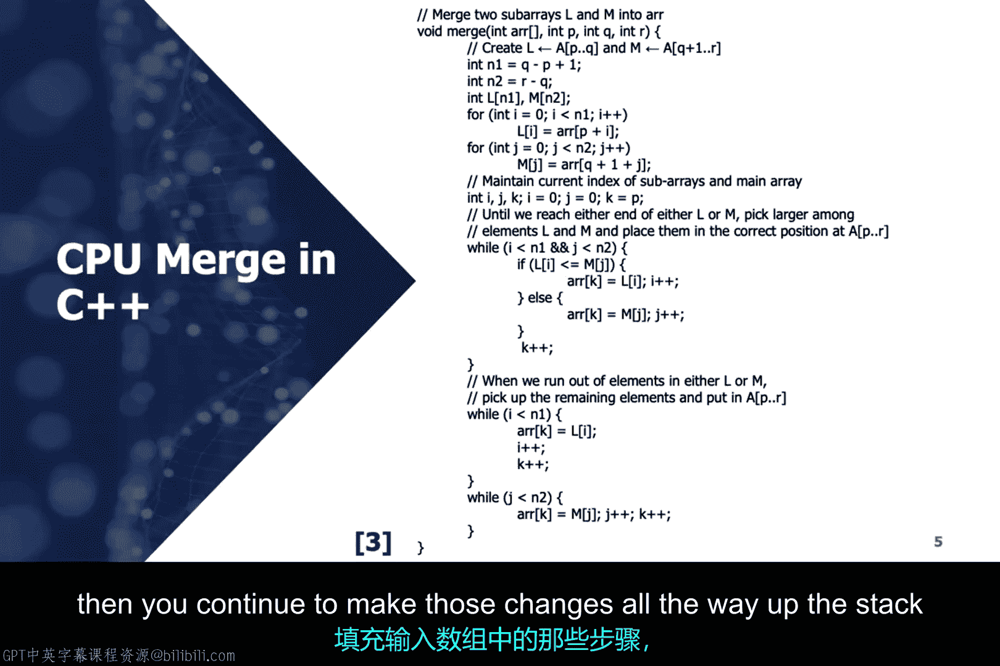
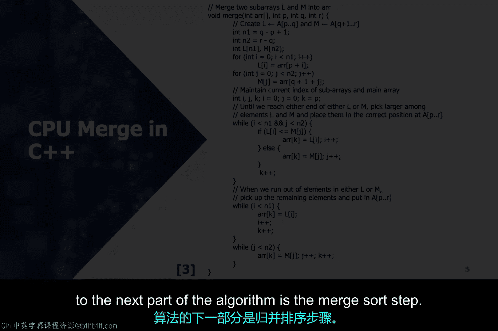
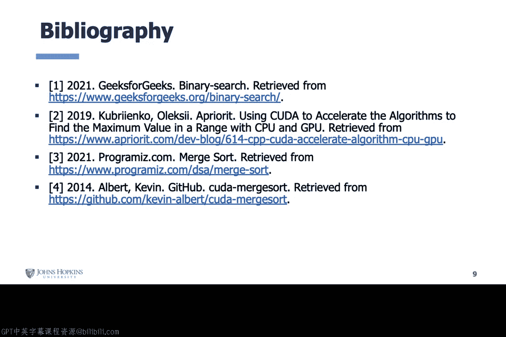

# 约翰霍普金斯大学《GPU编程（并发编程、并行编程、面向企业、CUDA高级库）｜GPU Programming》 p35 4_分治法与GPU算法设计.zh_en -BV1a1421r7vw_p35-

let's walk through taking a divideiding conquer algorithm well tuned for CPUs and converting it into a KUuda GP based algorithm。

Now， let's look at another common divide and conquer algorithm merge sort。

 What it does is it the goal is to end up with an array that is ordered or sorted。

The first thing you do is you create a tree of recursive calls that breaks down the input array that it's given by half until it reaches the a leaf node。

 which is basically when there's only one value that it has assigned to it。Then， of course。

 it returns that value back up the。Calling function， then sorts。That those two values。

 and returns that。And what happens is each call then knows the order of the two hs and selectively sorts them with that information until you get back to the full array and it's sorted。

 It's not necessarily the most efficient algorithm but it's a very efficient algorithm on a CPU with a single thread。

<|OTHER|>So the most important step from that diagram I showed in the previous slide is Em and what that does is。

<|OTHER|>Just imagine that the array that's passed around is always the same array。

 you're not actually creating two subs in the final product。

What you do is you take the pointers to the start and end of each of those。Sections of the array。

 wherever we are in that tree。<|OTHER|>And you create temporary array L and M in this case。

 you have pointers to the current lowest value in this array。 remember， they are sorted。

 and you always compare the lowest value in L L to the lowest value in M。

And which our one loss goes into the actual right。 So you're just replacing the values in there and then。

Once you've say completed L or M， all the other values from the other half of the array fill in those steps in。

The input array。 and then you continue to to make those changes all the way off the stack。

 So the next part of the algorithm is the merge sort step。

 And that's actually the step that's the top of the tree and it' called it at every point as you go down the tree on the way up。

 it says okay， these two sorted parts of the array。 Then the input array。

 and I'm going to return them into。😔。

The calling function and call merge on them， so that's when you have those two arrays。And you。

 it just bubbles its way up each time。Merging parts of the input array until you get to the final。

 very final step， and then you know you're at like the top of the tree and there's that merge there actually merges the whole array in sorted order。

😔，Like the CPU merge， there is coa merge and note that this merge。😔。

Necessarily has to handle not just a single item at a time like linear search。

 it's going to have to merge sub arrays。 So what it's given is the source array。

 which is the source from very start of the couda kernel execution in the destination array because it has to return to a different array and then it's given the start middle and end within the source array to work on merging right。

😔，<|OTHER|>And then what it does is it just goes through。

Takes that section and swaps places between those the。

 you know the two hats that are created by the long the start to middle and middle to end。

 so it's more in place。😔，Modification， except for it actually moves， the output data。

 the merge is in the destination array。So the coa merge sort is fairly similar in what it does to the CPU merge sort。

 Basically what it does is it creates the。The start middle and end for the call to the GPPU bottom up merge。

😔，Slight difference is that the CPU version is always dealing with sort of equal size slices。

 and it's only ever executing it one at a time。In this case。What the this merge sort does is it says。

 well， how much input data is there？😔，How many threads are there？😔。

What is the sort of width of the off set， how many slices are there。

 and it determines as it goes through a loop for its subordinate calls to。Mge the。

 the smaller sections of the array to merge。 So if you have a large number of threads on a small amount of data。

 this might only have one thread per merge， which it would be somewhat efficient。 Now。

 this will always have to， at some point merge across many。Input data subsets。

