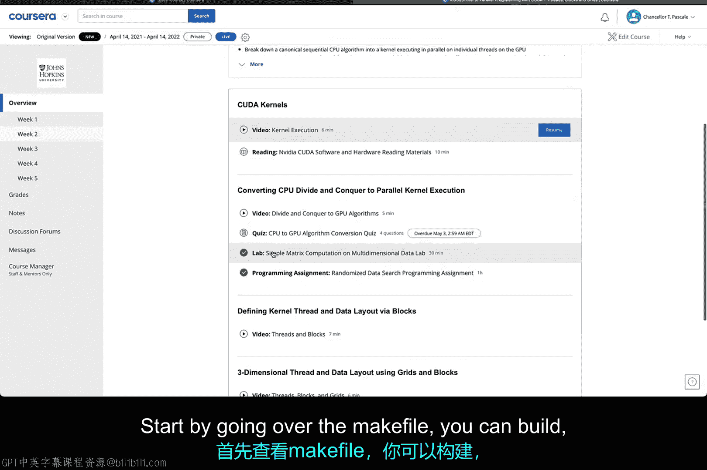
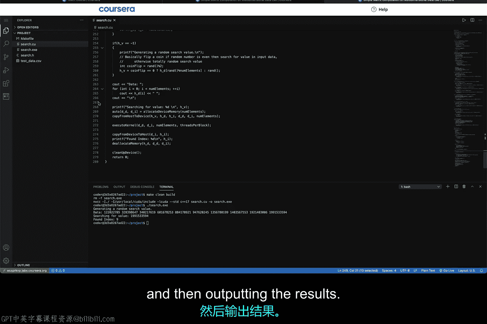

# 约翰霍普金斯大学《GPU编程（并发编程、并行编程、面向企业、CUDA高级库）｜GPU Programming》 p36 5_模块2实验总览视频.zh_en -BV1a1421r7vw_p36-

Hello， let's talk about the week2 programming La。😔，Start by going over the make file， you can build。

Clean and run your code。 You do that all via the terminal。 This may take a little while。

 and it may fail based on what's in the search that see you。

What you should see is an additional search do EX， execute to search。 EX。😔。

What you will notice is that once it runs。You'll see a line for。Data that's the input。

 the search value and the index of whether it's found， which in this case is the index of 9。

 the kernel in search at C is called search。It takes in two。Array pointers。

D D and D for the data and the index of the found item。And the nu elements。

 The first thing it does is it decides the index in block in thread space。

 and then make sure that that index is not greater than the number of elements。

Then it gets the input value and places it into a variable。

And then it will test if that variable is equal to the search value。If so， it will put。

At the index of 0。The index of the current thread。 Now。

 this can be overwritten a number of times if it's found numerous times are。

The allocate random memory。Function， which。Generates random numbers。

For the input to the search kernel function reads the CSV， you shouldn't have to worry about this。

 This reads input data files function allocates device memory。

 you don't need to worry about modifying。😔，This in the lab， but if you want to try it out。

Opy from host to device does as its name says， copies the H V。

 H D N H I into T D and D I based on the number of elements。This is using KutaM copy。😔。

And it should be pretty solid， so while you can explore it。

 there's no need to modify the execute kernel function is a wrapper around the Ka kernel for searching。

 it handles determining the number of threads per block and blocks per grid。And handles errors。

 as well。you want to copy the results from the device to the host using the copy from device to host。

 and its responsibility is pretty simple， it copies data from D underscore D to HI。

 which is the index of the found value。The next two functions decate memory and clean up devices。

 You shouldn't have to worry about them。 Lastly is the main function。

 Its first duty is to take the arguments from the command line and parse them to determine things like。

😔，Is the input data passed in， do you want to sort the input data。

 do you want to determine how many threads per block and therefore the number of elements in your data。

😔，And then do you want to pass in the search value？

And so it does all that and gives you what you need to pass to this search kernel。

 so then it gets to the meat of what it's supposed to do， first copying host data to device。

 execute the kernel， then copy device， memory to host， and then outputting the results。😔。

