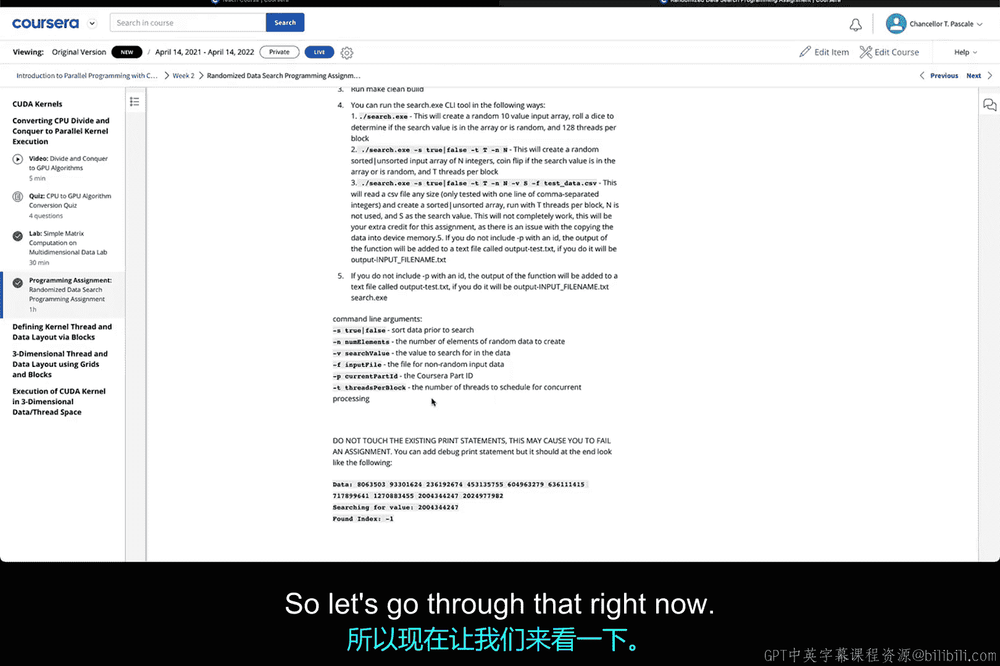
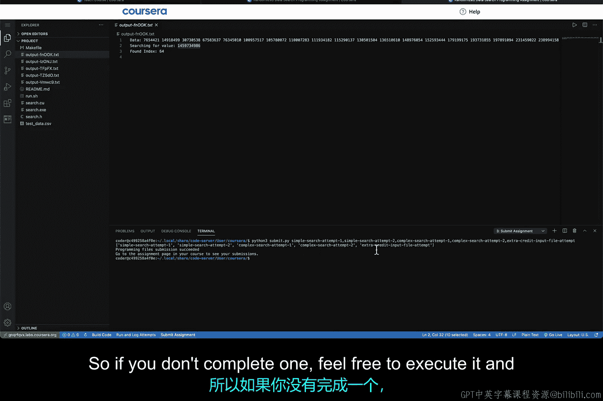
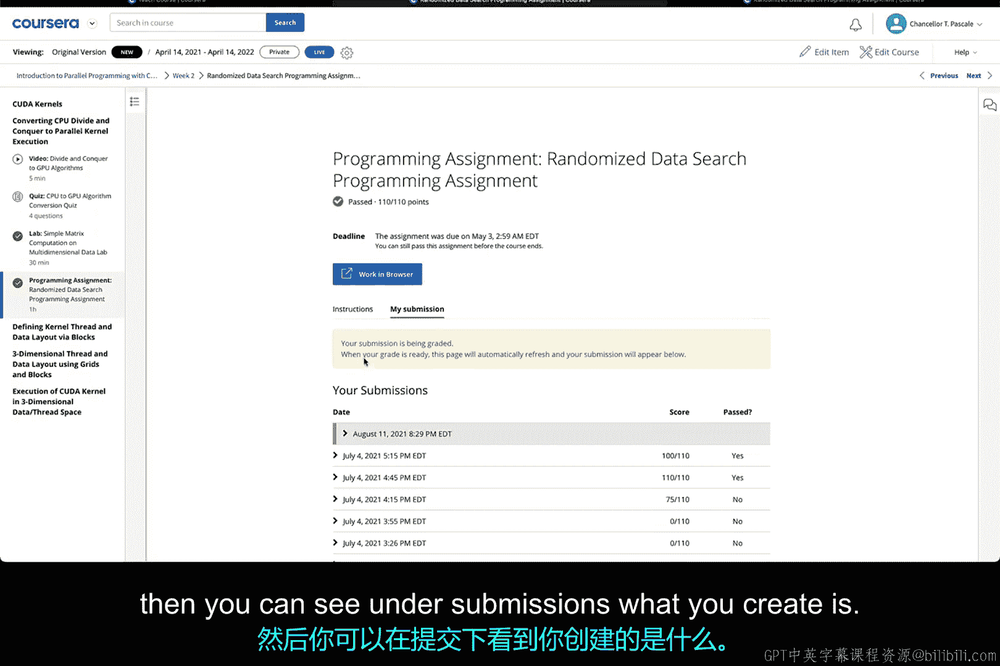
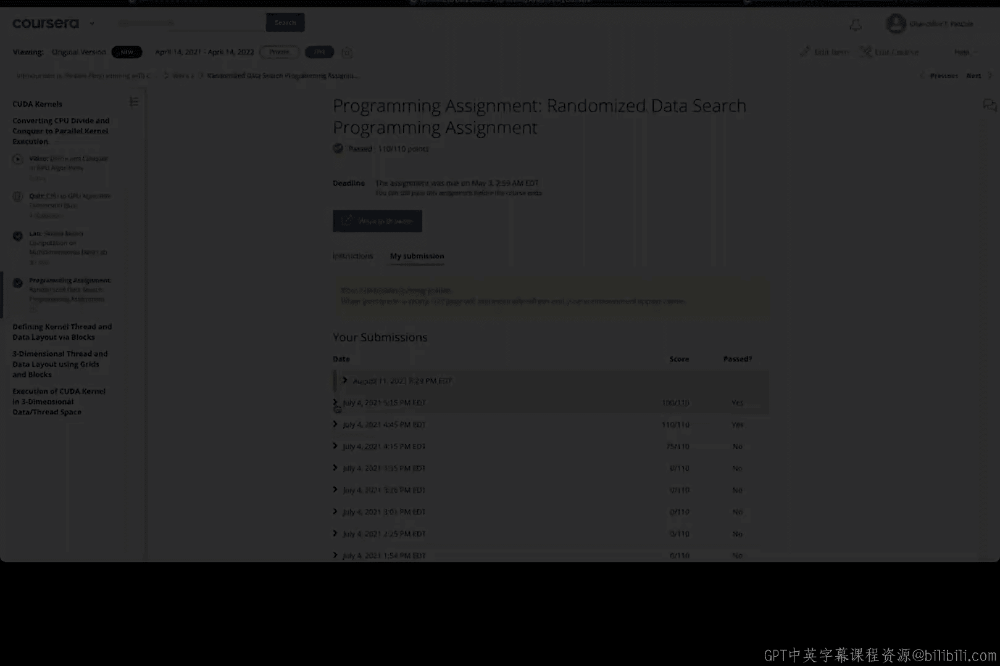

# 约翰霍普金斯大学《GPU编程（并发编程、并行编程、面向企业、CUDA高级库）｜GPU Programming》 p37 6_模块2随机数据搜索作业视频指南.zh_en -BV1a1421r7vw_p37-

So now let's move on to the first of two programming assignments。😔，In this assignment。

 you're going to search through randomized data。Sor of similar to what we saw。In the lab， but。

A major point here is that I've built a。Structure that will take in some different command line arguments saying whether you want。

The data to be sorted。How many elements of data that you're going to create are the value you're going to search for if there's an input file。

 what the file name is？The current part ID， which you really shouldn't need to modify because that's used in by the like the harness that and the buttons that you click。

And then the threads per block。So， you know， you want the numb elements to always be greater than threads per block and and。

Not all of these have to be included if you don't want to use them。

 there are some discussion of how the CLI tool works once you've compiled it。I don't modify。

Anything in the print statements， it'll say what the input data is， the value you're searching for。

 and if it was found， I use predefined data that's why there's this input file。

 so don't modify this when you're debugging， feel free to add extra statements。

 but after you're done make sure to remove them。What you're going to do is go into the project folder。

 We'll go over this in a second in the。Editor。And then you're going to modify the search kernel。

 you'll run typical make clean build and then。You' can then start using the tool using these guidelines。

And then， basically。What you're going to end up doing is clicking the buttons。

To submit once you have the output data。 So let's go through that right now。

So we， you should I。Recognizes on the bottom， there is。There are three buttons to build the code。😔。

Which runs make clean build。<|OTHER|>This will take a little while。H。

But wait for it to complete when that's done。😔，You can。Run and log。Your code。

 which also does make clean build as part of one its initial steps。

 So it'll take as long and then it'll run and what you'll notice is that a bunch of output dash。😔。

Part IDs will be created。😔，And they have。Different。Data inputs， and then a value and then。

And an output and also notice。That there are different。Command line argument， combinations used。

 and then when you're done， you can click submitit， but really quickly， let's look at。

<|OTHER|>An example of a search， algorithm， pretty simple。

Not too different what you've done in the past。So this is the main thing implementing the search algorithm。

For the most part， much of the rest of the code is already developed for you。嗯。

<|OTHER|>And there'll be parts for allocing device memory and host memory and copying between them。

Outputting content to files， you shouldn't have to modify any of that。

 if you want to explore a little bit， feel free to do that。

 but make sure that the output is in the form。That shown here are the inputs。😔。

Either from file or generated randomly， the search value。 and then where it is found in the。

The input and this actually gets checked， so don't just randomly put numbers in there and I'll change the values that are executed。

As well， and then you click the submit button and then it。Submits the five different parts of this。

They're evaluated independent of each other in your grade is the sum total of the weights of the values。

 so if you don't complete one， feel free to execute it and then you can see under submissions what your grade is。

