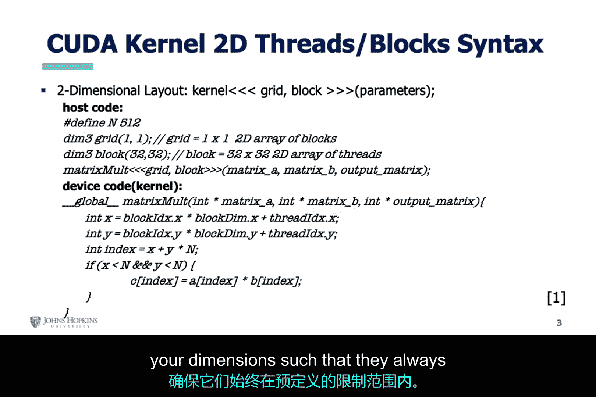
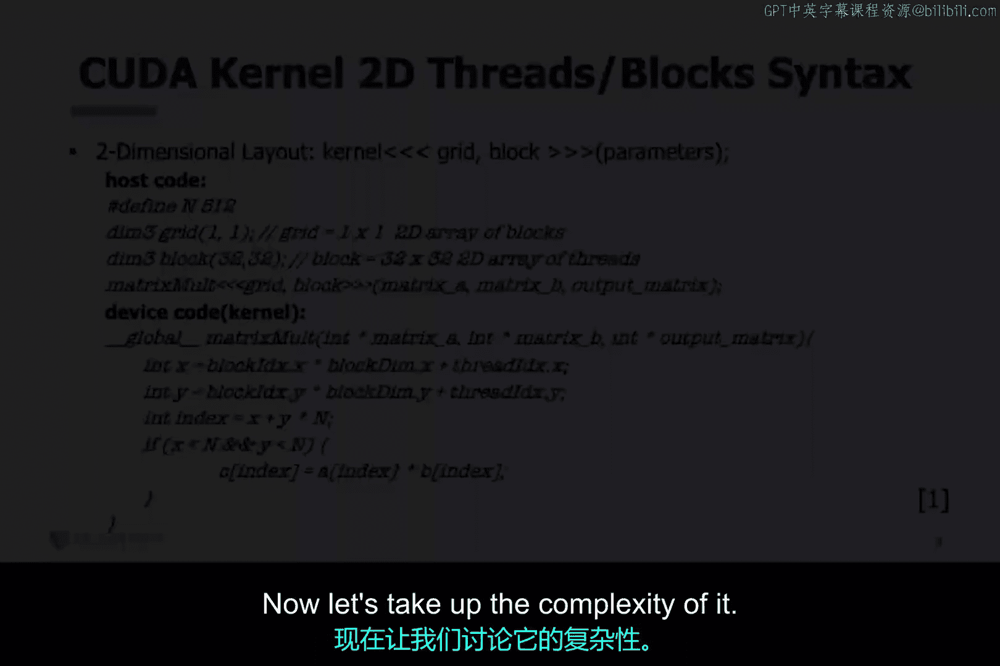

# 约翰霍普金斯大学《GPU编程（并发编程、并行编程、面向企业、CUDA高级库）｜GPU Programming》 p38 7_线程与线程块概念解析.zh_en -BV1a1421r7vw_p38-

Hello and welcome to this lecture， we're going to discuss how you determine the number of threads in the blocks that are going to be executed。

😔，Your kernels。😔，Let's look at the simplest way to define the number of threads that are executed in a block。

😔，That is basically a one dimensional layout。In general， how Colonel。Thread block。

Definitions are defined， as you say， the kernel you' are going to execute with three less than symbols than the description of how blocks are laid out。

Followed by how the threads are laid out。 in this case， just the number of threads per block。

 and then three greater than symbols。Followed by the arguments， you're going to pass to your colonel。

<|OTHER|>Now in the host code we've defined N to be 1618 and that's globally available to both the host and device code。

 so that's a way of defining the size of input output data and limiting the ability to go beyond that data。

 I'll bring that for a second。So the add kernel is very simple， it has one block。Pergri。😔。

So only one block at all。And it uses 32 threads per block。

 which means it's linear because only one integer value is passed， and then you pass it in。

As arguments， the arrays A B and Z。The device kernel。

Identified with the global Dunder takes three arrays of integer's， aviancy。Now。

 to get the index into the input。Araise and output array。

 You're going to first have to deal with the offset associated with what block you're in。 Now。

 in this case， we're only having one block， but we still have to say， okay， what block are we in。

 That's block I D X。And then the size of that block， which in this case would always be one。

 so the first part of this is just one is really zero for intents and purposes because block dimension is0。

<|OTHER|>And then the threat index index X， since this is linear data， that's really the only part。

That has an effect。 So the thread index in x becomes your index。

 It can happen that your thread index in x。Because you say specified a number that doesn't fall within a half orp is actually outside the balance of your data。

 so you always have to check。That your index is not greater than say 1618 in this case。Then， you。😔。

Calculate。The values for A and B and add them and put them into the C array。

 and that's all you have to do to deal with the linear kernel。

So now let's deal with a two dimensional。😔，Lay out threads in a block。 So we have now two dim 3。

Types， which represent。嗯。Data in three dimensions， just the specification of it。

The grid in this case will still only take one block in the X and Y direction。

 so the offset will always be0。And then then block。Is now made up of 32。Threads in the X and the Y。

Dimenssions， you call now a matrix multiply kernel with those two dim 3。Objects。

 and then you pass in the input and output matrices。

Now let's just focus in on how you'll get that index to your specific thread。First。

 to get the x value， you deal with the offset associated with the block。

 which I said since there will only ever be one block， that offset will always be0。

 and then you add the thread index in the x dimension。Then you do the same thing with why。

Once you have that， the only thing you have to do is multiply the y by。😔，The size of the input array。

 so it's 512。 that's just the offset within a block for your thread。

 And as long as both y and x are less than n。 So they haven't gone outside at 32。Value dimension。

 Then you can index into the A， B and C array。 So just always get in the habit of checking。

Your indexes or your dimensions。Such that they always fall within the predefined limits。

Now， let's take up the complexity a bit。For three dimensional threads。In a block。

You will have to specify your dim three for your block layout。😔。

As three dimensional in this case is n by n by n， which is 16 by 16 by 16。H。

We do specify the grid as a one by one by one note in again， that means all offsets associated with。

The dimensions of a block。Are always going to be 0， because the width is only a single。U。

A single value。<|OTHER|>So it looks the host code looks fairly similar aside from those changes。

The device code is a little bit more complex。It gets hard to dissect。😔，Down your index into X。

 Y and z。😔，And in reality， that would be inefficient， not of actual computation。

 but for a human to look at， because you'd have to define x， Y and z。

 then add back in all the offsets for Y and Z in the x。Adding in the X dimension。

 so it's just easier to。Calculate the value more directly。

 So the first row of the initialization of the variable index is about getting the offset in general for X。

 Y， and Z and applying that。To the base of the recalculation， but since。

They all end up being zero because the offsets are zero， you can sort of throw that out。

 then the next step is getting the offset。😔，In the X， Y and Z within a block， yeah。

 within a block on a thread。 And then adding the offset。For why。😔，And then finally， within that。

 adding that last bit offset for the x dimension。This is not easy to think about I'd have you。

Look at this a few times， you can break this down into x Y and z。

 and it may be in future examples I'll show you that way as well last thing to do is to ensure that the index is not outside the balance of your input array。

 which is 16 by 16 by 16 in this case。

