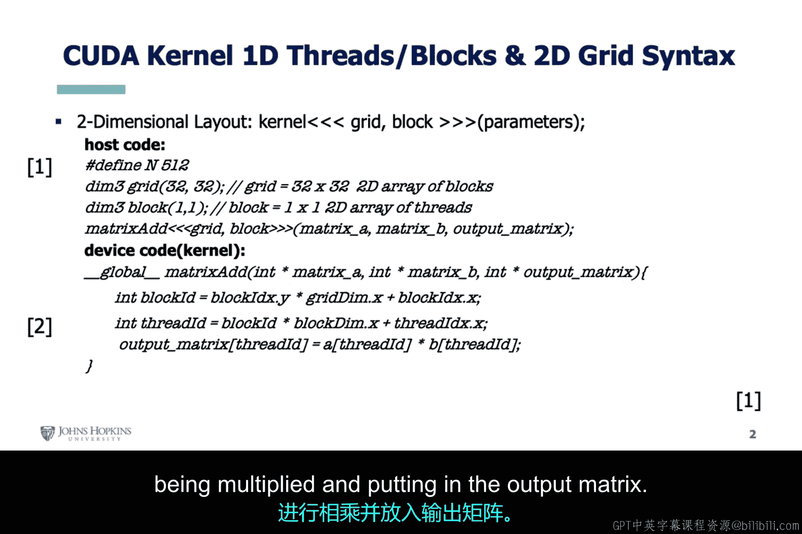
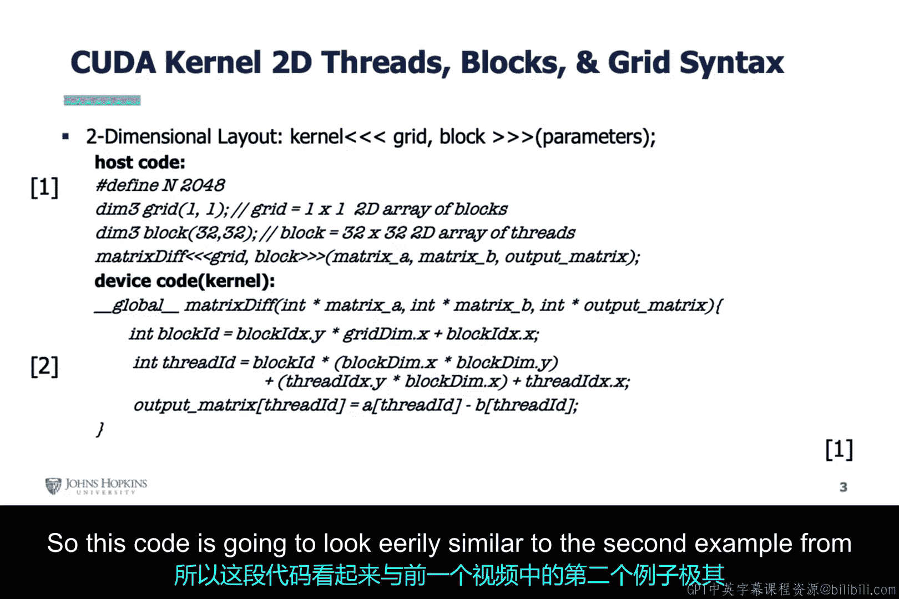
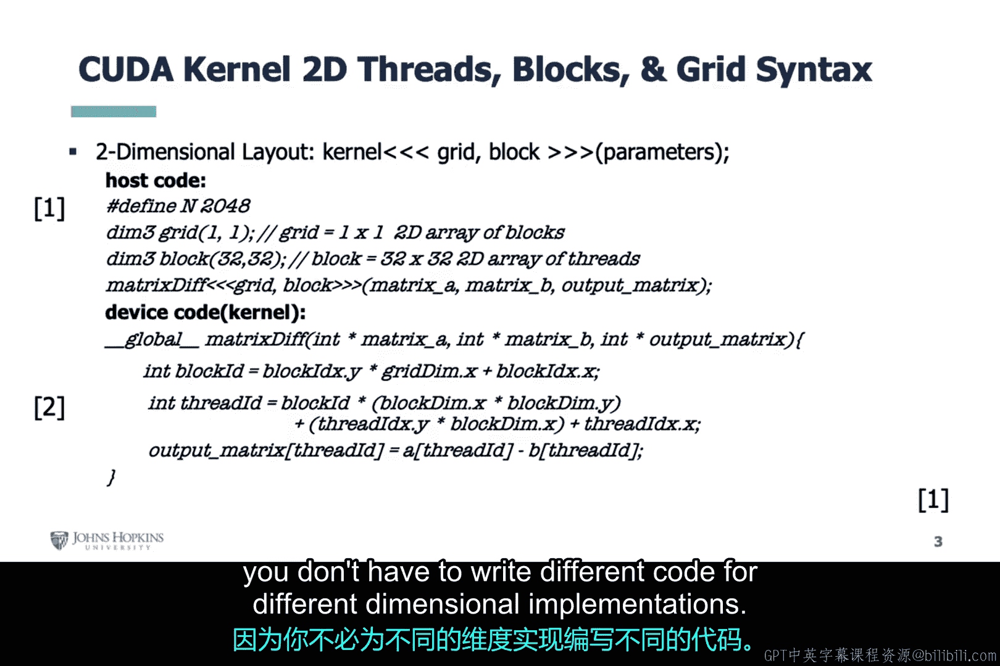
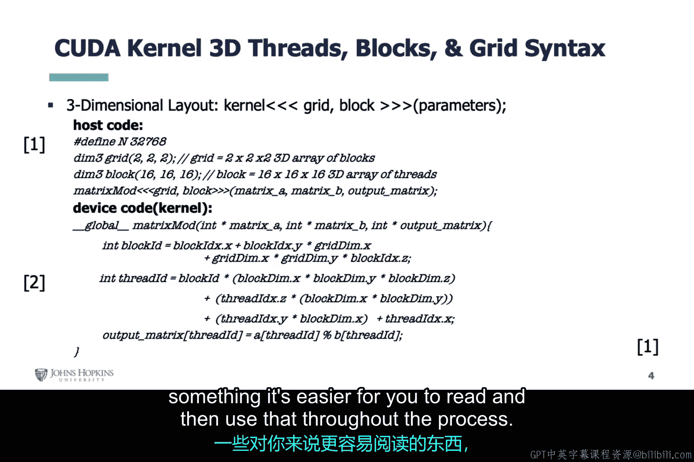

# 约翰霍普金斯大学《GPU编程（并发编程、并行编程、面向企业、CUDA高级库）｜GPU Programming》 p39 8_线程块与网格结构详解.zh_en -BV1a1421r7vw_p39-

In this video， we will go over。Layouts of threads and blocks， blocks and grids。

 so we go from the previous video which was one to three dimensional in this case。

 two to six dimensional， so that in might player your mind a little bit。

 but just understand that I'm showing you all that's possible you may only use，😔。

A small amount of this in your normal code。Here we're going to simplify what we're doing and focus only in the layout of blocks and grids。

 so in this case。😔，There is only a one dimensional layout of threads and blocks one by one。😔，Plock。

And then within a grid， you're going to have two dimensions， x and Y。And they'll be of size 32 each。

 and the input data is。😔，Max is out 512， so note。That you're actually。You may。

 because the grid size is larger than the input data， there's a high probability that half of your。

Threads will make over your input array or output array size， so I don't check it here。

 but in your normal device code， you what。😔，So in this case， in your host code。

 you just change the values in the grid。😔，Variable， which is a dim3 type。

And you call it with the same written block， kernel execution， syntax， the device code。 Now。

 what happens is you have to find the block I D， which。

You do your X and y dimensions and you figure that out， you know， okay。

 I'm in this position in this block。Right in these grades。 And then you have to say， okay。

 within that block， where which thread am I in and that calculation is very similar you have had before。

 so just keep that in mind that you've now pushed on the complications into this block I D。

Definition。And made your thread ID simpler， when you go to more dimensions。

 you'll have to do calculations in both， and then you just do the calculation of the two input arrays being multiplied and putting in the output matrix。

So this code is going to look eerily similar to the second example from the previous video。

In reality， when you say your grid is one by one， it is technically two dimensional。

The block here has a two dimensional layout。😔，The only difference is。Previously。

 you didn't spend the time to do the grid layout because you always knew you were in。

A0 by0 position a star for your offset for the block。But。😔，Let's say that the grid size changed。

 This kernel would still work。Because the block I is determined by that same calculation。

 It's the same calculation you saw in the previous slide， in fact。

So it is sort of resilient to changes， at least in two dimensions。

And the thread calculation is slightly more complex because now we've built in that x and Y。

For the two dimensions for us previously， we knew that the offset was going to be。Pach nothing in。

The Y dimension。 So you didn't have to worry about that。 So note that this。

Depicction or implementation of the two by two for both the grid。

<|OTHER|>And the block that those dimensions。Make this more resilient to any combination of 1 D by 1 D or 2 d by 2 d or 2 d by 1 D。

 et cetera。 for the layouts。 So this should actually be more useful。

 even in the one dimensional case because you don't have to write different code for different dimensional implementations。

 And now let's move to the most complex example， a three dimensional。

Thread to block。LayOut and a three dimensional block to grid layout。😔。

You define both the grid and block， dim three type。As3 dimensional。

 so for x Y and z for each of them。<|OTHER|>And it's a2 by2 by2， and it's 16 by 16 by 16。

In the device code， note that。Defining what the block IDd is。Now requires。

 including the index of C as a multiplier。So now I've added that third dimension。

 you have the offset。For。Why。And for Z now。 And then you just。Add in。

That value for the block index next。Your thread ID uses that block ID as part the calculation of its offset and then multiplies。

It's。Dimenssionalality in。X， Y， and Z， and then adds it offsets4。Zi。😔，Then， why。😔。

And then the thread Ids index index。 This is sort of complicated。

 but you can get in the habit of this。 And the nice thing is， if you do this。

You can make block IDd equal0 if you're never going to have any dimensionality with your grid。

 but you can always calculate this。 And if there's no dimensionality in your block。

<|OTHER|>Griid layout， then it'll always。Work， so this is very resilient for any dimensionality of your data because these values are always set。

In the sort of context for the kernel， so you might want to get your head around this， get something。

 maybe it looks slightly different， something it easier for you to read。

And then use that throughout the process。

