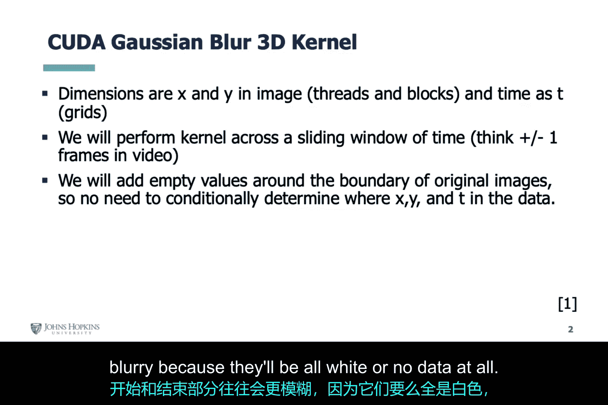
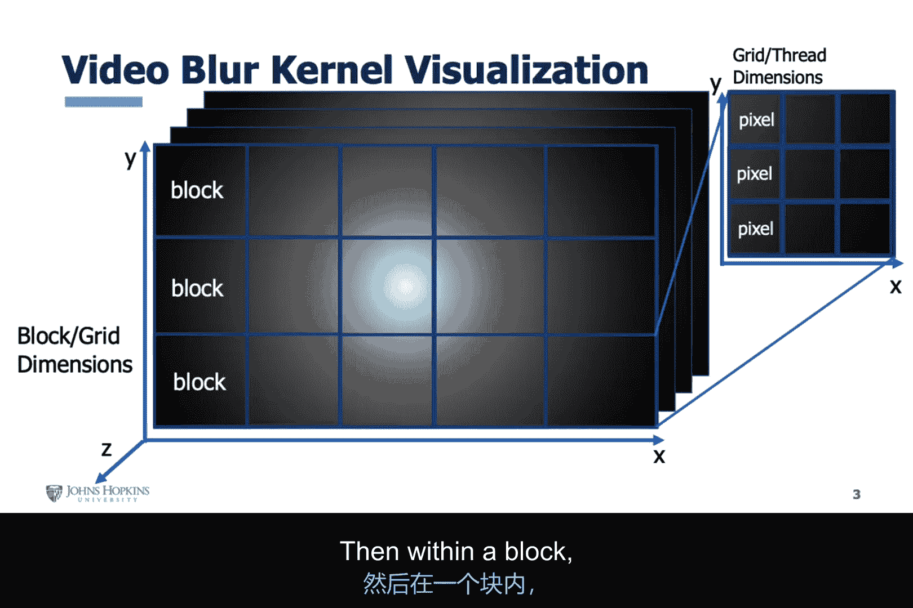
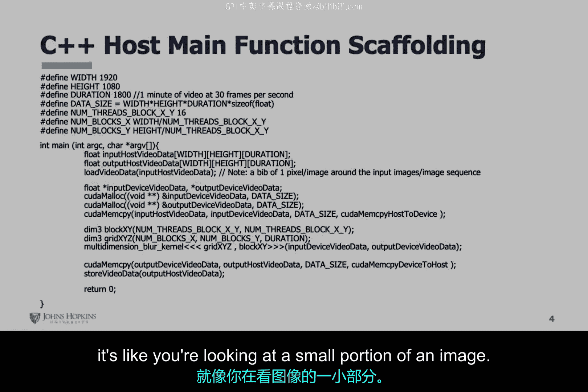
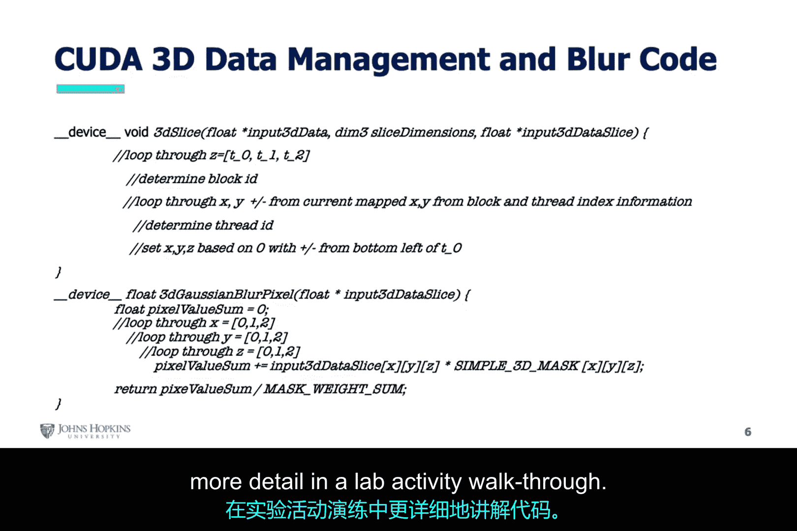

# 约翰霍普金斯大学《GPU编程（并发编程、并行编程、面向企业、CUDA高级库）｜GPU Programming》 p40 9_多维高斯模糊核函数实例.zh_en -BV1a1421r7vw_p40-

In this video， we're going to go over a example that I've developed that you can execute。

 which is a multidisional Gaussian blur。So it would be pretty nice。 something is visual。

 So for this kernel， which does a。<|OTHER|>3 dimensional calciumuss blur note the third dimension in this case is time。

 the other two dimensions being X and Y， and this is within an image that is a frame in video。

 the X and Y will be executed in threads and blocks。And time， so multiple frames will be processed。

<|OTHER|>In in grid space， and then what you can think about is that we're going to take a pixel in x and y in an image in our case。

 a gray scale image， so a value from0 to 100。And look at it across a video with a frame before and a frame afterwards。

 often called a sliding window because the next。Grid will be operating on the next window。

Across that same image and the typical pattern that we're going to implement is we're going to add a one pixel border around the outside the image and one frame at the beginning and end and that allows us to do this。

Sort of kernel in the classic sense of kernel， but it's you know， a three by three。By three。

 we include。The dimensions and time。You can can execute that without having to worry about while am I inside the image or not。

 so we'll just you the outside of the images and the beginning an end will tend to be more blurry because they'll be all white or no data at all。

Let's visualize what this gasussian b is going to look like。

 specifically what thread space is versus block space in indexing。So as I said before。

 blocks will be。Will operate across images in two dimensions。And。Across images in the Z dimension。

 which will be time。And within a block， pixels will a number of pixels will make up a block and， and。

You know， we're going to operate on a three by three。😔，Slice of an image。😔，And your pixel。

Your like thread index at that moment will be the middle of that and remember you'll also be looking at it across time。

 so this is not the easiest thing in the world to think of but think of each then a larger diagram。

 think of those as frames or going to be going across like a projector。😔，And then within a lock。

 it's like you're looking at a small portion of an image， so。

Next is the scaffolding and the host main function that。

 you know defines what the data input looks like and what to execute。 So generally we start off with。

 you know a few lines to define what the input data is。😔，Both from a memory perspective。

 which is when we're saying these arrays of floats， and then I load in the video data into that。

3D input。And then we also have an output， but that's not used initially。

And then we have to specify what the input data in the kernel looks like， so GP view memory。

 then you're going to copy that input data from the video source。

In the CPU memory into the GPU memory。You're going to then define the。😔。

Block and grid layout and note that。It's。1920 by 1080 image with 30 I'm sorry。

 and a minute a video at 30 frames for a second， that's all defined at the very top of the code。

And you just break things down within。That those confines to make sense for the number of threads and blocks that you have available。

 then you execute the multidimensional plural kernel with those dim3 layouts。

 and then you copy the results back out and you store the video。

Next comes the scaffolding for the actual kernel。And in it's three dimensional。

We have a mask which basically in all dimensions weights less by the further you are from the center of the kernel that you're operating on。

 this is an integer based one that are numerous ways to calculate this which are floating point。

 and then you need the mask， some， sum of all the values in the mask to get the mean value。

So within the kernel， youre going to operate on the input 3D dimensional data。

 so you have to take a slice of it。And that's why you have this dim three slice that says I'm operating on a three by three by three。

Subset of the data， you do your block and thread calculations。

And then you get that 3D slice via the 3D slice method。Thank you。

Opererate that Gaussian blur on that 3D pixels based on passing it in that sub datata set that's in input 3D slice。

And then you output only that。Value that's calculated by generating the mean of all the values within that slice based on the position you are。

 and then that's the output for a specific pixel in the new video。

Now I'm going to dive into the pseudocode for two of the most important parts of the kernel。

 so the device 3D slice method， what that does is it loops through X。😔，Y and Z to get。

The specific thread IDd you're in， and then it takes what one。Value to left， right， and into。

The time dimension， one frame before after， and it pulls out from the input 3D data。Just like a cube。

😔，If you can think about it that way around your current thread ID， which is mapped to a pixel。

And it returns that in the 3D Gaussian blur pixel， it takes that cube or any input size。Data。

 and it loops through x， Y and z。It doesn't matter if you could do z Y and X in reality to get to a specific pixel。

 you find that pixel's value in that simple 3D mask from the previous slide。

 and you multiply them to add to an overall value， you take that pixel value sum。

 which is the sum of all the weighted values from the different pixels based on the distance from the center or the pixel you're at。

And you generate a weighted mean。 And that's the outputted pixel in the new image。

 walk through the code in more detail in a lab activity walkthrough。

