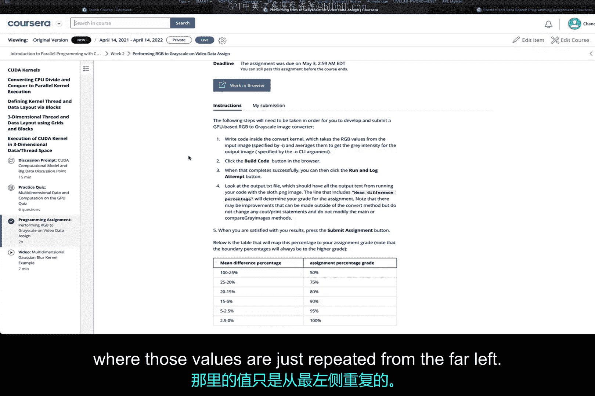
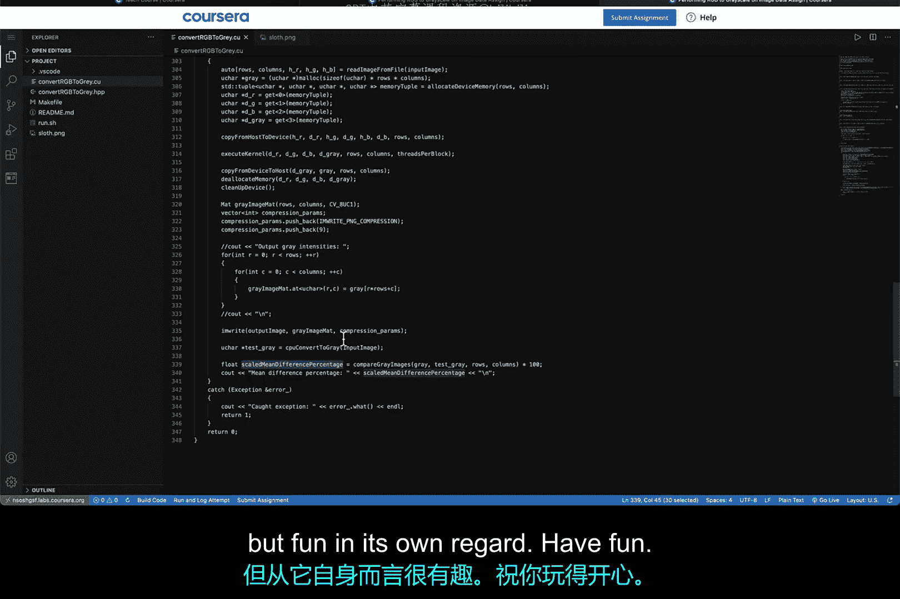
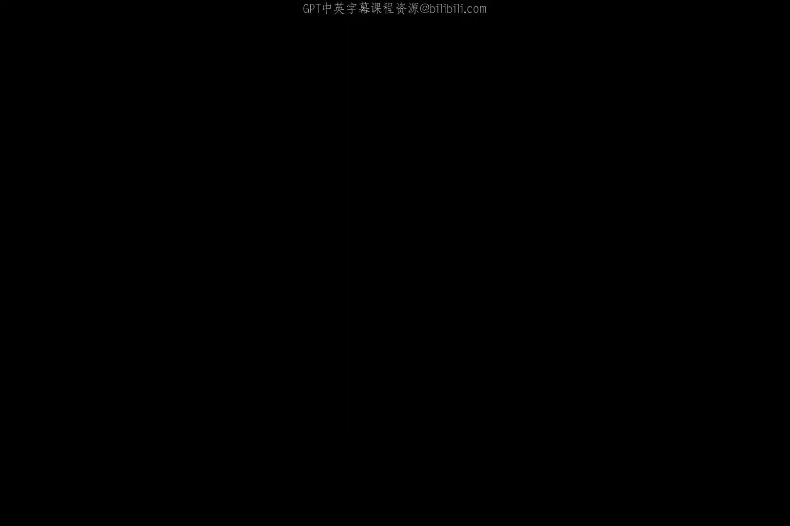

# 约翰霍普金斯大学《GPU编程（并发编程、并行编程、面向企业、CUDA高级库）｜GPU Programming》 p41 10_模块2图像处理作业视频指南.zh_en -BV1a1421r7vw_p41-

And finally， we'll go over the second programming assignment。

 the one that ask you to take image and convert it from RGB to grayscale。

 the minimum is to accept an image and then take its RGB values and convert them into grayscale using a simple。

Averaging algorithm， nothing too complex， but it's a new type of data。 Now to make video。

 you could take a video， you could break it down in individual images and then run it through this process。

 It's not a requirement。 It might be something nice if you're really interested in video。

 So the instructions are here。 It's just like everything else you're going build the code。

 It runs make and clean andll run and log the attempt， which will execute the executable。

 this generate from built code and then output the。TheThings that expects wallet。Runs。

 there will be an output of an image， the grayscale image。

 and then what I do is the code calculates a mean difference percentage。

 so for each pixel in sort of a CPU based。Implementation algorithm。

Versus the GPU kernel that you're going to implement。

 it takes each pixel in the x and Y and compares the values and then say that's from0 to1 and then it does that over all the pixels and gets that it does a mean of all those values and then it says from 0 to 255 what is the percentage that you're off and then there is a calculation here it says based on your mean difference percentage of what the grade you'll get so if you're 100% to 25% off you'll get 50% oh way up to if you're 2。

5% to 0% you'll get 100 you should be able to get easily get。

An 80 on this using not doing anything but implementing。A simple averaging algorithm。

 which I'll show you in a second now。I will say that there is something with how the rows and columns。

 the X and Y in the images are taken out of the file， not the actual file part。

 but the memory part of that process that will need to be tweaked to get up to the 90 to 95 or even 100% so you don't need to do that。

 but it might be an interesting challenge and it really does make you think of how things are because what you'll end up with is you'll end up with like a set of。

I could calm on the right hand side where those values are just repeated from the far left。

 so let me show you what it looks like。

Al right， so now let's quickly look at the code， the most important part of your submission should be getting the convert to work。

 it takes in three different unsigned cha pointers for RGB， red， green。

 and blue respectively and outputs into another unsigned char which is gray now these are from0 to 255 in all these cases okay。

So what you do is you're going to average each pointer sorry you're going to go through and each kernel is going to be executed by a single thread and it's going to look at its mapped RG and B values and then it's going to average them and basically what you're doing is you're saying the intensity of those three channels。

 Rg and B， you're averaging them to get the intensity of a gray scale。

 so from 0255 in all these cases to 0255， it's not perfect but it does a pretty good job。

There are other functions here， one here， it basically compares the gray image generated by this convert kernel and some wrapper code to a CPU version of the same algorithm。

 there's the function to actually execute the kernel。

And you know basically you shouldn't have to worry about deocating memory and cleaning up the device。

 I parse the command line arguments for you， which doest a perfect job of that right so what I do in the see if you convert to gray which is what you are evaluate it against is I read in the image and I use a v and open CV to read in an image and convert it to a different scale or different number of bands in this case I use gray scale which is the target scale that you want。

 I figure out the number of rows and columns I create a pointer for that and then I populate that pointer at the R times rows plus the columns so going y and then for the rows and then x for your offset in the X。

Which is C。 And so then there's the main。Function is pretty easy to read I I'll keep you from having to hear me read it some of the more important parts is that I'll read in you know I'll execute the kernel and then I will write the image you've created then I'll create the test gray image and then I'll do this scaled mean difference percentage and then that determines your gray image is done elsewhere so the nice thing is you will get to see you know a nice image processing capability。

 very simple veryrumentary but fun in its own regard so have fun。😔。

