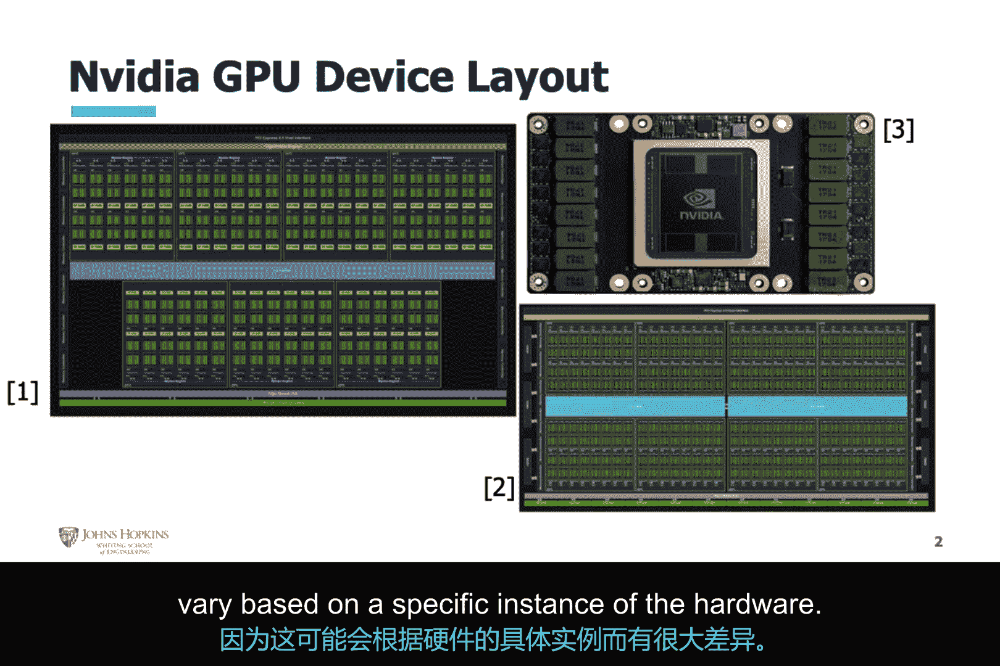
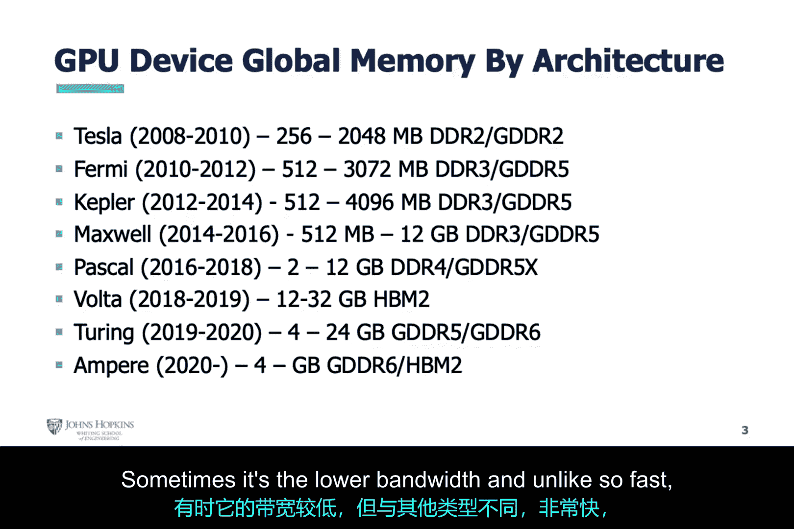
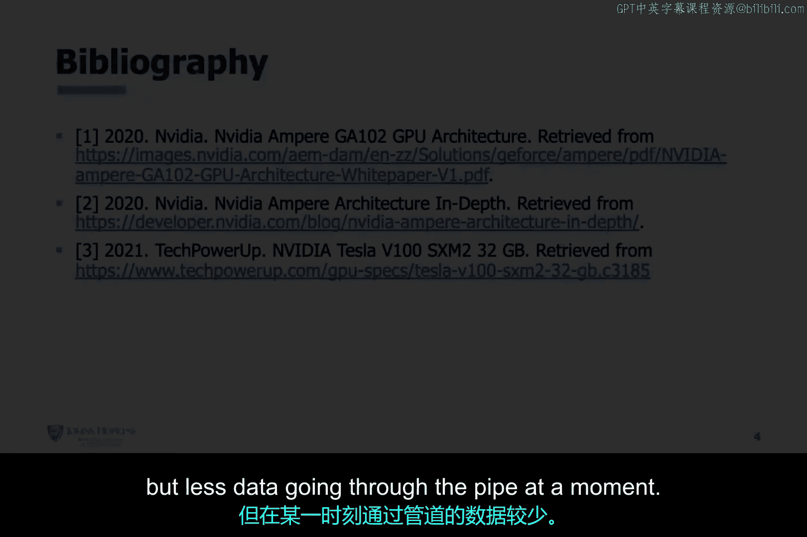

# 约翰霍普金斯大学《GPU编程（并发编程、并行编程、面向企业、CUDA高级库）｜GPU Programming》 p42 11_NVIDIA GPU设备全局内存.zh_en -BV1a1421r7vw_p42-

Hello and welcome to the lecture on NviDdia GPU device Global memory。 So let's look at three GPUus。😔。

In their global memory， the global memory in all of these cases are on the left and right side of the diagram or the actual card。

 one and two show diagrams of GPUs in their memory controllers for the ampere architecture and number3 on the top right shows an actual GPU。

 What you will see is that there are 16 memory controllers and then off to the right and the extreme left and right of the diagram as the actual memory and in diagrams of GPU devices you won't see the global memory or it will just be like sort of general boxes。

 they don't want to say specifically for an architecture。

 what the amount of global memory is because that can greatly vary based on a specific instance of the hardware。

So now let's look at by architecture， the range of global memory and the sort generation of it。

 So every two years or so， there is a new architecture by Kuta。And what you'll notice is。

The low end is and the high end of the first three generations are fairly moderate until you get to Maxwell。

 and the reason you have this sort of threefold jump in memory is this is when you start to get GPUs that are made。

 specifically four servers or there are clusters of GPUs。

And then what you'll notice is that from that point forward， you're getting a steady increase。

 sometimes doubling per generation。In both the lowest end and the highest end。

 So more and more global memory is available， and this allows your applications to handle more and more data per thread。

 So take advantage of that。Note that I do not say the upper end for the ampere architecture。

 since we are in the middle of that。Another thing to note is on the right hand side is whether it's DDR 2。

3，5，4， G DDR 2 to 5。 and those are。Basically very similar memory， as you will see in CPUus。

 It's when we get to HM2， which is high bandwidth memory that you see memory specifically designed for GPus。

 and it tends to be really fast， sometimes with the lower。Bandth and like so fast。

 but less data going through the pipe at any moment。

