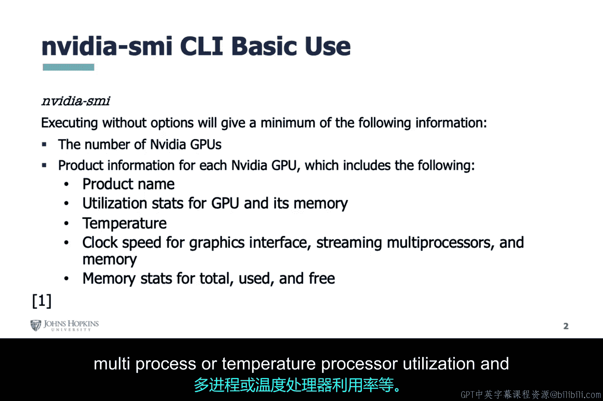
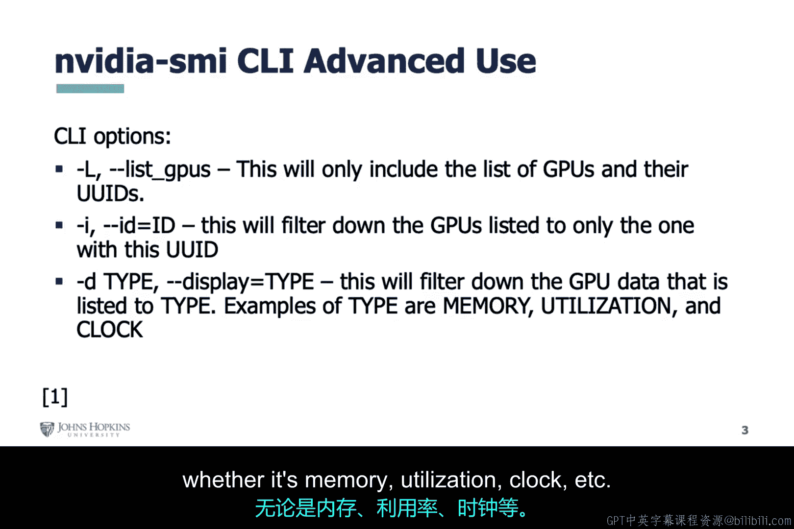
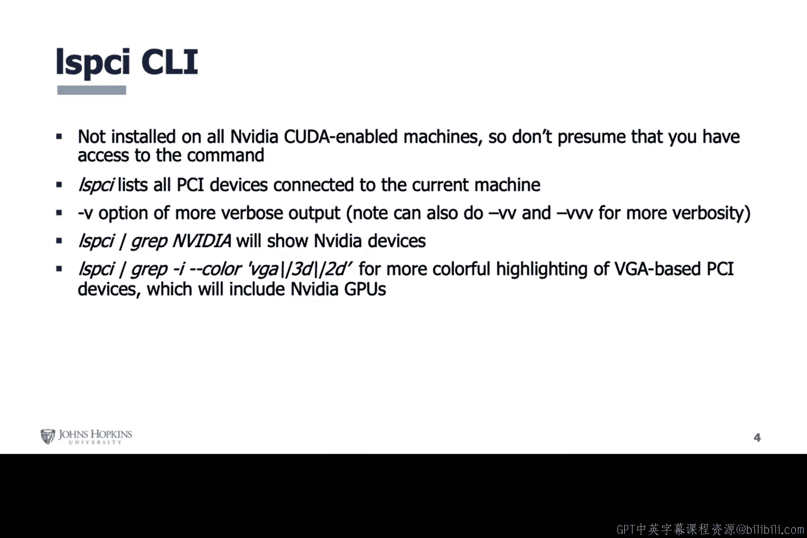

# 约翰霍普金斯大学《GPU编程（并发编程、并行编程、面向企业、CUDA高级库）｜GPU Programming》 p43 12_Linux CLI GPU设备识别.zh_en -BV1a1421r7vw_p43-

Welcome。In this lecture， we're going to go over how on the Linux command line。

 you can use available tools to identify specific features of your GPU。😔。

One of them being global memory。Amount and bandwidth。Invidia SmiI command， without any arguments。😔。

Will give a listing of all Nvidia GP for each nvidia GPU。 it will tell you things like。

What are the memory capabilities， What's the clock feed for the graphics interface。

 streaming multi processor temperature。

Processor utilization， and many more。Other command line options are the dash L or list GPs。

 which will list only the GPs and their U U IDs， the ID D or dash I argument。

 which allows you to look for a specific GPU and only return information of a GP that matches it or dash D。

😔，Which is like the type of stats you'd like to get back， whether it's memory， utilization， clock。

 etc cetera。

L PCI， which is basically a listing of the PCI devices connected to a machine。

Is a command that may not be available in all machines， but it will give you lots of information。

And you can do things like Gr for NviDdia to show only Nvidia devices。

 You can choose different levels of verbosity， and you can color。

The information such and makes more contextual sense to you。

