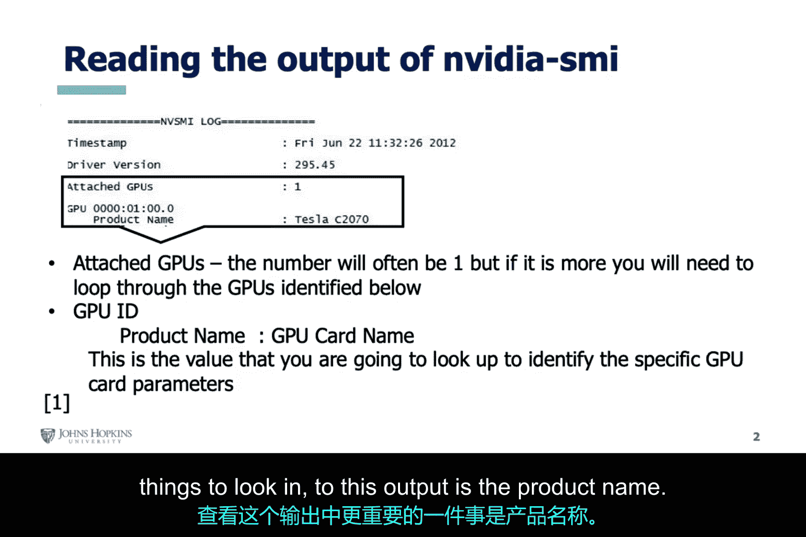
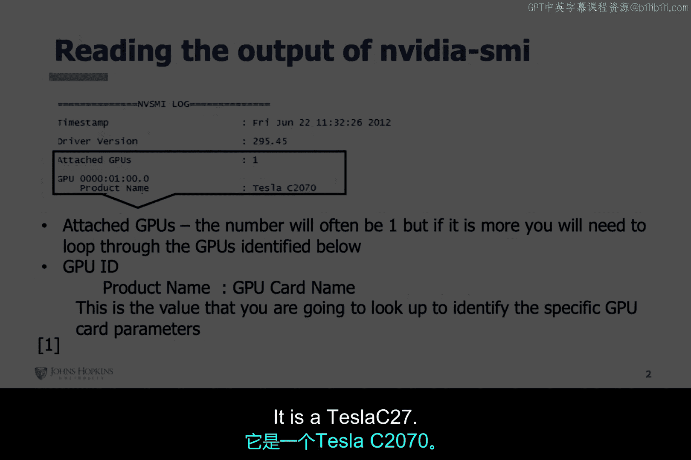
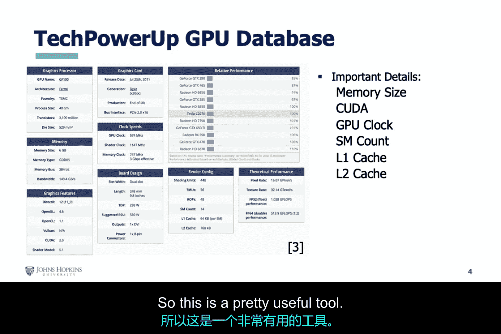

# 约翰霍普金斯大学《GPU编程（并发编程、并行编程、面向企业、CUDA高级库）｜GPU Programming》 p44 13_GPU全局内存研究.zh_en -BV1a1421r7vw_p44-

Hello and welcome to this video lecture， where we will go over taking the identifier for a GP device and finding out how much global memory and other capabilities that it has。

😔，So now we're going to look at the output of the NviIDdia SMI command。

 which basically gives you information about NviIDdia GPUs connected to the cart host。In this case。

 you have one attached GPU。And one of the more important things to look in。

To this output is the product name。 It is a Tesla C 2070。

One source of information about the GPU card and its global memory is the Wikipedia list of Nvidia GPus。

 It's an exhaustive listing of each manufactured Nvidia GPU even prior to Kuta。😔。

And all the statistics associated with it。 So you can sort of search in your in your case for a Tesla 2070。

 And what you see in this highlighted area is that your card has。6 gig of GDDR 5 Ram。

Another data source is tech Powerup， which has a GPU database。

 which you can look up your specific card and find out all your information in one more easily digestible display。

It has information about the processor， the memory， in this case。

 yet again 6 gigab of GDDR 5 memory tells you about the bandwidth and memory bus。

All sorts of information about the card and even gives relative performance。

 So this is a pretty useful tool。

