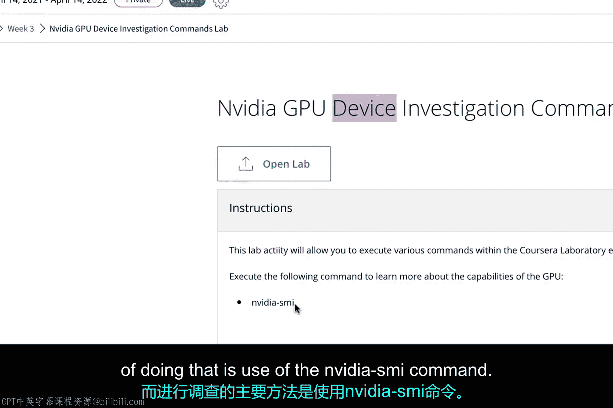
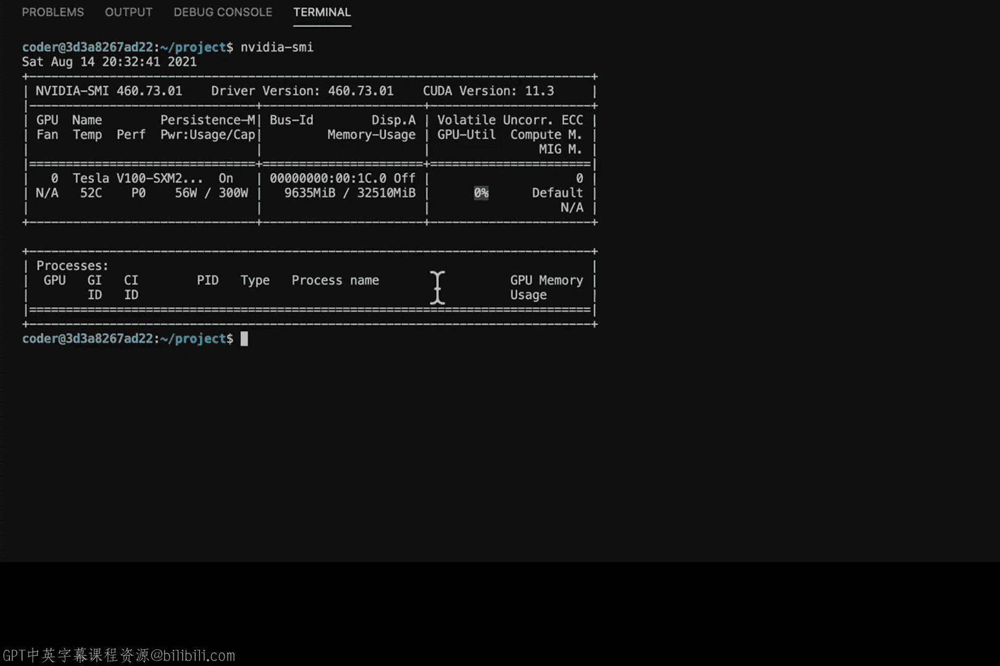

# 约翰霍普金斯大学《GPU编程（并发编程、并行编程、面向企业、CUDA高级库）｜GPU Programming》 p45 14_NVIDIA GPU设备检测命令实验视频.zh_en -BV1a1421r7vw_p45-

In this video， we're going to go over the week three La。

 which is really focused in on GP device investigation and the primary way of doing that is use of the NVIDA SMI command。

Once everything is done loading in the browser， bring up a terminal， and execute NviDdia dash SI。😔。

What gets printed out from the NVID SMI command is very important information about your GPU。

At the very top is information about the NVDSMI version， the driver version， and the couda version。

 so the first thing is you know the name of your processor is the Tesla V100 XM2 so you can look that up。

 you have information about current usage and maximum power usage， temperature。Memory information。

How much the GPU is utilized？😔，And then you can look up things like what are the running processes on the GPU？

