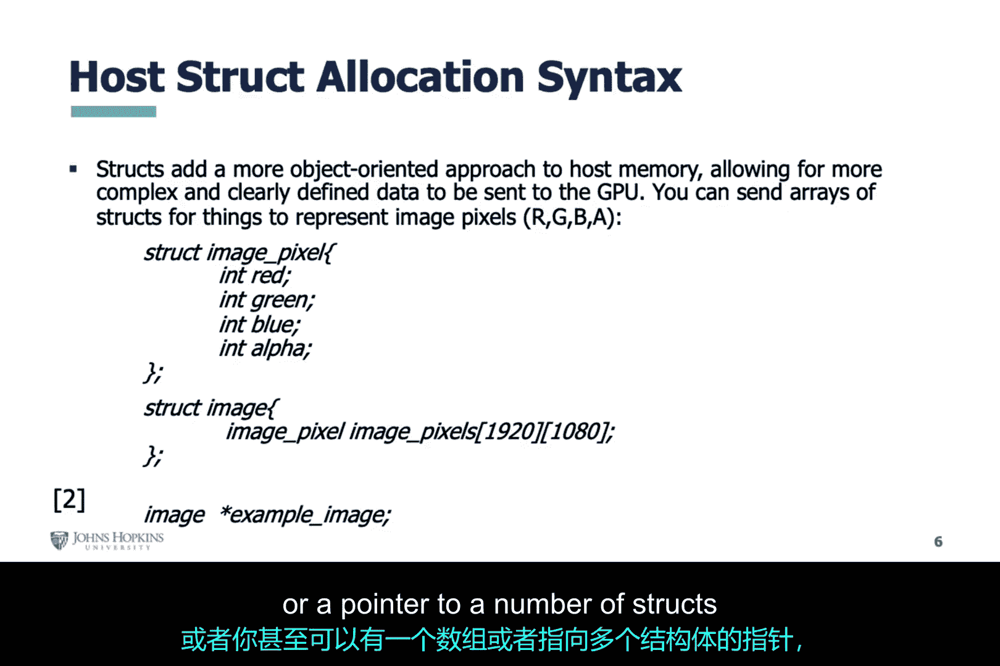
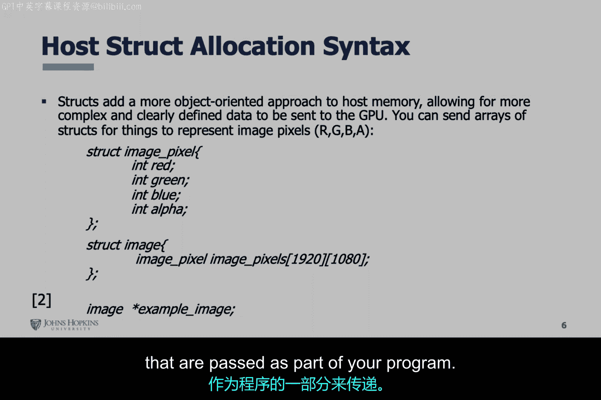

# 约翰霍普金斯大学《GPU编程（并发编程、并行编程、面向企业、CUDA高级库）｜GPU Programming》 p46 15_主机内存分配机制.zh_en -BV1a1421r7vw_p46-

Hello， in this lecture， we're going to go over how you get memory allocated in hostt memoryory。

 which is the first half of the process of getting data into the GPU。😔。

So there are four different memory types， pageable， pinned， mapped。And unified。Parial is the default。

And basically， you allocate memory。😔，As in any other memory， for a CPU peve。Program。Then。

 it gets transferred。Into pin memory。😔，Then to the device ramp。<|OTHER|>Pinned data transfer。

 basically in this huge you specify memory is pinned and so you save that extra bit of time spent。

Allocating pageable memory。There's Matt。Which basically。Maps your memory from the GPU onto the CPU。

 So the memory is always on the CPU。<|OTHER|>And then there's unified。

 which basically is a layer above。The memory on both devices。

 and they both act as if it is the same memory。 but under the hood。

 there's actually transfers going on。 So it makes it things easier。

 What you'll notice here is that pageable memory is slowest because it adds an extra copy。

 So memory transfer times heavy unified is the second slowest because kernels execute slower because all memory is still existing on the CPU and the pin and map。

Are fairly fast。And they're similar in speed because they have either little memory transfer or little overhead for kernel execution。

When allocating primitives。On the host， generally， you'll be using。Pageable memory。

 And there's no major change here for how they're allocated as to any other variable in C or C plus plus。

 So when。Allocating host pageable memory for things like pointers and arrays。They again。

 follow the same practice that you would have in any other C or C+ program。With pointers。

 you use the mallic command。And a size underscore T type。

 So basically multiply the input size to the size of your array that you want by the size of the type of。

Primitive that you're going to use。 or if you use a struct or something like that。

 Ars are very similar。 They have a more simplified allocation scheme。

So for allocating non pageable memory， here is a syntax for pin memory allocation。

 you will use the kuta malik host with a size underscore T type。Pass to it。

 note that the map memory allocation is very similar， it's Kuda host Malic。

 I've made this mistake a number of times， this syntax is fairly similar。

 you give it the pointer to the memory you'd like to allocate the size of it and then you use a flag which is coa hostalc mapped。

 which will differentiate it from other types of memory。And then lastly。

 the unified memory allocation use the Kuta Malic manage command yet again with the pointer to。

The what the pointer you want to use？The size of what you're trying to create。

 So the number of elements times the size of the type， in this case， float。

Related to host memory allocation is thestruct。Strts are very similar to classes。Templates。

But they're much simpler。 They just specify。The object。

So you say this is the name of it in this case， you can the image pixel or image。

And then the properties of the struct and the type。You can also within astruct。Have arrays。

 you can specify default sizes， I won't get into using dot notation versus D referencing or any that you can look at any good C or C++ tutorial or a good course on C or C++ to understand it better。

 but this can really make your code a lot cleaner and then you just either pass a pointer to astruct or you can even have an array or a pointer to a number ofstructs that are passed as part of your program。

😔。

