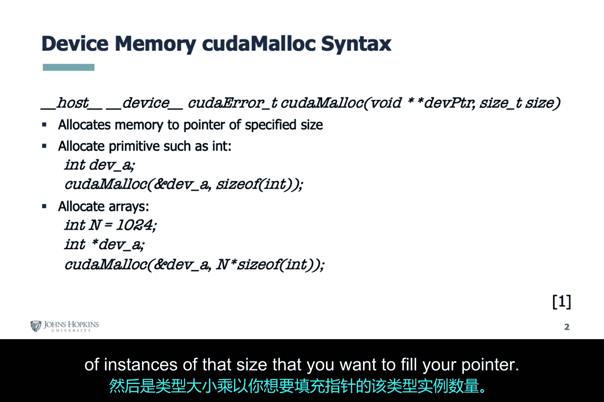
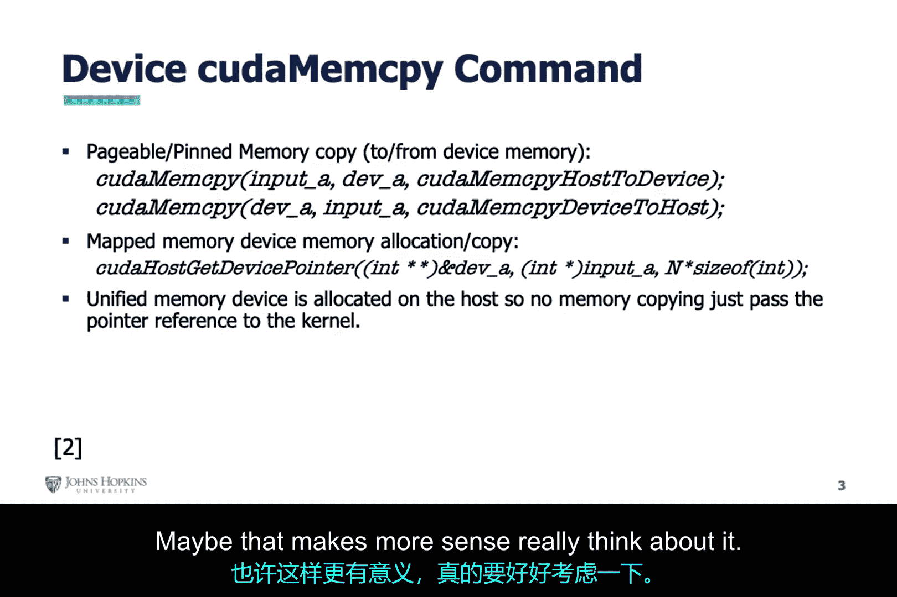
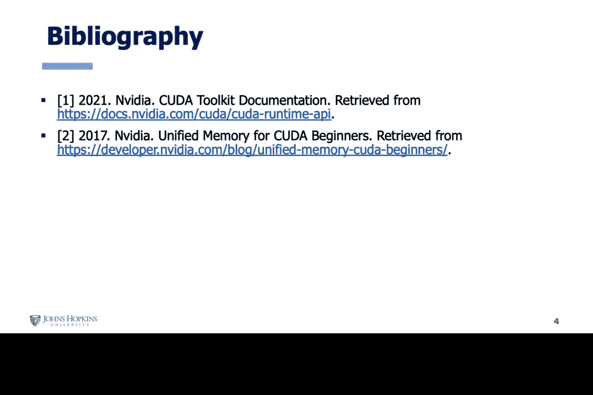

# 约翰霍普金斯大学《GPU编程（并发编程、并行编程、面向企业、CUDA高级库）｜GPU Programming》 p47 16_设备全局内存分配策略.zh_en -BV1a1421r7vw_p47-

So now let's move on to allocating global memory on the device。The most basic。Devicice。

 memory allocation， command， kta Malic。Is useful for many operations is the following simple syntax。

You pass it， the device pointer and the size。😔，Of the device pointer， so how many bytes？

Based on the input size or the size of the array you want to create。

And the size of the type that is going to be filled with。So this will allocate memory。

To the pointer of the size。You can allocate primitives just by passing the pointer and then the size of the type of primitive。

😔，Or for pointers for more complex or larger structures， you。Give the pointer。

 and then you see the size of the type multiplied by the number of。

Instances of that size that you want to fill your pointer。

The next very important command to learn。Is the Kuda Mem copy command？

And this can copy information in both directions。😔，For page1 and pin memory。😔，Basically， you put。

Source destination， and then a flag for the direction of the copy。

 So Kudam copy host a device copies from the host to device memory and Kam copy device to host does the reverse and note that the arguments or pass So this would copy memory out into the device and back from the device into the host。

 when it comes to mapped memory， you need to use the coupa host， get device pointer with the。😔。

Host pointer is the second argument， and the device pointer as the first。

Then you specify the size of。The pointer。Or the amount of the pointer you're going to copy in either direction。

So。This is pretty nice because it makes that a whole lot easier， as one less copy。

 you're just mapping the data directly。And when you're using unified memory。

 you don't have to specify any copies because the device will just。And the CPU will just act。

As if the memory is local to them， which it may or may not be， but you let Kuta determine that。

 So it's pretty nice， a lot more simple， less perform。When you use different types of memory。

 really think of the application， think of the costs， think of， is there a lot of processing。

 so maybe a little cost on the front or back end isn't that important as opposed to constantly doing the cost of copying data as you need it or maybe it's a complex。

Code base that you have。 So you want something that's simpler to maybe unified memory with its slight extra cost that might be amortized over a lot of calculations。

 Maybe that makes more sense。

Really think about it。

