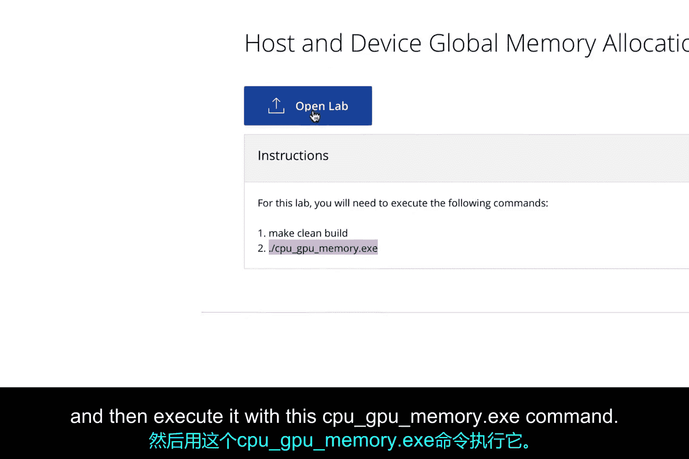
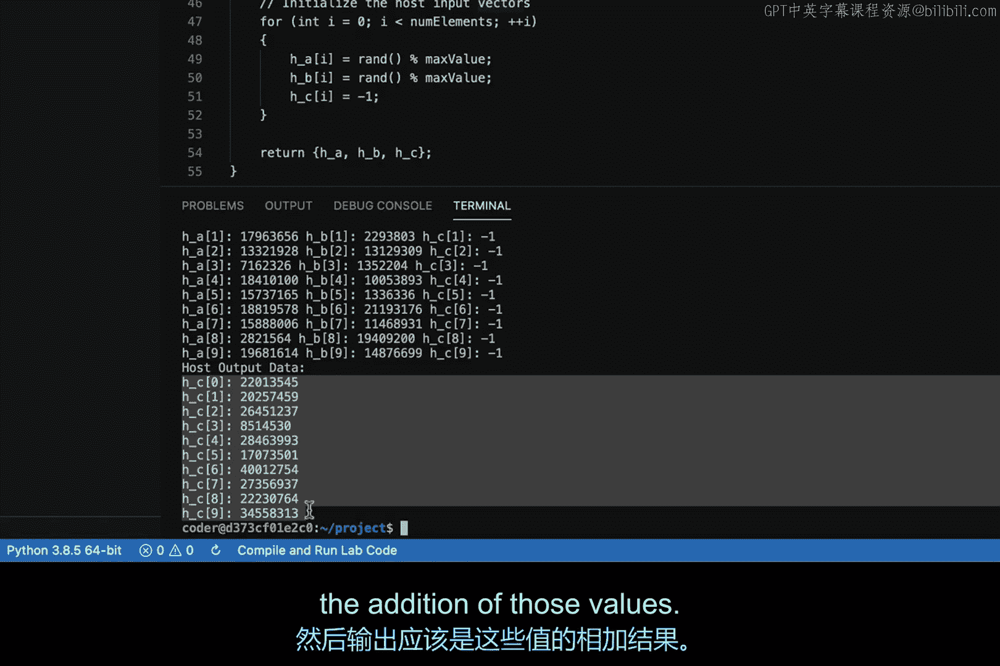

# 约翰霍普金斯大学《GPU编程（并发编程、并行编程、面向企业、CUDA高级库）｜GPU Programming》 p48 17_主机与设备内存分配实验视频.zh_en -BV1a1421r7vw_p48-

Okay， let's look at week three's deviceice Memory allocation Lab。Lav has two steps。

 you on make clean build to build your code and then execute it with the CPU GPpumemory。ec command。

So let's look at the make file， there are three major。

Targetets， there's build， which will compile the code。There's clean。

 which will remove the CPUp GPpmemory。ex file， and then Run which executes that file once it's been compiled。

<|OTHER|>We run make clean， make clean， we remove the CPU GP viewmemory。exc file。

So now let's look at the add kernel for the lab。It takes in。3。Pointter inputs， A， B， and C。

 and the No elements。😔，It first identifies the index like many of the kernels that we develop。

In thread and block space， it does a check to ensure that it's not going to go outside the bounds of。

DA and DB and adds the value at the index I and places an in to C。

The next function allocates random memory。HOn the host。😔。

<|OTHER|>And then you will continue to allocate device memory。For A and B。

The code then copies data from host to device memory for A and B。😔，Pointers using MamM copy。

 so the X function executes the kernel， based on pointers A B and C。

 it then takes the threads per block and the number of elements， determines the blocks per grid。

 and uses that to specify the kernel execution and then passes DABC and the nu elements。

Two functions， one for delocating memory as always， and then to clean up the device。

 then a parse command line arguments function is created that that uses dash n for the number of elements and dash T for the threads per block Now let's move on to the main function。

😔，<|OTHER|>The first part is it parses the command line and gets the number of elements and threads per block。

 then it allocates random host memory based on the number of elements and puts it in A， B and C。

Then it'll print those values out just for debugging's sake。

<|OTHER|>Then it'll allocate device memory and put those in D and DV。

<|OTHER|>And then it'll copy from A and B in hosts and device and then executes the kernel C is host memory。

 therefore it has to be kamalic managed memory。After it's executed the kernel。

 we'll deallocate memory， we'll print。😔，<|OTHER|>The output， and then clean up the device。

 run the make clean build to create a new executable now that we have the executable。

 let's try running it。The output will be the host input data initially for the 10 values。

 and then the output， which should be the addition of those values。

