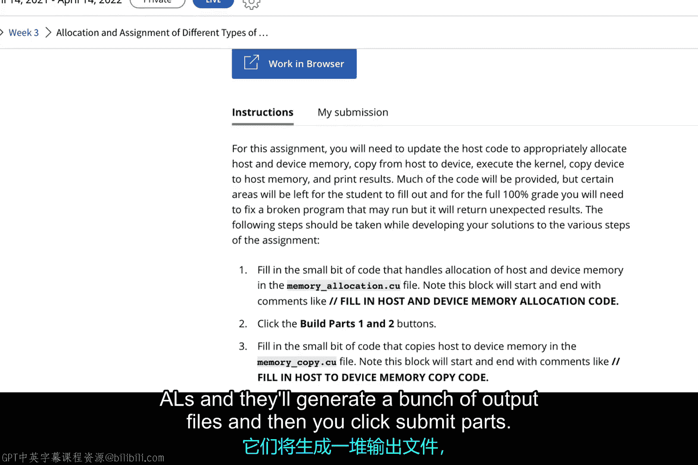
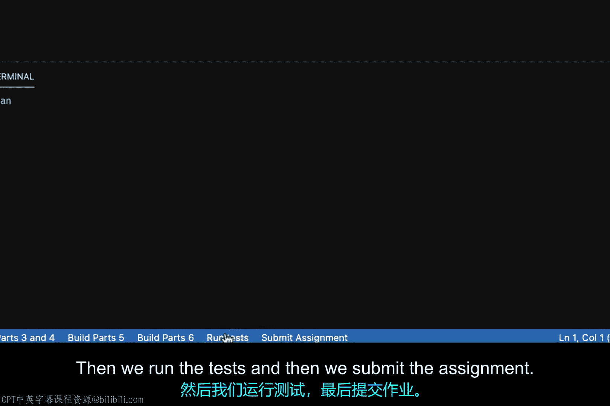

# 约翰霍普金斯大学《GPU编程（并发编程、并行编程、面向企业、CUDA高级库）｜GPU Programming》 p49 18_不同类型主机-全局内存分配规范.zh_en -BV1a1421r7vw_p49-

We're going to cap off。Week 3， discussing the programming assignment。

 So we're gonna go over the instructions for a little bit here。So。😔。

Note they'll these small bits of code that you get to fill in and the various dot files that have。

The fill in host and device memory or similar comments。 I can click。

<|OTHER|>Once you've done that build Part one and  two。

 you'll update memory copy a similar comment where you should be putting a code between。

You'll clickBuild Part3 and four， same thing with the broken page。😔，Pinned memory， built part5。😔。

Then with map memory， build Part 6， then you'll run the test for all of the executables and I'll generate a bunch of output files。

 and then you click submitmit parts。

First things we're going to look into the memory allocation Kuda file。😔。

And you're going to have to update the allocate device memory。

 Note that there will be a number of comments for fill in。And in between them。

 that's where you put the coat。Then we're going to move on to the memory copy。

Now you'll look for copy from host to device。😔，And they're going to be it again some comments as to where you should be putting your code in。

With the broken mapped memory allocation couda file， you'll have to fix the allocate device memory。

 Next， the broken page pin memory allocation couda file will need you to yet again。

Fix the allocate device memory function。 We'll move on to the run do S。

 which make clean builds and then executes a few runs of different parts。 Now， the make file。😔。

Has builds and runs targets for each thing that you need to do for the project。

 It will do a clean virtual output， all the files there are as test data and CSV format as intejugers and as floats。

😔，Now we will shift our focus to the buttons on the bottom of the browser。😔，We step through。

Each of the parts the Navy built。Then we run the tests and then we submit the assignment。😔。

