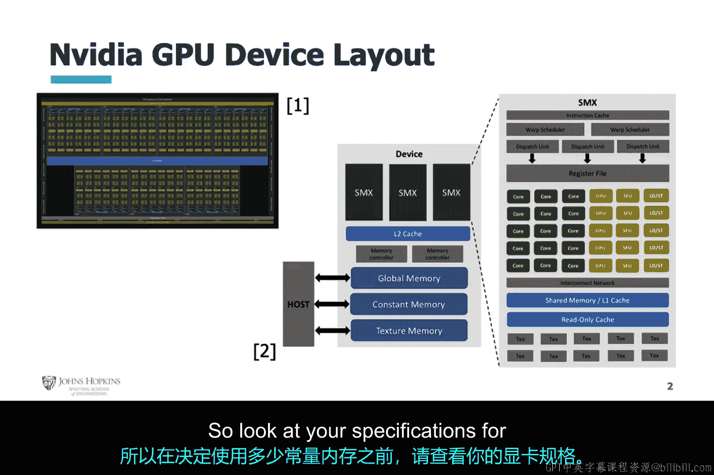
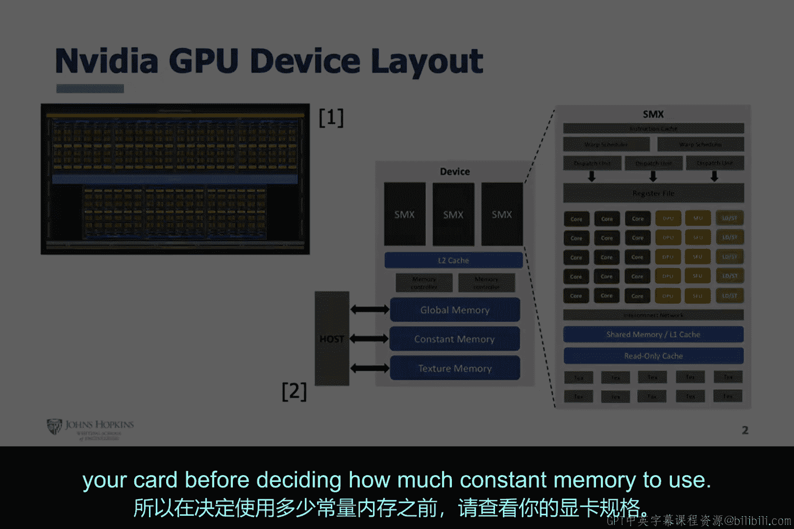
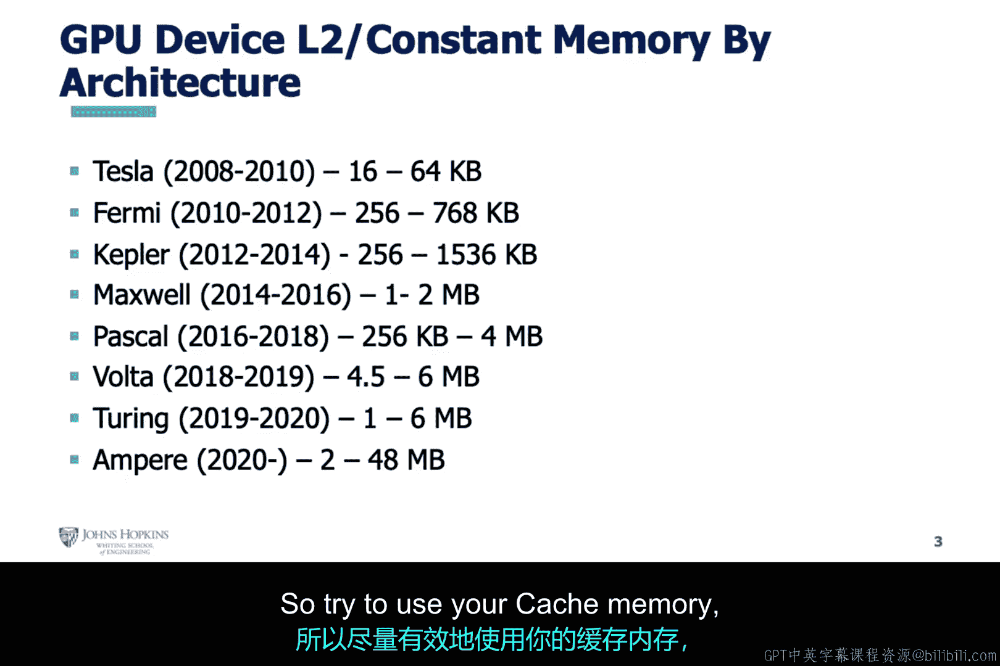
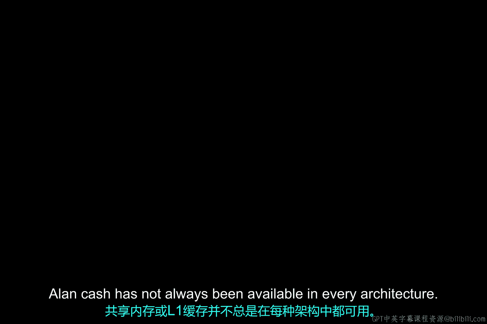
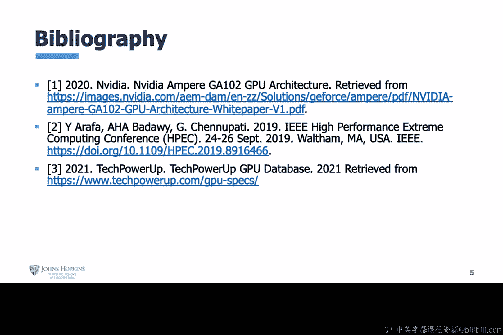

# 约翰霍普金斯大学《GPU编程（并发编程、并行编程、面向企业、CUDA高级库）｜GPU Programming》 p50 19_NVIDIA GPU共享与常量内存视频讲座.zh_en -BV1a1421r7vw_p50-

Hello and welcome to the NviDdia lectureture on Sha and constant memory on the NviDdia GPU device。

 Let's drill down into some diagrams to get a better understanding of the NviDdia GPU device On the top left。

 you see a familiar diagram。 It shows the overall layout of an NviDdia GPU card。

You see seven different SMs and then different types of memory， buses， etc。On the right。

 you see a new diagram， which shows。A drill down into the S M， in this case， an S M X。

 But functionally， all the versions of the S Ms or streaming multi processors are functionally equivalent。

So on the streaming multi processorcessor。You will see the shared memory or L 1 cache。

 This is shared with all cores and therefore threads on the same block。

You will also see that when we're looking at the device that there is constant memory。Now。

 constant memory is most often capped at 64 k。But it can be incorporated into the L2 cache， at times。

So look at your specifications for your card before deciding how much constant memory to use。

So。😔，<|OTHER|>In this list of architectures in the related L2 cache。

 which is the majority of the memory allocated。You will see it goes up over time now。

 when it started， almost all of the L2 cache， the 64 KB limit。

Is allocated by constant memory or available to be allocated by constant memory， but then。

The amount of L2 cash increased， such that now it's approaching 48 MB Note that using L2 cache can have significant costs and make its lower and equivalent to global memory。

 if you have a lot of。Cash read misses， which then have to go to global memory。 So try to use your。

Cash， memory， especially L2， very effectively。

Shared memory， or Ellen Cash。😔，Has not always been available in every architecture。

And based on design decisions， the amount per streaming multi processor has gone up and gone down。

And if you see from the point of affirming the Ampere， it has tripled。

 but that's over 10 years of development。 You know， having that cache it can be really useful。

 but just like everything else， using it effectively。

 avoiding read misses and also using it to communicate between threads and not have it cause race conditions or similar things is very important。

