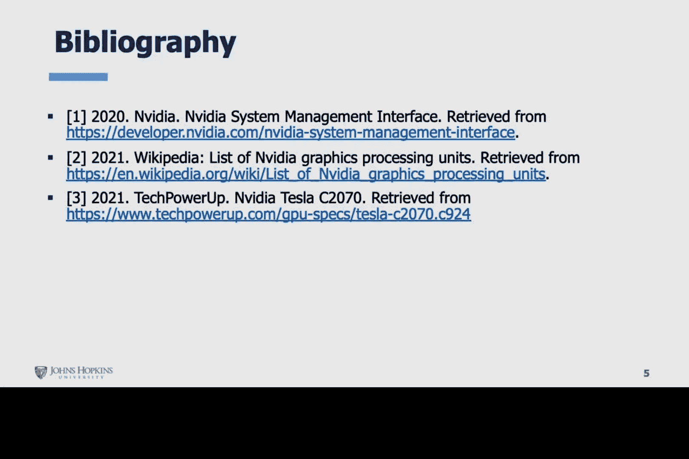

# 约翰霍普金斯大学《GPU编程（并发编程、并行编程、面向企业、CUDA高级库）｜GPU Programming》 p51 20_GPU共享与常量内存研究.zh_en -BV1a1421r7vw_p51-

Now we're going to go over how you would investigate the amount of shared and constant memory。😔。

On your device。

So probably the most important tool for your investigation is the NVIDdia SMI tool。<|OTHER|>Hi。

 like I said before， if you can install。Cuda， the NVD developer， toolkit， etc。

 you will get NVdia SMMI。😔，Unfortunately， tools like LSPI。Or Windows or Mac tools are not。

Necessarily always available， so I would say depend on NVDSMI whenever you can。So。

Basically when you use the NVID SMMI command， you get a log。

 it'll tell you all of the attached devices， you can look up in there to see the product name。

 so in this case Tesla C2070， and then you can go to other external resources to find out specifics。

😔，For I go over a specific online database。Regarding。How you can find。Specifics of。

Your NviIDdia GPU device。I would say， no matter what， based on knowing which architecture generation。

Of card theyre using going to one of these tuning guides would be incredibly helpful。

 what you'll notice is they keep， you know。Five， six generations worth of tuning guides around。

 so anything that's even mildly supported。Has documentation for it。

And these aren't just applicable to constant or shared memory。

 they tell you a bunch of things about memory usage。

 transferring data between different types of memory。

 almost anything you would need to know that might get you that optimization that you need for your code to run like you hope it does。

<|OTHER|>So while in the previous global memory discussion。

 I stated you could go to Wikipedia and their list of NviA GPU devices。

That actually doesn't work very well for shared or constant memory because they don't give a lot of information about that tech powerup has a GPU database where basically you start at the very top and you can say this either look for a specific card where you can look at architectures or specific types of devices then once you've found the device that you want to investigate you can look at this really nice dashboard that says things about the processor。

 they all want out to cache， constant memory， things like that。

 and then it will compare the performance of that card versus other card， so this is very。

 very valuable and I would keep it handy if you're moving between a lot of devices。

