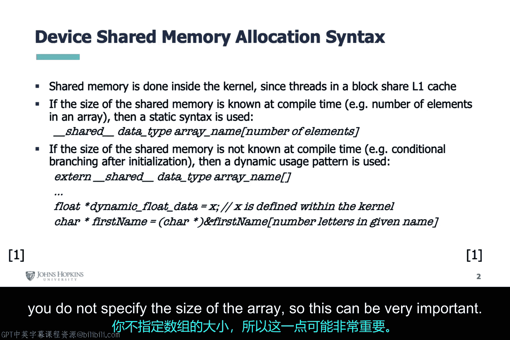

# 约翰霍普金斯大学《GPU编程（并发编程、并行编程、面向企业、CUDA高级库）｜GPU Programming》 p52 21_GPU共享内存分配技术.zh_en -BV1a1421r7vw_p52-

Now I'm going to discuss shared memory and how to allocate it on the GPU device。😔。

So the syntax for allocating shared memory is not super complex。

But you have to think about what you're doing before you use it。

So there are two ways to do it if you know at compile time or it will be determined。😔。

The size of your shared memory allocation。During runtime So in the first case at compile time is pretty easy。

 you just specify memory with the shared T when you are declaring it in this case as an array。😔。

<|OTHER|>You can use things like malic and things like that as well。嗯。If you are。

Not in control of the size of the memory at runtime， let's say。

That this shared memory is determined by something that's right into the block。

Like a name or something in its variable size。Then you're going to want to have a dynamic memory allocation and。

It's almost the same thing。 The difference here is you add the X keyword。

 which is valid in C and C post+ under other context。 And then unlike the static。Example。

 you do not specify the size of the array。So this can be very important and keep that in mind when you're going to use shared memory。

Shared memory can be a very valuable tool in your toolkit to make your kernels run faster。First off。

 they are faster than global memory， presuming that there are no read misses。

In our's case they're as fast as global memory under that circumstance。

The next thing that's nice about them is it allows threads to communicate within a block because the memory is shared within a block。

You can have things like Inter process communications using shared memory to store interim results。😔。

The negative， just like anything like this is that。

While the logical order is sequential and ordered and everything should hit。The same command。😔。

An instruction at the same time， that is not how it actually happens in the real world。

 threadreads can run at different speeds based on what they're doing。

 You will need to use the sync threads function to create a barrier such that all threads in the block wait for the same。

Instruction to be completed before continuing。This allows you to ensure that if you want to read in data and then write it。

 that nothing will read and write while other threads are waiting to read。

