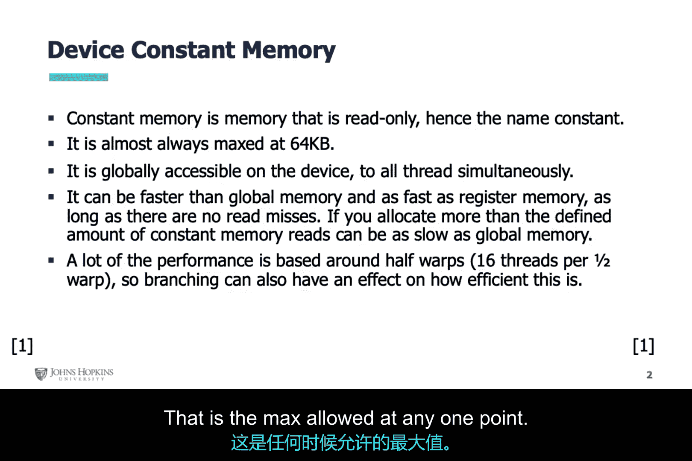
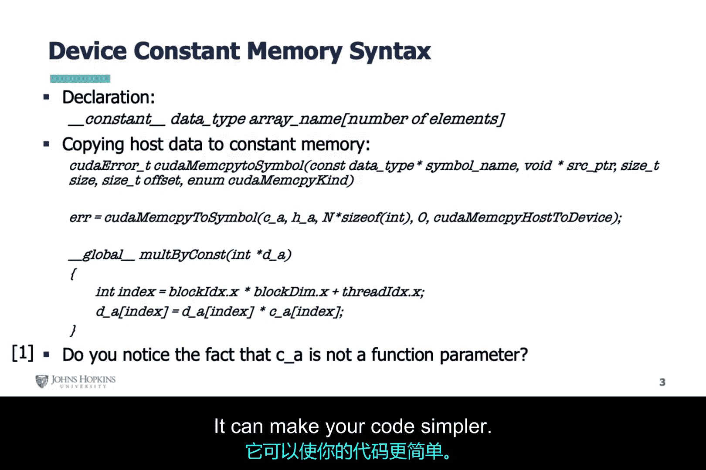

# 约翰霍普金斯大学《GPU编程（并发编程、并行编程、面向企业、CUDA高级库）｜GPU Programming》 p53 22_GPU常量内存分配方法.zh_en -BV1a1421r7vw_p53-

So now we're going to talk about。😔，Devicice， constant memory。

 and how you allocate it and transfer data from the host into device Con memory。😔，Note that。

I never mentioned transferring data。With shared memory。

 and that is because that is not consideration， shared memory is allocated and used solely on the device。

 constant memory does take a little bit more thought。So constant memory， as its name， indicates。

 doesn't change。 So once it is defined。At the level of the GPU device。

It doesn't change all threads have access to those same values。And it is often maxed at 64 kilobys。

 you will allocate it。At the level of the C file， it is not done within a kernel。 it is not even。

Defined。Or initialized。Within a specific function。 So that means the constant。

Variables go at the top or outside the context of a function， and they are set once and only once。

Inside， a function。Note that while it can be faster than global memory and even up to the same speed as register memory。

 it can be slowed down by cache misses， so make sure that you specify。😔。

Your constant memory to be well within the 64 kilobys。That is max allowed at any one point。

So when you want to use constant memory。😔，He declare it with thee D constant。And then the data。

 type of you know， the array and the size that has to be done at the level of the file。

 not within a function。<|OTHER|>And then you copy host data into your constant memory using the Ka mem copy to symbol。

Function and so you pass the pointer to the constant memory on the device。

 the host memory pointer a size， there's an offset。

 and then the memory kind which that type of copy is should always be kutaM copy hosted device。

 and that's because。😔，The memory is constant， so you can't modify in the kernel。

 so there should never be a need or even a possibility of using KaM copy device to host。

Note also that constant memory。On。The CPU uses the constant keyword。

 and nothing keeps you from coughing between CPU and GP constant memory， but don't get confused。

 I've seen a number of places where constant memory for the device。

People use the Dunder device keyword to make it even clearer。

<|OTHER|>This is a very powerful tool and you should use it when you have predefined constant inputs。

 things like kernels for blurring。An image or， you know。

 lightening or darkening an image by the same value or something along those lines。

 So keeping it in the back of your head when you're writing your code because this can speed things up。

 it can make your coat simpler。

