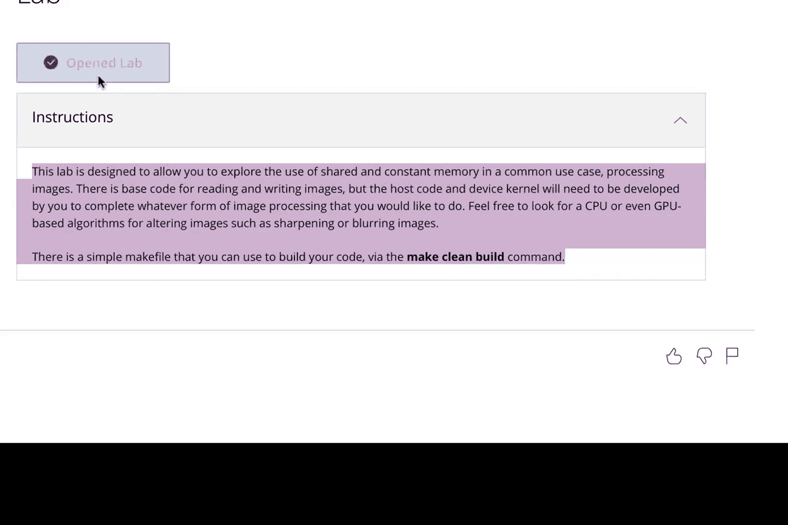
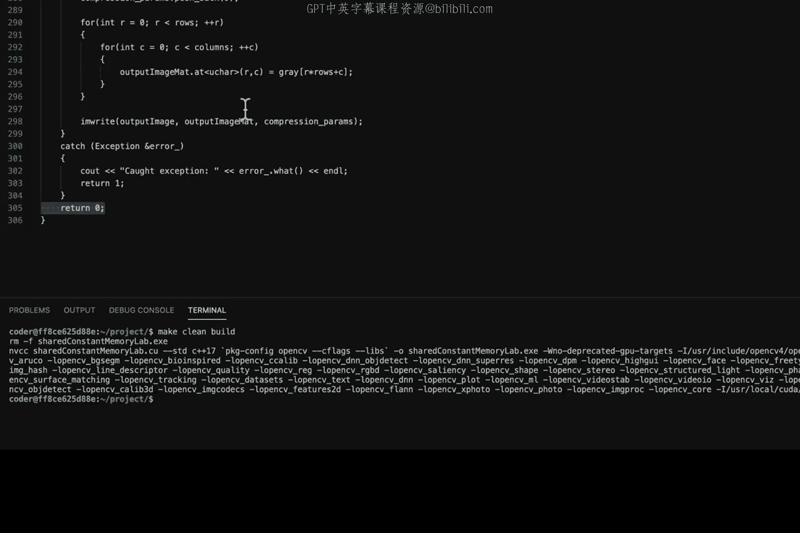

# 约翰霍普金斯大学《GPU编程（并发编程、并行编程、面向企业、CUDA高级库）｜GPU Programming》 p54 23_CUDA共享-常量内存图像处理实验视频.zh_en -BV1a1421r7vw_p54-

So now we're going to look at week four。In the lab。

 specifically the one whoa shared in constant memory of an image processing lab。

There's some simple instructions that you can see here。But basically。

 you'll run make clean build to build your code and then you can execute it。As we've done previously。

So now we're going to look at the make file as always it has。A build， run and clean。

I've previously mentioned using。Building clean you can run， make clean。Build。

What will happen is first。<|OTHER|>It remove the shared constant Re labb dotDXia。

 which no longer exists， then it will try to compile it， which it succeeded in doing right there。Now。

 looking at shared constant memory lab do C you， the couta kernel。

You'll see there's comments for where you need a place code that initializes variable sync threads。

Performance calculations and above。I determine the thread ID， the block ID。

 and things like that for you。So you'll just need to fill this in。

Then we look at the allocate device memory。😔，Which allocates using ka malic。D。😔，Dvicice RGV channels。

 And then for the rows and columns of the image。It copies them into。Constant memory。

Note if there specified in the dot H3P header file。😔，So you'll copy data from host to device。😔。

From the device。From the host RGV to the device RGV pointers function takes in unsigned Char pointers for RGV values。

And then passes them to the kernel。The next function copies device memory using KaM copy from the device RGV values。

😔，Memory RGV values。We， then use。😔，They allocatecate memory and clean up device functions to make sure that the memory and the device are in working order for the next iteration。

😔，There's a function for parsing command line arguments and reading from a file。😔。

So the first thing that the main function does is parsic commandline arguments to get the input image output image。

 the part ID， and then the threads per block， it reads the image based on the input image file name。

Gen， it's a gray。<|OTHER|>Pointter and then allocates device memory for RGB copies that to the device from the host。

 executes the kernel on the RGB values and the rows and columns。

 copiesies it back out of the device onto the host， dealocates memory and cleans up the device。

Then it creates an image of type PNG。😔，Based on。The great pixels。

 but notice you can use RGB if you want to try something different。

<|OTHER|>There's a little bit disconnect here giving you the opportunity for a little bit of freedom。

 but right now it gets the pixels from the gray。Allright。

 and then it writes out the image and then returns0 like any good program should。

